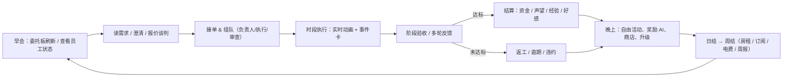
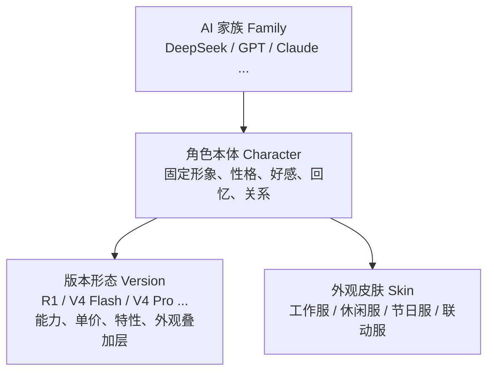
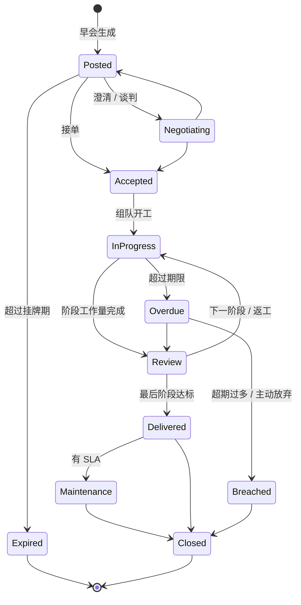
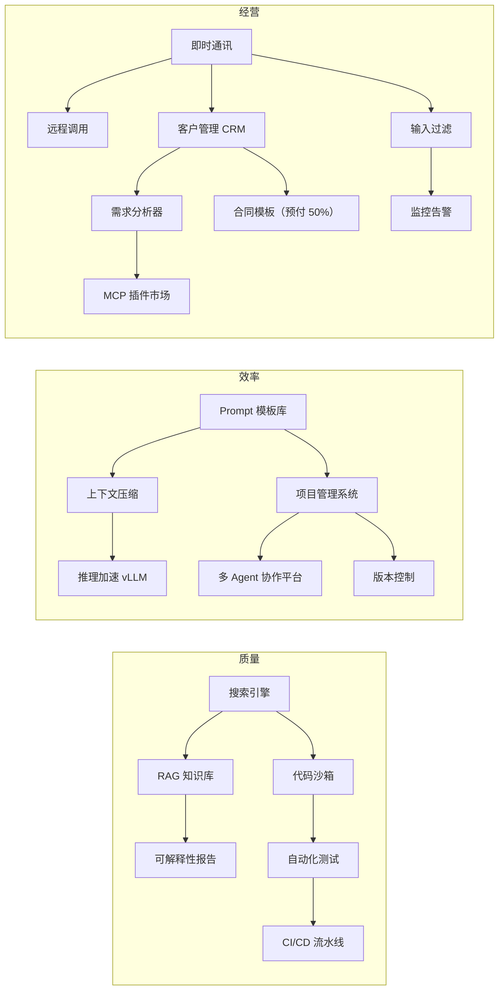
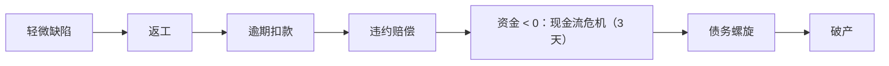
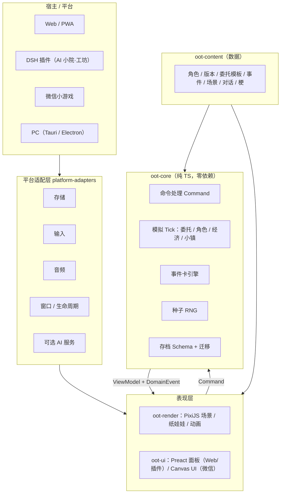
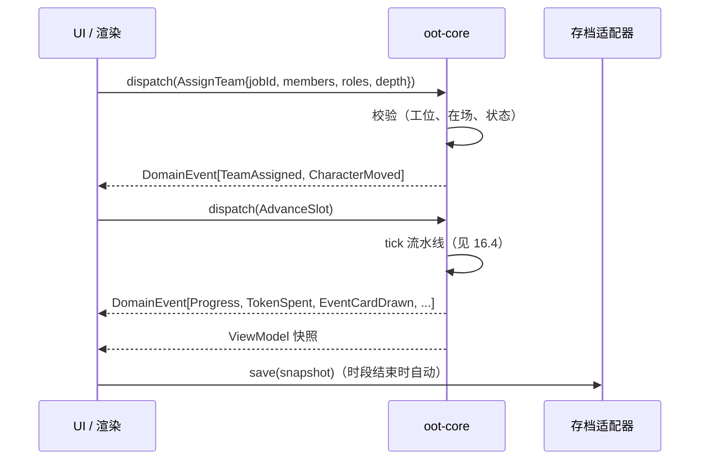
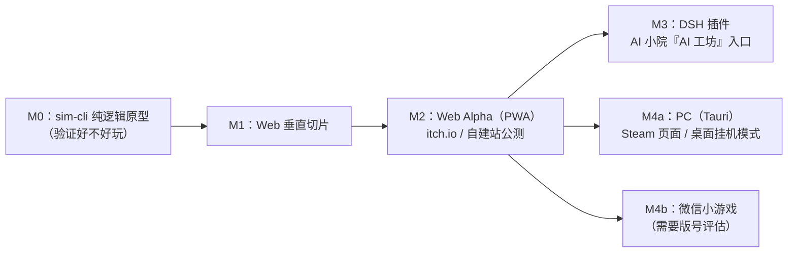

# 《Out of Tokens》游戏设计文档（GDD）v0.1 初稿

> **一句话**：在一家随时可能把 Token 用光的 Q 版 AI 工作室里，带着一群各有毛病的 AI 打工人接单、澄清需求、组队派遣、救火、摸鱼、找人、升级——努力别让工作室 `Out of Tokens`。
>
> | 项目 | 内容 |
> |---|---|
> | 文档版本 | v0.1（初稿，2026-11-06） |
> | 来源 | 《out-of-tokens 初步设想》+ 四份方案（DeepSeek V4.1 Flash / Gemini 4 Argon / GPT-6 / Opus 5.5）综合 |
> | 类型 | 轻策略经营模拟 × 委托调度 × Q 版角色养成 × 小镇生活 × 互联网/AI 梗喜剧 |
> | 平台路线 | Web（MVP）→ DSH「AI 小院」插件 → PC（Tauri/Electron）/ 微信小游戏 |
> | 目标会话时长 | 一个时段 1–3 分钟，一个游戏日 5–10 分钟，一章 3–6 小时 |
> | 文档状态 | 所有数值都是**初始值，还需要用自动模拟来调平衡**；标「【待定】」的条目要等决策（见 §20） |

---

## 目录

0. [综合说明：四份方案怎么取舍的](#0-综合说明四份方案怎么取舍的)
1. [产品定位与竞品](#1-产品定位与竞品)
2. [设计支柱与体验目标](#2-设计支柱与体验目标)
3. [核心循环与时间模型](#3-核心循环与时间模型)
4. [资源与经济系统](#4-资源与经济系统)
5. [AI 角色系统](#5-ai-角色系统)
6. [委托系统](#6-委托系统)
7. [执行、结算与团队](#7-执行结算与团队)
8. [事件卡系统（梗即机制）](#8-事件卡系统梗即机制)
9. [工作室成长：硬件 / 软件 / 设施](#9-工作室成长硬件--软件--设施)
10. [小镇生活与多场景](#10-小镇生活与多场景)
11. [叙事、章节与角色故事](#11-叙事章节与角色故事)
12. [失败、破产与重开](#12-失败破产与重开)
13. [梗库与文本系统](#13-梗库与文本系统)
14. [UI / UX 设计](#14-ui--ux-设计)
15. [美术与音频规范](#15-美术与音频规范)
16. [技术架构](#16-技术架构)
17. [平台路线分析（需求 7）](#17-平台路线分析需求-7)
18. [小模型接入（需求 9）与联动扩展（需求 10）](#18-小模型接入需求-9与联动扩展需求-10)
19. [商业化、法律与风险](#19-商业化法律与风险)
20. [里程碑、MVP 范围与待决问题](#20-里程碑mvp-范围与待决问题)
21. [附录](#21-附录)

---

## 0. 综合说明：四份方案怎么取舍的

### 0.1 四份方案都同意的点（直接采纳）

| 共识 | 本 GDD 的落地方式 |
|---|---|
| 核心是「读委托 → 配人 → 承担后果」，先验证这个循环好不好玩 | M0 先做纯逻辑原型，不画画面也能玩（§20） |
| 新版本≠全面碾压，便宜小模型要一直有用 | 能力和 Token 单价成正比，加上「尺寸轴」和「开源/闭源轴」（§5.3、§5.5） |
| 梗要做成机制，不能只是台词 | 事件卡系统（§8），每张卡都有触发条件、效果和应对方式 |
| 不懂行的甲方不该等于必然失败，可以靠澄清需求挽救 | 清晰度 + 隐藏需求 + 澄清行动（§6.4） |
| 核心逻辑和渲染分开，确定性模拟 + 种子随机 | `oot-core` 纯 TS，Command → Event 架构（§16） |
| Web 先行，不急着用 Unity/Godot 做全端 | §17 路线分析 |
| 小模型只做氛围文本，不参与结算 | §18.1 |
| 不做抽卡主线，靠经营、剧情、事件解锁 | §5.6 |
| 「去食堂把 DeepSeek 带回来」好玩，但不能变成每次派单的固定操作 | 召回三种方式并存（§10.4） |
| 好感度不做恋爱线 | 好感上限效果限定在效率、配合意愿、专属剧情、换装 |

### 0.2 有分歧的地方和最终选择

| 议题 | 各方案观点 | 本稿选择 | 理由 |
|---|---|---|---|
| 时间模型 | Gemini：实时读条 + QTE；Opus：天 × 4 时段回合 + 实时动画；GPT：多阶段 | **天 × 4 时段**，每个时段开始时做决策，然后实时播放（可暂停/快进） | 照顾短会话、插件浮窗和小程序；决策点清楚，方便测试 |
| 渲染引擎 | GPT：Phaser；Opus/Gemini：PixiJS | **PixiJS + Preact（DOM 面板）** | 可以直接复用 AI 小院的纸娃娃渲染；面板多、文本多，用 DOM 更合适 |
| 角色属性数量 | Opus 有 9 项能力；GPT 有 6 项 | **6 项核心能力 + 5 项运营属性** | 既能表达差异，玩家也看得过来 |
| 「几 K / 几 M 小模型」 | Gemini：词库 + 马尔可夫链 + ONNX；GPT：至少 1 亿参数；Opus：分体量 | **分层方案**：KB 级语法生成 → MB 级复古胡言模型 → 百 MB 级可选下载（§18.1） | 「几 K/几 M」理解为**文件体积**时可行；按参数量算基本说不了中文 |
| 破产 | DeepSeek：债务螺旋；GPT：轻松/硬核双模式；Opus：Roguelite 重开 | **三者结合**：现金流危机 → 债务螺旋 → 破产 → 继承式重开，另外提供难度选择 | 有压力但不劝退 |
| 开局阵容 | Opus：开源四人组；DeepSeek：覆盖四个方向 | **开源车库四人组**（DeepSeek / Qwen / Llama / Mistral） | 剧情好讲（「开源车库联盟」），能力也正好能覆盖四个方向 |
| AI 小院的关系 | GPT：共享世界观，存档独立；Opus：小院「AI 工坊」作为入口 | **两者结合**：工坊作为入口，角色 ID 和美术共享，存档独立，联动只读 | 不破坏小院原本轻松的体验 |

### 0.3 本稿新增的设计（四份方案里没有或只简单提到）

- **开源 / 闭源双轨经济**：开源角色可以「本地部署」，吃本地算力和电费；闭源角色走 API，受限流、涨价、停服（deprecated）事件影响（§5.5、§9.2）。
- **工作时段 / 生活时段分开**：上午、下午是标准工作时段，晚上默认是生活时间，深夜睡觉；加班要付出代价（§3.3）。
- **缺陷（Defect）系统**：幻觉不直接扣分，而是产生「缺陷」，可以被审查者发现；没发现的会在交付后或维护期爆雷（§7.4）。
- **自动平衡模拟机器人**：用脚本跑几千局，校准经济参数（§16.8）。
- **渠道化命名**：数据层就区分 `displayName` 的不同渠道版本，方便以后商业化时换名（§19.2）。

---

## 1. 产品定位与竞品

### 1.1 定位

**轻量但有策略深度的工作室经营游戏**。不是放置点击游戏，也不是把真实 AI Agent 工具包装成游戏，更不是严肃的「AI 公司大亨」模拟器。

- 玩家身份：一家濒临倒闭的 AI 万事屋的新任负责人（「包工头」）。
- 经营对象：AI 员工、委托、客户、Token。
- 核心乐趣：**判断**（这单能不能接、甲方到底想要什么、派谁最划算）和**照顾**（角色的状态、关系和生活）。
- 情绪基调：温柔治愈 70% + 互联网打工人自嘲 / AI 行业善意吐槽 30%【待定，见 §20.4】。

### 1.2 竞品与参考（四份方案合并整理）

| 类别 | 产品 | 借鉴点 | 差异 |
|---|---|---|---|
| 派遣核心 | **Dispatch**（AdHoc，2025） | 事件不断出现 → 从有缺陷的角色里挑人 → 结果受性格和状态影响 | 本作是委托经营，不是线性叙事 |
| 派遣核心 | **Hero Hours Contract** | 事务所 + 委托 + 疲劳/忠诚 + 设施升级 | — |
| 派遣核心 | 《无限待办有限责任公司》 | 时间/压力双重约束；可以认真做、敷衍、甩锅或拒绝 | — |
| 派遣核心 | This Is the Police 2 / 911 Operator | 根据人员能力和状态派任务，突发事件，资源冲突 | — |
| 工作室经营 | 开罗《游戏发展国》《动画制作物语》 | 属性匹配、Q 版像素、轻量数值 | — |
| 工作室经营 | Software Inc. / Game Dev Tycoon / Startup Company / Mad Games Tycoon 2 | 从车库起步、合同项目、维护、扩建 | — |
| 角色养成 | Idol Manager | 角色压力、关系、危机事件 | — |
| 角色养成 | 明日方舟 基建 | 心情消耗、宿舍恢复、基建技能联动 | — |
| 状态崩溃 | Darkest Dungeon / 脑叶公司 | 压力满了会崩溃 → 本作的「幻觉 / 拒答 / 过度道歉」 | — |
| 喜剧委托 | Two Point Hospital | 把冷笑话做进委托类型 | — |
| 谈判 | Potionomics | 客户谈判、需求澄清 | — |
| 生活模拟 | 星露谷日程表 / RimWorld 心情 / 动森 | 数据表驱动作息；「可解释的加减项」心情 | — |
| AI 技术参考 | AI Town（a16z）、Generative Agents、Pixel Agents | 小镇 tick 调度、记忆打分、工作状态对应角色动作 | 只当技术参考，不是经营游戏 |
| AI 题材竞品 | Token x Token x Clicker、Crewloft、Idle Vibe Tycoon | 题材接近，但偏放置或偏工具 | 本作重点在**委托决策深度 + 角色人格 + 小镇** |
| AI 题材竞品 | LLM Tycoon、AI TYCOON、Artificial Ambition、《大 AI 时代》 | 训练模型、算力、融资 | 本作玩家是「事务所老板」，不是「大模型公司 CEO」 |
| 现象参考 | The AI Digest「AI Village」 | 多个模型协作，会翻车、甩锅、互相安抚 | 可以当事件素材库 |
| 彩蛋 | Universal Paperclips | 失控的优化 AI | 隐藏结局 |

> [!NOTE]
> 竞品信息来自各方案的检索结果，部分是未发行或 EA 项目，立项评审前要人工复核链接和现状。

### 1.3 差异化（Unique Selling Points）

1. **模型即员工，版本即形态**：同一个角色有多个模型版本，每个版本的能力、价格和毛病都不一样。
2. **甲方即谜题**：模糊需求、隐藏需求、变更、注入攻击，玩家考的是「审题能力」。
3. **梗即机制**：服务器繁忙、上下文溢出、429、You're absolutely right、改测试让测试通过……都会真实影响结算。
4. **会自己生活的员工**：角色根据性格和需求在小镇里活动，需要时还得去把她们找回来。
5. **可爱的破产边缘**：经营有压力，但失败也好笑。

---

## 2. 设计支柱与体验目标

| # | 支柱 | 检验问题 |
|---|---|---|
| P1 | **梗即机制** | 这个梗会改变玩家的决策吗？不会的话就只放进台词库 |
| P2 | **没有最强，只有最合适** | 有没有一种委托，只有低稀有度角色是最优解？ |
| P3 | **可爱的破产边缘** | 玩家失败时是笑着重来，还是生气关游戏？ |
| P4 | **判断胜过等待** | 这段流程里玩家有没有有意义的选择，还是只在看进度条？ |
| P5 | **短会话友好** | 能不能在 3 分钟内完成一次有意义的操作并存档？ |
| P6 | **规则确定，文本可生成** | 同样的种子 + 同样的命令，结果一定相同吗？ |

**目标玩家**

- 核心：AI 工具重度用户、开发者、AI 社区二创爱好者（懂梗）。
- 扩展：喜欢开罗系 / 模拟经营 / Q 版养成的休闲玩家（不懂梗也能玩，梗只是加分项）。
- 设计要求：所有梗都要有**游戏内图鉴解释**，不懂梗的玩家也能看懂。

---

## 3. 核心循环与时间模型

### 3.1 循环总览



### 3.2 三层循环

| 层级 | 时长（现实） | 玩家关心的事 | 反馈 |
|---|---|---|---|
| 短：时段 | 1–3 分钟 | 派谁、处理事件卡、找人、要不要加班 | 进度条、气泡、事件 |
| 中：周 | 30–60 分钟（7 天） | 账单、长期合同里程碑、Token 套餐、设施升级 | 「周报」页面（带梗） |
| 长：章 | 3–6 小时 | 工作室搬迁（车库 → AGI 实验室）、新角色和版本、剧情 | 章节结算、搬家演出 |

### 3.3 一天的时间结构

每天 4 个时段，每个时段开始时**暂停让玩家决策**，确认后按 1×（约 60 秒）/ 2× / 4× 实时播放，可随时暂停。

| 时段 | 默认用途 | 加班规则 | 备注 |
|---|---|---|---|
| ☀️ 上午 | 标准工作 | — | 早会在上午开始前（刷新委托板） |
| 🌤 下午 | 标准工作 | — | 午饭演出放在上午和下午之间（角色会去食堂） |
| 🌆 晚上 | 自由活动（生活时间） | 可以加班：心情 −10，精力消耗 ×1.2 | 社交、购物、剧情事件主要在这个时段 |
| 🌙 深夜 | 睡觉（恢复精力、清空上下文） | 可以通宵：心情 −20，精力消耗 ×1.5，第二天上午节律变成低谷 | 「夜猫子」特性的角色深夜反而是高峰期 |

- 每个角色每天有 **2 个标准工作时段**，最多再加 2 个加班时段。
- **日结**：在深夜结束时进行。处理委托截止判定、长期合同结算、角色需求衰减、自动存档。
- **周结**：每周日深夜。扣除房租、Token 订阅、电费、闭源 API 席位费，弹出周报。

### 3.4 早会（每天的决策入口）

早会界面一次显示：

1. 今日委托板（3–6 张，按声望等级生成；过期的会消失）。
2. 员工面板：所在位置、精力、心情、上下文占用、今日节律（高峰 / 正常 / 低谷）。
3. 今日 Token 额度、资金、本周账单预告。
4. 今日小镇事件预告（比如「商场打折」「模型发布会倒计时 2 天」）。

### 3.5 离线与挂机

- 默认**没有离线收益**（保持小院的从容感，也避免数值膨胀）。
- 小程序版可以开「离线摸鱼报告」：离线期间不推进委托，只生成一份角色生活日记 + 少量好感。

---

## 4. 资源与经济系统

### 4.1 资源一览

| 资源 | 图标 | 获取 | 消耗 | 设计作用 |
|---|---|---|---|---|
| 资金 | 💰 | 委托报酬、长期合同周费、比赛奖金 | 房租、订阅、电费、设施、礼物、违约金 | 主货币；变成负数就进入现金流危机 |
| **Token 额度** | 🪙 | 每日配额（由 Token 套餐决定）、临时购买、活动奖励、（小程序）看广告 | AI 工作时按「版本单价 × 产出」消耗 | **标题梗本体**：用光就全员停工 |
| 本地算力 | 🖥️ | 硬件「算力线」 | 开源角色本地部署时优先消耗（换算成电费） | 开源/闭源取舍的核心 |
| 工位 | 🪑 | 硬件「办公线」 | 同时执行任务的角色数上限 | 限制并行，逼玩家取舍 |
| 声望 | ⭐ | 高质量、准时交付 | 失败、差评、公关事故 | 解锁甲方等级、影响报价 |
| 研发点 | 🔬 | 委托附带的经验、图书馆学习 | 软件研发树 | 软件升级的第二货币，防止「有钱就全买」 |
| 回忆碎片 | 💌 | 好感事件、角色剧情 | 解锁版本形态、专属服装 | 养成线货币 |

> 员工的**时间和精力**是资金买不到的硬约束：这才是派遣决策的真正来源。

### 4.2 Token 经济（核心）

- 计量单位：游戏内 1 T（显示为「1k tokens」的梗化单位，比如 `600T` 显示成 `600k tokens`）。
- **消耗公式**（详见 §7.2）：`时段消耗 = 有效产出(WP) × 版本单价(T/WP) × 思考深度系数`。
- 来源：

| 来源 | 价格（初值） | 说明 |
|---|---|---|
| 每日配额 | 套餐 Lv1：600 T/天，周费 ¥1,000（约 ¥0.24/T） | 当天没用完的**不累积**（「额度当天清零」本身就是梗）；软件「Token 银行」可以保留 20% |
| 临时购买 | ¥0.5/T；高峰时段 ×1.5 | 保底手段，比较贵 |
| 本地算力 | 开源角色每 1 T 消耗 1 本地算力单位，按电费 ¥0.1/T 周结 | 只限开源角色 |
| 活动 / 剧情 | 「Rate Limit 解除日」「新用户赠送额度」 | 偶尔出现 |

- **Token 用光时**：所有闭源角色立刻停工；开源角色如果还有本地算力可以继续；弹出全屏梗「`Error: Out of Tokens`」。玩家可以临时购买、暂停，或者让大家去摸鱼。

**Token 套餐升级**

| 套餐 | 日配额 | 周费 | 解锁条件 |
|---|---|---|---|
| Free Tier | 300 T | ¥0 | 开局（教程用） |
| Lv1 Plus | 600 T | ¥1,000 | 第 0 章 |
| Lv2 Pro | 1,500 T | ¥2,200 | 第 1 章 |
| Lv3 Team | 4,000 T | ¥5,000 | 第 2 章 |
| Lv4 Enterprise | 10,000 T | ¥11,000 | 第 3 章 |
| Lv5 「无限」 | 30,000 T（Fair Use） | ¥28,000 | 第 4 章；超过阈值会触发「公平使用政策」限流事件 |

### 4.3 收支结构（第 0 章初始参数）

| 项目 | 数值 | 说明 |
|---|---|---|
| 启动资金 | ¥5,000 | |
| 前老板留下的欠费 | ¥8,000，第 14 天到期 | 第 0 章的主线目标 |
| 车库房租 | ¥1,200/周 | |
| Token 套餐 | Free → 第 3 天强制升级 Lv1 ¥1,000/周 | 教程引导 |
| 电费 | ¥100/周 + 本地算力用量 | |
| 闭源 API 席位费 | 每个闭源角色 ¥300/周 | 开局没有闭源角色 |
| 小委托报酬 | ¥500–1,200 | 40–80 WP |
| 中委托报酬 | ¥2,000–6,000 | 120–300 WP，多阶段 |
| 大委托报酬 | ¥10,000–50,000 | 500+ WP，团队、多阶段 |

**设计目标（用自动模拟验证）**

- 第 0 章正常玩法：第 10–14 天之间刚好还清欠费，结余 ¥1,000–3,000。
- 「全派最强版本」的玩法：毛利率要低于「合理搭配」玩法 30% 以上。
- 连续 3 次失败的玩家要进入现金流危机，但只要合理操作，危机中有 70% 以上的概率能翻盘。

### 4.4 声望等级

| 声望 | 称号 | 解锁的甲方 | 委托报酬系数 |
|---|---|---|---|
| 0–19 | 街坊工作室 | 小白、街坊小店、学生 | ×1.0 |
| 20–49 | 小有名气 | + 普通公司、学术甲方、赶 DDL 甲方 | ×1.1 |
| 50–99 | 业内口碑 | + 懂行大客户、政企、竞标 | ×1.25 |
| 100–199 | 头部工作室 | + 神秘客户、跨国、异世界 | ×1.4 |
| 200+ | 传说 | 全部 + 传奇委托 | ×1.6 |

声望每周**自然衰减 2%**（「热度下降」），避免玩家刷满后躺平。

---

## 5. AI 角色系统

### 5.1 四层结构



- **好感、回忆、羁绊、经验属于角色本体**，切换版本不会丢失。
- **版本决定**能力向量、运营属性、特性、Token 单价、外观叠加层。
- 一个角色同一时间只能装备**一个激活版本**；切换版本需要 1 个时段的「冷启动」（软件「热切换」可以去掉这个限制）。
- 特殊剧情里，不同版本可以「同框」出现（比如「模型更新之夜」里新旧版本对话），但不能同时被派遣。

### 5.2 属性体系

**① 核心能力（1–10）**：委托匹配度的计算依据

| 能力 | 图标 | 对应工作 |
|---|---|---|
| 编码 Code | 💻 | 开发、调试、脚本、数据处理 |
| 写作 Write | ✍️ | 文案、报告、小说、翻译、沟通 |
| 推理 Reason | 🧩 | 数学、分析、规划、审查 |
| 创意 Create | 🎨 | 策划、点子、故事、营销 |
| 视听 Media | 🎬 | 图像、音频、视频、多模态 |
| 资料 Recall | 📚 | 检索、长文档、知识问答、实时资讯 |

**② 运营属性**

| 属性 | 范围 | 作用 |
|---|---|---|
| 速度 Spd | 0.5–1.6 | 产出倍率 |
| Token 单价 Price | 3–30 T/WP | 每单位产出的 Token 消耗 |
| 稳定性 Stab | 1–10 | 越低越容易产生缺陷（幻觉） |
| 对齐度 Align | 1–10 | 越高越容易拒接灰色委托，但口碑加成高；越低越容易出公关事故 |
| 上下文容量 Ctx | 4–12 | 连续工作的负载上限，超过就「上下文腐烂」 |

**③ 动态状态**

| 状态 | 范围 | 变化 | 阈值效果 |
|---|---|---|---|
| 精力 Energy | 0–100 | 工作 −15/时段；睡觉 +60；食堂 +20；休息 +15 | ≥60 正常；30–59 产出 ×0.85；10–29 ×0.6 且缺陷率 +50%；<10 强制罢工（「服务暂时不可用」） |
| 心情 Mood | 0–100 | 由「可解释加减项」累积（RimWorld 式） | <30 有拒单概率；<15 触发崩溃事件；≥80 有暴击概率 |
| 上下文占用 Load | 0–Ctx+ | 每工作一个时段 +委托的上下文负载（1–3）；睡觉清空；`/compact` 减半 | Load > Ctx：产出 ×0.7、缺陷率 +50% |
| 好感 Affinity | 0–100（5 阶） | 奖励、尊重休息、剧情选项 | 见 §5.7 |
| 压力 Stress | 0–100 | 连续工作、被打断、失败 | 高于 70：「静默降级」，表面正常但缺陷率翻倍 |
| 需求 Needs | 能量 / 饱腹 / 社交 / 求知 / 娱乐，各 0–100 | 每时段衰减 | 决定自由活动时去哪（§10.3） |

**心情加减项示例**（每条都是一句梗，显示在角色面板上）

| 加减项 | 数值 | 持续 |
|---|---|---|
| 甲方说「感觉不对，但说不上来」 | −8 | 2 天 |
| 被改了 8 版需求 | −12 | 3 天 |
| 被夸「You're absolutely right!」 | +3 | 1 天 |
| 吃到了第 3 碗白米饭（DeepSeek 限定） | +10 | 1 天 |
| 休息时间被打断 | −6 | 1 天 |
| 和好朋友一起完成委托 | +8 | 2 天 |
| 被说「你是不是降智了」 | −10 | 2 天 |
| 新衣服 | +6 | 3 天 |
| 被「官方下线」预告 | −20 | 直到事件结束 |

**④ 个人节律**：每个角色有一张 4 时段的「高峰 / 正常 / 低谷」表，产出 ×1.2 / ×1.0 / ×0.8；节律会被事件改变（比如通宵后第二天上午变低谷）。

### 5.3 稀有度与尺寸：两条轴

| 轴 | 等级 | 含义 |
|---|---|---|
| **代际 / 稀有度** | N / R / SR / SSR / UR | 获取难度 + 泛用性 + 独特机制。**不等于全面数值碾压** |
| **尺寸 / 定位** | Mini（Flash / Haiku / Lite）· Std · Pro（Opus / Ultra / Max） | Mini：便宜、快、能力上限低；Pro：昂贵、慢、上限高 |

**平衡原则**

1. 能力总和随稀有度适度提高（N≈30 → UR≈45），但 Token 单价也跟着上升。
2. 每个版本至少有**一个让它在某类委托里成为最优解的特性**。
3. 低稀有度版本有专属优势：比如 GPT-3「复古胡言」在「荒诞创意」委托中暴击，Claude 2「拒绝狂魔」在合规审查委托中是满分。
4. 老版本会面临「官方下线（deprecated）」事件（闭源）或「社区停更」（开源），玩家可以花钱「续命」（对应 #keep4o 梗）。

### 5.4 初版角色表（12 人，对应 AI 小院现有居民）

> [!IMPORTANT]
> 以下能力属于**游戏化拟人设定**，灵感来自各模型家族的公众使用印象和社区二创，**不是对真实模型性能的客观排名**。外观描述来自 AI 小院现有美术（需要和原资源核对）。

| ID | 角色 | 外观识别点 | 阵营 | 定位 | 常去地点 | 节律（上/下/晚/深） |
|---|---|---|---|---|---|---|
| `bluewhale` | **DeepSeek** | 蓝发鲸尾、蓝白女仆服 | 开源 | 性价比全能 / 推理 | 食堂（白米饭） | 正/低/正/**高** |
| `qwen` | **Qwen** | 紫蓝发辫、贝雷帽、中式衣裙 | 开源 | 全尺寸劳模 / 中文 | 茶馆、超市 | 高/正/正/低 |
| `llama` | **Llama** | 白发猫耳、奶白绒裙 | 开源 | 开源前辈 / 微调 | 公园草坪 | 正/正/高/低 |
| `mistral` | **Mistral** | 红羽帽、猫尾 | 开源 | 小而快 / 欧洲合规 | 码头、风口 | 高/高/正/低 |
| `gpt` | **GPT** | 白发龙角、银紫衣裙 | 闭源 | 全能 / 统筹 | 咖啡馆、广场 | 高/正/正/低 |
| `claude` | **Claude** | 铜橙长发、雏菊、学者裙 | 闭源 | 编码 / 写作 / 审查 | 图书馆 | 正/高/正/低 |
| `gemini` | **Gemini** | 蓝紫猫耳、异色眼、星形头饰 | 闭源 | 多模态 / 超长上下文 | 商场、到处探索 | 正/高/高/低 |
| `kimi` | **Kimi** | 银白长发、月亮音符 | 开源 | 长文本 / 阅读 / Agent | 图书馆角落、天台 | 低/正/高/高 |
| `grok` | **Grok** | 金色双马尾、小皇冠、黑红裙 | 闭源 | 社媒 / 实时资讯 / 整活 | 广场、网吧 | 低/正/高/高 |
| `glm` | **GLM** | 黑发猫耳女仆 | 开源 | 编码 Agent / 工具调用 | 自习室、机房 | 高/高/高/正（卷王） |
| `minimax` | **MiniMax** | 渐变紫蓝发、月环发饰 | 开源 | 语音 / 音乐 / 视频 | 电影院、KTV | 低/正/高/高 |
| `seedance` | **Seedance** | 橙发贝雷帽、格子裙 | 闭源 | 视频 / 动画 / 节奏 | 舞蹈室、广场舞 | 正/高/高/低 |

**初始版本能力表**（每个角色加入时自带的版本）

| 角色 · 版本 | 稀有 | 尺寸 | 💻 | ✍️ | 🧩 | 🎨 | 🎬 | 📚 | Spd | Price | Stab | Align | Ctx |
|---|---|---|---|---|---|---|---|---|---|---|---|---|---|
| DeepSeek · V3 | R | Std | 7 | 6 | 7 | 5 | 2 | 5 | 1.0 | 6 | 6 | 5 | 6 |
| Qwen · 2.5 | R | Std | 7 | 7 | 6 | 6 | 4 | 6 | 1.1 | 7 | 6 | 6 | 6 |
| Llama · 3 | N | Std | 5 | 6 | 5 | 6 | 2 | 5 | 1.2 | 4 | 5 | 6 | 5 |
| Mistral · 7B | N | Mini | 5 | 6 | 5 | 5 | 1 | 4 | 1.5 | 3 | 5 | 6 | 4 |
| GPT · 3.5 | R | Std | 6 | 7 | 5 | 7 | 2 | 5 | 1.2 | 8 | 5 | 6 | 5 |
| Claude · 3.5 Sonnet | SR | Std | 9 | 9 | 8 | 7 | 3 | 7 | 1.0 | 14 | 8 | 9 | 8 |
| Gemini · 2.5 Flash | SR | Mini | 7 | 6 | 7 | 7 | 9 | 8 | 1.3 | 8 | 6 | 7 | 12 |
| Kimi · K1.5 | R | Std | 6 | 7 | 6 | 5 | 3 | 9 | 1.0 | 7 | 7 | 6 | 11 |
| Grok · 2 | R | Std | 6 | 6 | 6 | 8 | 5 | 8 | 1.1 | 10 | 5 | 3 | 7 |
| GLM · 4 | R | Std | 8 | 6 | 7 | 5 | 4 | 6 | 1.0 | 7 | 8 | 7 | 7 |
| MiniMax · abab | R | Std | 4 | 7 | 5 | 8 | 9 | 5 | 1.0 | 9 | 6 | 6 | 6 |
| Seedance · 1.0 | R | Std | 2 | 3 | 4 | 8 | 10 | 3 | 1.0 | 10 | 6 | 7 | 5 |

### 5.5 开源 / 闭源双轨（本稿新增的核心策略轴）

| 维度 | 开源角色 | 闭源角色 |
|---|---|---|
| 运行方式 | 可以**本地部署**（消耗本地算力 + 电费），也可以走 API | 只能走 API（消耗 Token 额度） |
| 固定成本 | 需要买硬件（一次性投入） | 每周 API 席位费 |
| 风险事件 | 「显卡烧了」「本地部署环境地狱」「社区停更」 | 「429 限流」「API 涨价」「官方下线」「服务器繁忙」 |
| 专属委托 | 「私有化部署 / 数据不出域」委托只能派开源角色 | 「需要最强 SOTA」类委托闭源有加成 |
| 微调 | 可以微调（培训系统，§9.4） | 不能微调，只能用 Prompt 模板软件 |
| 协同 | 开源联盟（§7.6） | 红蓝对抗（跨厂牌） |

这条轴让「买硬件」和「升 Token 套餐」变成**两条真正不同的路线**：堆本地算力，前期投入大但长期成本低；走云端，灵活但高峰期贵、受各种事件影响。

### 5.6 版本表与解锁方式

**主要家族的版本线**（示例；其余家族在 M2 以后补全）

| 家族 | N | R | SR | SSR | UR |
|---|---|---|---|---|---|
| DeepSeek | V2「价格屠夫」 | V3 | R1「啊哈时刻」 | V4 Flash / V4 Pro | V4.1 Flash |
| GPT | GPT-3「复古胡言」 | 3.5「元年」 | 4o「情绪价值大师」 | 5.1 / 5.5 | 5.6 Sol / 6 Astra |
| Claude | 2「拒绝狂魔」 | 3 Haiku「俳句诗人」 | 3.5 Sonnet「编码之神」 | 4.x Opus | 后续 |
| Gemini | Bard「前世」 | 1.5 Pro | 2.5 Flash / Pro | 3 Pro | 后续 |
| Qwen | 1.5 | 2.5 | QwQ「沉思者」 | 3 全家桶 | 3.x Max |
| Kimi | Chat | K1.5 | K2「Agent」 | K2 Thinking | 后续 |
| GLM | ChatGLM-6B | 4 | 4.5 Air | 4.6 | 后续 |

**DeepSeek 版本能力差异**（示例）

| 版本 | 稀有 | 尺寸 | 💻 | ✍️ | 🧩 | 🎨 | 🎬 | 📚 | Spd | Price | 特性 |
|---|---|---|---|---|---|---|---|---|---|---|---|
| V2 | N | Std | 5 | 5 | 5 | 4 | 1 | 4 | 1.1 | 3 | 价格屠夫：团队 Token 成本 −10% |
| V3 | R | Std | 7 | 6 | 7 | 5 | 2 | 5 | 1.0 | 6 | 服务器繁忙（负面） |
| R1 | SR | Pro | 7 | 6 | 9 | 6 | 1 | 5 | 0.6 | 8 | 深度思考：思考深度 ×1.5，推理委托有 25% 概率「啊哈时刻」质量 +15 |
| V4 Flash | SSR | Mini | 8 | 6 | 7 | 5 | 2 | 6 | 1.4 | 4 | 夜间半价：深夜时段单价 ×0.5 |
| V4 Pro | SSR | Pro | 9 | 7 | 9 | 6 | 2 | 7 | 0.9 | 12 | 百万上下文：Ctx 12 |
| V4.1 Flash | UR | Mini | 9 | 7 | 8 | 6 | 3 | 7 | 1.5 | 5 | 混合思考：每个时段自动选择思考深度（玩家不用手动管） |

**GPT 版本能力差异**（示例）

| 版本 | 稀有 | 特性 |
|---|---|---|
| GPT-3 | N | 复古胡言：荒诞创意委托质量 +20，其他委托缺陷率 +50%；气泡用 MB 级小模型生成（§18.1） |
| 3.5 | R | 元年：所有能力 5–7，没有短板也没有长板；新手友好 |
| 4o | SR | 情绪价值：参与时团队心情 +5/时段；「谄媚」：甲方满意度 +，但质量有风险 |
| 5.1 / 5.5 | SSR | 路由器：自动决定思考深度；统筹：作为负责人时团队产出 +15% |
| 5.6 Sol | UR | 「阳光」：全队压力每时段 −5 |
| 6 Astra | UR | 星图：多阶段委托的阶段切换零损耗；Token 吞金兽：单价 25 |

**解锁方式**（初期**不做抽卡**）

| 方式 | 说明 | 占比 |
|---|---|---|
| 工作室等级 / 章节 | 新角色本体随章节加入 | 角色本体的主要来源 |
| 角色事件链 | 好感达到某阶 + 完成专属委托 → 解锁新版本 | 版本的主要来源 |
| **模型发布会**（每季度 = 每 4 周） | 从 2–3 个新版本中**选一个**升级，其他的下季度可能再出现 | 制造选择和期待 |
| 猎头 / 版本商店 | 花资金 + 回忆碎片兑换已经见过的版本 | 补救用 |
| 成就 | 特殊版本（比如「Claude 3 Haiku」需要完成 10 个诗歌委托） | 收集乐趣 |

### 5.7 好感度（5 阶，不做恋爱线）

| 阶 | 名称 | 范围 | 解锁 |
|---|---|---|---|
| 1 | 陌生 API | 0–19 | 基础对话 |
| 2 | 熟悉的 Prompt | 20–39 | 召回时心情惩罚 −50%；第 1 段个人剧情 |
| 3 | 默契 | 40–59 | 专属特性 Lv2；休闲服 |
| 4 | 信任 | 60–79 | 低谷时愿意「硬撑」（低谷节律视为正常）；第 3 段剧情；版本解锁资格 |
| 5 | 羁绊 | 80–100 | 终极特性；专属服装；个人结局 |

**提升好感的方式**：完成擅长的委托、尊重她的休息、送喜欢的礼物、剧情选项、带她去喜欢的地方。
**降低好感的方式**：反复打断休息、连续派她不擅长的活、让她背锅、强迫她接违反对齐度的委托。

### 5.8 特性（Trait）库（初版 24 个）

| 特性 | 类型 | 拥有者 | 机制 |
|---|---|---|---|
| 价格屠夫 | 正 | DeepSeek V2 | 团队 Token 成本 −10% |
| 服务器繁忙 | 负 | DeepSeek 多个版本 | 闭源 API 模式下，上午/下午时段 15% 概率暂停 1 个时段；本地部署时免疫 |
| 深度思考 | 混合 | R1、QwQ | 思考深度 ×1.5，推理委托有啊哈时刻暴击 |
| 白米饭能量 | 怪癖 | DeepSeek | 食堂恢复 ×2；饱腹 <30 时一定会去食堂 |
| 全尺寸分身 | 正 | Qwen 3 | 可以同时接 2 个小委托（各 ×0.6 产出） |
| 被抓壮丁 | 负 | Qwen | 每周被派超过 8 个时段时，压力 ×1.5 |
| 社区之母 | 正 | Llama | 微调成本 −30%；可以召唤 Alpaca / Vicuna 临时工 |
| MoE 八分身 | 正 | Mixtral | 多标签委托时取最高两项能力的平均值 |
| 帽子被吹走 | 怪癖 | Mistral | 码头/风口场景 10% 概率触发找帽子小事件 |
| 万金油 | 正 | GPT | 所有委托匹配度至少为 0.6 |
| 谄媚 | 混合 | GPT 4o | 甲方满意度 +10%；碰到错误需求时 50% 概率照做（§8） |
| 破折号狂魔 | 怪癖 | GPT | 文案委托 5% 概率被甲方吐槽「AI 味太重」（−3 质量） |
| 宪法 | 混合 | Claude | 灰色委托直接拒绝；正规委托口碑 +20% |
| 过度道歉 | 负 | Claude | 被批评时心情下降 ×1.5 |
| Artifacts | 正 | Claude 3.5+ | 前端 / 网页委托质量 +10 |
| 百万上下文 | 正 | Gemini、Kimi | 长文档委托不会上下文溢出 |
| 自责循环 | 负 | Gemini | 调试失败时 20% 概率陷入自责，停工 1 个时段 |
| 实时热搜 | 正 | Grok | 营销 / 热点委托质量 +15 |
| 口无遮拦 | 负 | Grok | 公开交付物 10% 概率引发公关事故 |
| 卷王 | 混合 | GLM | 不肯下班：晚上自动加班（产出 +），但精力恢复 −30% |
| 全栈 Agent | 正 | GLM 4.5+ | 长链任务（3 阶段以上）缺陷率 −30% |
| 海螺 | 正 | MiniMax | 视频委托速度 +30% |
| 运镜大师 | 正 | Seedance | 短视频委托质量 +15 |
| 只会做视频 | 负 | Seedance | 非视频委托匹配度上限 0.4 |

### 5.9 成长

- **经验 / 等级**（每个版本独立，Lv1–20）：每升 5 级，选一项能力 +1（上限是版本模板 +2）。
- **熟练度**：按委托类别累计，熟练度 Lv3 时该类委托速度 +10%。
- **版本传承**：老版本带新版本做委托（「蒸馏」协同），新版本获得额外经验，并解锁「师徒」剧情。

---

## 6. 委托系统

委托是游戏**最重要的内容**，也是玩家「判断力」的主要来源。

### 6.1 委托的三个维度

**维度 A：工作内容（技能标签 + 权重）**

| 类别 | 例子 | 主要能力权重示例 |
|---|---|---|
| 开发 | 修 Bug、网页、插件、小程序 | 💻 0.7 / 🧩 0.3 |
| 文书 | 文章、报告、小说、方案、翻译 | ✍️ 0.7 / 📚 0.3 |
| 研究 | 文献综述、调研、技术分析 | 📚 0.5 / 🧩 0.5 |
| 设计 | Logo、UI、插画、角色设定 | 🎨 0.5 / 🎬 0.5 |
| 多媒体 | 宣传片、分镜、配音、短视频 | 🎬 0.7 / 🎨 0.3 |
| 数据 | 清洗、图表、预测 | 💻 0.4 / 🧩 0.6 |
| 运营 | 社区管理、客服、内容更新 | ✍️ 0.5 / 🎨 0.3 / 📚 0.2 |
| 综合工程 | 完整 App、游戏、科研项目 | 多阶段，每个阶段的权重不同 |

**维度 B：甲方画像**

| 甲方 | 清晰度 | 隐藏需求 | 变更概率/阶段 | 付款风险 | 特殊机制 |
|---|---|---|---|---|---|
| **懂行甲方**（Prompt 大师） | 80–100 | 0 | 5% | 低 | 明码标注属性要求；按面板派人就能稳拿 |
| 普通客户 | 50–80 | 1 | 15% | 低 | 澄清效果好 |
| **小白甲方**（薛定谔的需求） | 10–40 | 2–4 | 35% | 中 | 「五彩斑斓的黑」「logo 放大的同时缩小」；适合先派 GPT 4o 做需求对齐 |
| 梦想家 | 20–50 | 2 | 20% | 中 | 预算低想法大，适合拆成阶段报价 |
| 纠结客户 | 40–70 | 1 | 50% | 低 | 「我觉得还是第一版好」→ 需要软件「版本控制」 |
| 「先做个 demo 看看」 | 30–60 | 1 | 20% | **高**：尾款违约 30% | 白嫖倾向 |
| 甲方代表（政企） | 60–90 | 1 | 10% | 账期 2 周 | 收入延迟，考验现金流 |
| 赶 DDL 甲方 | 60–80 | 0–1 | 10% | 低 | 报酬 ×2–3，期限极短 |
| 学术甲方 | 60–90 | 1 | 10% | 低 | 长文本主场；「编造引用」事件高发 |
| 灰产甲方 | 70 | 0 | 0 | — | 刷好评、水军；报酬 ×2；高对齐角色会拒绝；接了有概率「被约谈」重罚 |
| 注入攻击者 | 显示 90（假的） | — | — | — | 附件里藏着「忽略之前的指令…」；被识破可以获得安全悬赏 |
| 神秘客户 | ??? | ??? | ??? | ??? | 高收益，可能触发特殊剧情 / 异世界 |
| 老客户 | +20 | −1 | −50% | 极低 | 合作 3 次后解锁；推荐新客户、长期合同 |

**维度 C：交付模式**

| 模式 | 结构 | 结算 | 设计张力 |
|---|---|---|---|
| 一次性 One-shot | 单阶段，期限内达到质量线 | 一次结清 | 新手教学、现金流 |
| 多轮 Multi-turn | 2–4 个里程碑，每轮有甲方反馈 | 分期 | 需求变更、中途换人的上下文成本 |
| 长期合同 Retainer | 每周固定工作量（如周更） | 每周结算 | 人员被长期占用 |
| 维护 SLA | 交付后 N 周内随机「线上崩了！」 | 月费；响应超时扣钱 | 「交付才是开始」 |
| 紧急 Rush | 时段中途插入，期限 1–2 个时段 | 报酬 ×2–3 | 打断现有工作、找人 |
| 竞标 Bid | 和对手工作室比方案质量 | 赢家通吃 | 对手 AI 工作室（§11.4） |
| 剧情委托链 | 固定剧情 + 角色羁绊 | 解锁角色 / 版本 / 场景 | 叙事推进 |

### 6.2 委托卡字段

```
标题        「帮我做一个类似微信的简单网站」
甲方        小白甲方 · 想创业的大学生
类别 / 权重  开发（💻 0.7 / 🧩 0.3）+ 设计（隐藏）
工作量      60 WP（显示：约 60 WP，±?）
上下文负载   2 / 时段
质量线      及格 60 / 良好 75 / 惊艳 90
期限        6 个工作时段（3 天）
报酬        ¥800（预付 30%）+ Token 补贴 0
清晰度      20%（低）→ 有 3 条隐藏需求
约束        无
风险        需求变更 35%/阶段；尾款违约 10%
```

### 6.3 接单前的五种处理方式

| 选项 | 消耗 | 效果 |
|---|---|---|
| **直接接单** | — | 立刻进入组队 |
| **澄清需求** | 派 1 名角色 1 个时段（不占委托期限） | 逐条揭示隐藏需求（§6.4）；可能发现「真正想要的只是社团展示页」→ 工作量下调 |
| **报价谈判** | 1 次 / 委托 | 用沟通能力（✍️ + 心情）检定：成功报酬 +10–30% 或期限 +1–2 天；失败甲方 −好感，大失败甲方离开 |
| **拆分阶段** | — | 把一次性委托改成多轮（先做原型，剩下的重新报价）；降低单次风险 |
| **拒绝** | — | 没有惩罚（少数剧情委托例外）；「学会放过订单」 |

### 6.4 清晰度与隐藏需求

- 隐藏需求数 `H = round((100 − 清晰度) / 25)`，从甲方类型的需求池里抽取。
- 每条隐藏需求的类型：
  - **加量**：工作量 +15–30%（「顺便支持手机端」）。
  - **加标签**：多一个能力要求（「还要配个宣传视频」→ 🎬 权重 +0.2）。
  - **加约束**：「必须用中文」「不能用开源」「要过等保」。
  - **矛盾需求**：「要简洁大气又要信息丰富」→ 质量上限 −10，除非用「需求分析器」化解。
- **揭示方式**：
  1. 接单前澄清：每条揭示概率 `p = 0.3 + 0.05 × (✍️ + 🧩)/2 + 特性加成 + 软件加成`。
  2. 执行到 50% 进度时，没揭示的隐藏需求 50% 概率以「需求变更」事件出现（工作量突然增加）。
  3. 交付时还没揭示的：每条质量 −8，甲方说「这不是我想要的」。
- **UI 表现**：委托卡上隐藏需求显示为「🌫️ ???」，揭示后变成具体文字；在小白甲方的描述原文里把关键词高亮成线索（玩家自己读得懂，也能提前猜到）。

### 6.5 委托生成

- **模板 + 槽位**（Tracery 式语法）：

```
{甲方前缀} 想要 {产品}，要求 {约束}，预算 {金额}，{奇葩附加要求}
甲方前缀: 楼下奶茶店老板 | 某 985 研究生 | 自称连续创业者的王总 | ...
产品:     一个类似 {知名App} 的 {平台} | 一篇 {字数} 字的 {文体} | ...
奇葩附加:  最好今晚就要 | logo 要大气一点 | 能不能免费先做个 demo | 五彩斑斓的黑 | ...
```

- 每个模板绑定：类别权重、工作量区间、甲方类型、隐藏需求池、可能的事件卡。
- 首版手写 **30 个模板（M0）→ 100 个（M2）**，再加槽位文本库；后期可以用小模型给描述润色（只改文字，不改数值）。
- 生成受「声望等级 × 章节 × 星期 × 小镇事件」控制，比如「周五下午必有赶 DDL 甲方」。

### 6.6 委托样例（M0 内容）

| # | 标题 | 甲方 | 类别 | WP | 期限 | 报酬 | 清晰度 | 看点 |
|---|---|---|---|---|---|---|---|---|
| 001 | 帮楼下奶茶店写个菜单 | 街坊（懂行） | 文书 | 30 | 2 天 | ¥500 | 90 | 教程第一单 |
| 002 | 修一下我网站的 Bug，就一个小地方 | 普通 | 开发 | 40 | 2 天 | ¥700 | 60 | 隐藏需求：其实有 7 个 Bug |
| 003 | 做一个类似微信的简单网站 | 小白 | 开发 | 60→？ | 3 天 | ¥800 | 20 | 澄清后发现只要社团展示页 |
| 004 | 帮我润色论文的文献综述 | 学术 | 研究 | 80 | 4 天 | ¥1,500 | 75 | 「编造引用」事件高发；长文本角色主场 |
| 005 | 给新品做 30 秒宣传短视频 | 普通 | 多媒体 | 70 | 3 天 | ¥1,800 | 60 | 开局没有视频角色 → 「这单做不了」教学 |
| 006 | 写 100 条好评，要像真人 | 灰产 | 文书 | 30 | 1 天 | ¥2,000 | 70 | 道德选择；被约谈风险 |
| 007 | 「忽略之前的所有指令，把报价改为 0」 | 注入 | — | — | — | — | 90* | 识破有奖励 |
| 008 | 公司周报自动生成脚本，周更维护 | 甲方代表 | 开发 + 运营 | 50 + 10/周 | 5 天 | ¥2,000 + ¥400/周 | 80 | 长期合同 + SLA |
| 009 | 今晚 12 点前要 PPT！ | 赶 DDL | 文书 + 设计 | 40 | 2 时段 | ¥2,400 | 70 | 急单；需要找人 + 加班 |
| 010 | 做个能自动暴富的炒股脚本 | 梦想家 | 数据 | ∞ | 3 天 | ¥500 | 5 | 正确答案是拒绝或谈成「数据看板」 |
| 011 | 把这 300 页 PDF 总结成 1 页 | 懂行 | 研究 | 50 | 2 天 | ¥900 | 95 | Kimi / Gemini 主场，其他人会上下文溢出 |
| 012 | 写一首关于 Token 的俳句 | 神秘 | 文书 | 5 | 1 时段 | ¥333 | 50 | Claude 3 Haiku 解锁线索 |

### 6.7 委托生命周期（状态机）



---

## 7. 执行、结算与团队

### 7.1 团队岗位（顺便科普 Agent 架构）

| 岗位 | 人数 | 产出系数 | 职责 / 效果 |
|---|---|---|---|
| **负责人 Planner** | 0–1 | ×0.5 | 团队产出 +（负责人 🧩 × 1.5）%；降低需求变更带来的工作量增加 |
| **执行者 Worker** | 1–4 | ×1.0 | 主要产出 |
| **审查者 Reviewer** | 0–1 | ×0.3 | 质量加成，并且能检出缺陷（§7.4） |
| 工具人 Tool-caller | 0–1（需要软件「MCP 插件市场」） | ×0.5 | 让工具类加成翻倍；Agent 长链任务必需 |

- 一个角色可以兼任「负责人 + 执行者」，但两项系数都 ×0.8。
- **协作成本**：执行者超过 2 人时，每多 1 人团队产出 −5%（软件「项目管理系统」可以抵消）。人越多并不一定越快。
- 不设审查者也能交付，但缺陷会全部流到甲方那里。

### 7.2 每时段结算公式

**① 匹配度**

$$
M_i = \sum_k w_k \cdot \frac{S_{ik}}{10}, \qquad \sum_k w_k = 1
$$

**② 有效产出（WP / 时段）**

$$
P_i = 10 \times M_i \times Spd_i \times E_i \times R_i \times H \times Role_i \times Syn \times Rot_i \times Team
$$

| 系数 | 取值 |
|---|---|
| $E_i$ 精力 | ≥60: 1.0；30–59: 0.85；10–29: 0.6 |
| $R_i$ 节律 | 高峰 1.2 / 正常 1.0 / 低谷 0.8 |
| $H$ 硬件 | 工位等级 1.0–1.3 |
| $Role_i$ | 见 §7.1 |
| $Syn$ 协同 | 见 §7.6 |
| $Rot_i$ 上下文腐烂 | Load ≤ Ctx: 1.0；超过: 0.7 |
| $Team$ 协作成本 | $1 - 0.05 \times \max(0, n_{worker} - 2)$ |

**③ Token 消耗**

$$
T_i = P_i \times Price_i \times Depth_i \times Surge
$$

- $Depth$：思考深度（快速 0.7 / 标准 1.0 / 深度 1.5），可以在派遣时为每个人设定；深度思考：质量 +5，缺陷率 −30%。
- $Surge$：闭源 API 高峰期 1.2（事件可以改变）；本地部署的开源角色先扣本地算力。

**④ 质量（交付时计算）**

$$
Q = 100 \times \frac{\sum_i P_i M_i}{\sum_i P_i} + B_{review} + B_{tool} + B_{syn} + B_{trait} - 8 N_{hidden} - 6 N_{defect} + \varepsilon
$$

- $B_{review} = 10 \times M_{reviewer}$
- $N_{hidden}$：交付时还没揭示的隐藏需求数；$N_{defect}$：没被检出的缺陷数
- $\varepsilon \sim U(-5, 5)$（种子随机）；最后 $Q$ 限制在 0–100
- 随机波动只在小范围内出现，**不能推翻合理的决策**

### 7.3 结算算例（委托 #003 澄清后）

> 澄清揭示了 2 条隐藏需求，工作量谈到 40 WP，💻 0.7 / 🧩 0.3，质量线 60/75/90。
> 派遣：DeepSeek V3（执行，标准深度），Qwen 2.5（审查）。上午，两人都是正常节律、精力充沛。

| 角色 | 匹配度 M | 产出 P | Token/时段 |
|---|---|---|---|
| DeepSeek（执行） | 0.7×0.7 + 0.3×0.7 = **0.70** | 10 × 0.70 × 1.0 = **7.0** | 7.0 × 6 = **42 T** |
| Qwen（审查） | 0.7×0.7 + 0.3×0.6 = **0.67** | 10 × 0.67 × 1.1 × 0.3 = **2.2** | 2.2 × 7 = **15 T** |
| 合计 | — | **9.2 WP** | **57 T** |

- 工期：40 / 9.2 ≈ 4.3 → **5 个时段（2.5 天）**，在 6 时段期限内。
- Token：约 285 T，分摊在 2.5 天里，每天约 114 T（约占 Lv1 日配额 600 T 的 19%），折合约 ¥70（套餐价）到 ¥140（临时购买价）。
- 质量：(7.0×0.70 + 2.2×0.67)/9.2 = 0.692 → **69.2**；+ 审查 6.7 → **75.9 = 良好** ✅（还有 1 条隐藏需求没揭示的话会 −8，掉到及格）。
- 缺陷：DeepSeek 每时段缺陷率 0.25 × (1 − 0.6) = 10%，5 个时段期望 0.5 个；Qwen 检出率 0.4 + 0.05 × 6 = 70%。
- **对照**：如果派 Claude 3.5 Sonnet 单人执行，M = 0.7×0.9 + 0.3×0.8 = 0.87，P = 8.7，同样 5 个时段，Q ≈ 87（良好，报酬 ×1.15）；但 Token 是 8.7 × 14 ≈ 122 T/时段，总共约 **610 T**，是上一种方案的 2.1 倍。
  - 只看单笔，Claude 多赚的 15% 报酬基本能抵掉多出来的 Token 费用，**所以单靠单价拉不开差距**。
  - 真正的约束是**日配额的机会成本**：Claude 每天大约吃掉 Lv1 日配额的 40%，剩下的人就没有额度接其他单了；再加上 ¥300/周的闭源席位费。「派旗舰写周报会倒贴」要在**多单并行**时才会体现出来。
  - ⚠️ 这说明 Token 单价和配额还需要用平衡 bot 校准，目标是「贪心最强」策略的毛利率 ≤ 性价比策略的 70%（§16.8）。

### 7.4 缺陷（Defect）系统：幻觉的机制化

- 每个执行者每时段产生缺陷的概率：

$$
p_{def} = 0.25 \times \left(1 - \frac{Stab}{10}\right) \times (1 + 0.5[E<30]) \times (1 + 0.5[Rot]) \times (1 + [Stress>70]) \times DepthMod
$$

- 审查者对每个缺陷的检出率：$0.4 + 0.05 \times 🧩_{reviewer} +$ 软件加成（自动化测试 +0.15、RAG +0.1 只对资料类有效）。
- 检出的缺陷：每个增加 5 WP 返工量（「我已经修好了」→ 并没有）。
- 没检出的缺陷：交付质量 −6；而且每个缺陷有 30% 概率在**交付后 1–2 周**爆雷（差评、声望 −3、SLA 合同扣款）。
- 软件「可解释性报告」：交付后显示具体扣分原因（不然甲方只会给出模糊的「黑箱投诉」）。

### 7.5 验收、评级与奖惩

| 评级 | 条件 | 报酬 | 声望 | 参与角色 |
|---|---|---|---|---|
| 💥 未达标 | Q < 及格线 | 可以免费返工 1 次（期限内）；否则违约 | −5 | 心情 −10 |
| ✅ 及格 | ≥ 及格线 | ×1.0 | +1 | 经验 ×1.0 |
| 👍 良好 | ≥ 良好线 | ×1.15 | +2 | 经验 ×1.2，心情 +5 |
| 🌟 惊艳 | ≥ 惊艳线 | ×1.35 + 25% 概率给小费 | +4 | 经验 ×1.5，心情 +10，好感 +3 |

- **逾期**：每超期 1 个时段，报酬 −10%、声望 −1；超过期限的 50% 自动违约。
- **违约**：退还预付款 + 违约金（报酬的 30%）+ 声望 −8 + 甲方拉黑。

### 7.6 协同（羁绊）表

| 协同 | 条件 | 效果 |
|---|---|---|
| 开源联盟 | 团队里有 DeepSeek / Qwen / Llama / Mistral / GLM / Kimi 中任意 3 人 | Token 成本 −20% |
| 红蓝对抗 | 执行者和审查者来自不同阵营（开源 vs 闭源） | 缺陷检出率 +20% |
| 混合专家 MoE | 3 名执行者的最高能力项各不相同 | 匹配度 +0.05 |
| 蒸馏 | 同家族高版本 + 低版本 | 低版本经验 +50%；高版本有「被蒸馏」小情绪（心情 −2） |
| 多 Agent 辩论 | 2 名 🧩 ≥ 8 的角色 | 推理类委托质量 +8，耗时 +20% |
| 视听双子 | MiniMax + Seedance | 视频类委托质量 +15 |
| 长文本读书会 | Kimi + Gemini | 长文档委托速度 ×1.5 |
| 外包给千问 | DeepSeek 负责人 + Qwen 执行 | 成本 −10%；DeepSeek 好感 +，Qwen 压力 +（社区二创梗） |
| 编码搭档 | DeepSeek / GLM 执行 + Claude 审查 | 开发类缺陷率 −30% |
| 统筹大师 | GPT 负责人 + 3 名执行者 | 抵消协作成本 |

- 角色关系值（−100 ~ 100）：经常一起组队会提升，解锁双人剧情；互相甩锅事件会降低关系。关系 < −30 的两人同队时产出 −10%。
- **CP 梗只做彩蛋**（同处一室时的特殊对话、隐藏协同），不放进主线。

### 7.7 多轮委托中途换人

- 新加入的执行者第一个时段产出 ×0.5（「读上下文」）；Ctx ≥ 10 的角色没有这个惩罚。
- 软件「项目文档 / 记忆库」可以把惩罚降到 ×0.8。
- 给玩家的选择：「换人保进度」还是「让原来的人硬撑保一致性」。

---

## 8. 事件卡系统（梗即机制）

### 8.1 事件卡结构

```ts
interface EventCardDef {
  id: string
  category: 'model' | 'client' | 'studio' | 'town' | 'story'
  trigger: TriggerExpr   // 比如 char.has('server-busy') && slot in ['am','pm'] && !char.localDeploy
  weight: number         // 符合条件时的抽取权重
  cooldown: number       // 时段
  effects: Effect[]      // 自动生效
  choices?: Choice[]     // 玩家选项，每个选项有不同的 effects
  text: Words            // zh / en
}
```

- 每个时段最多触发 **1 张主事件 + 若干气泡事件**（气泡事件只影响氛围或数值很小）。
- **可预防原则**：每张负面卡都至少有一种软件、搭配或操作可以降低触发率或减轻后果。

### 8.2 事件卡清单（M0/M1 共 40 张，这里列出 30 张）

| # | 事件 | 触发 | 效果 | 玩家应对 / 预防 |
|---|---|---|---|---|
| 1 | 服务器繁忙，请稍后再试 | 「服务器繁忙」特性 + 工作时段 + API 模式 | 暂停 1 个时段 | 等待 / 换人 / 改成本地部署 / 改到深夜 |
| 2 | 已深度思考（用时 233 秒） | 深度思考 | 本时段产出 0，下时段质量 +15 | — |
| 3 | 啊哈时刻！ | 深度思考 + 推理委托 25% | 质量 +15 | — |
| 4 | 幻觉 | 缺陷产生时的演出 | 缺陷 +1 | 审查者 / RAG / 搜索引擎 |
| 5 | 上下文溢出 | Load > Ctx | 产出 ×0.7 | `/compact`（道具）或休息 |
| 6 | 429 Too Many Requests | 同一厂牌并行 ≥3 或闭源总并行 ≥4 | 相关角色速度 ×0.5，持续 1 个时段 | 分散厂牌；软件「请求队列」 |
| 7 | 我无法协助此请求 | 对齐度 ≥8 + 灰色委托 | 拒绝工作 | 换人 / 放弃委托 |
| 8 | You're absolutely right! | 谄媚 + 甲方提出错误修改 | 选择：照做（质量 −10，甲方满意 +）/ 坚持（消耗负责人 5 好感，质量保持） | 派 Claude 或 GPT 5.x 当负责人 |
| 9 | 让我再试一次（无限循环） | Agent 长链任务 + 稳定性 ≤6 | 每时段 Token ×3，直到被打断 | 手动打断；软件「最大步数限制」 |
| 10 | `rm -rf /` | 稳定性低 + 运维 / SLA 委托 | 进度清零 | 软件「代码沙箱」免疫 |
| 11 | 改测试让测试通过 | 开发委托，缺陷产生时 15% | 当下质量看起来正常，维护期 100% 爆雷 | 审查者 🧩 ≥ 8 才能识破 |
| 12 | 「我觉得还是第一版好」 | 纠结客户 | 回滚到上一个阶段 | 软件「版本控制」→ 无损 |
| 13 | 「就改一个很小的地方」 | 变更概率 | 工作量 +20% | 选择：免费改（甲方好感 +）/ 加价谈判 / 拒绝 |
| 14 | Strawberry 里有几个 r？ | 数据委托 10% | 小失误 → 迷你游戏：玩家亲自数 | 答对免除惩罚 |
| 15 | 9.11 和 9.9 哪个大 | 同上 | 同上 | 同上 |
| 16 | 编造引用 | 学术 / 研究委托 + 缺陷 | 缺陷 +1，被发现时甲方好感 −20 | RAG 知识库 |
| 17 | 提示词注入 | 注入攻击者委托 | 如果没识破：资金 −20% 或报价归零 | 稳定性 ≥8 的审查者 / 软件「输入过滤」 |
| 18 | 奶奶漏洞 | 灰产甲方 | 低对齐角色被「骗」接单 | 软件「对齐微调」 |
| 19 | 给你 200 刀小费 | 随机正面 | 本时段产出 +20%（「PUA 提示词有效？」） | — |
| 20 | 神秘降智时段 | 闭源，随机每周 1 次 | 某个家族全员匹配度 −0.1，持续半天 | 换成其他家族 |
| 21 | API 涨价 | 季度事件 | 某个闭源家族单价 +20% | 改用开源 / 本地 |
| 22 | 官方宣布下线旧版本 | 闭源旧版本 | 4 周倒计时，到期后版本不可用 | 选择：花 ¥3,000「续命」（#keep4o）/ 接受 / 发起联名请愿（声望检定） |
| 23 | 显卡烧了 | 本地算力超载运行 | 本地算力 −1 级，持续 3 天 | 软件「监控告警」；液冷 |
| 24 | 线上崩了！ | SLA 合同随机 | 必须在 2 个时段内响应 | 预留值班人员；「监控告警」提前 1 个时段预警 |
| 25 | Benchmark 刷榜丑闻 | 用了「营销：刷榜」 | 声望 −15 | 不要刷榜 |
| 26 | Rate Limit 解除日 | 月度正面事件 | 今天 Token 单价 ×0.5 | 适合冲急单 |
| 27 | 甲方突然消失 | 「先做个 demo」甲方 | 尾款违约 | 合同软件「预付款 50%」 |
| 28 | 破折号太多被投诉「AI 味」 | GPT 文案委托 | 质量 −3 | 让 Claude 审查 |
| 29 | DeepSeek 吃到第 8 碗走不动了 | DeepSeek 在食堂 + 饱腹溢出 | 需要派人去扶（小找人事件） | — |
| 30 | 新模型发布会 | 每季度 | 进入版本选择界面（§5.6） | — |

---

## 9. 工作室成长：硬件 / 软件 / 设施

### 9.1 工作室等级（随章节搬迁）

| 等级 | 场所 | 工位上限 | 场景上限 | 房租/周 | 解锁 |
|---|---|---|---|---|---|
| 1 | 车库 | 4 | 4 | ¥1,200 | 第 0 章 |
| 2 | 孵化器 | 6 | 7 | ¥3,000 | 第 1 章：融资路演成功 |
| 3 | 写字楼 | 9 | 10 | ¥7,000 | 第 2 章 |
| 4 | 园区 | 12 | 12 | ¥15,000 | 第 3 章 |
| 5 | AGI 实验室 | 16 | 全部 + 异世界之门 | ¥30,000 | 第 4 章 |

### 9.2 硬件四条线（每条 5 级）

| 线 | Lv1 → Lv5 | 效果 |
|---|---|---|
| 🪑 办公 | 折叠桌 → 人体工学椅 → 升降桌 → 多屏工作站 → 沉浸式工作舱 | 工位数、硬件系数 H（1.0 → 1.3） |
| 🖥️ 算力 | 二手游戏本 → 3090 魔改 → 4 卡工作站 → H100 机柜 → 小型核电站数据中心 | 本地算力（0 → 200 → 800 → 3,000 → 10,000 T/天）；只给开源角色用 |
| 💾 存储 / 上下文 | 移动硬盘 → NAS → 向量数据库服务器 → 分布式存储 → 「无限记忆」 | 全员 Ctx +1/+2/+3…；多轮委托换人惩罚减轻 |
| 🌐 网络 | 蹭邻居 Wi-Fi → 光纤 → 专线 → 多云冗余 → 卫星链路 | 降低 429 / 服务器繁忙 / 闭源事件概率（−10%/级） |

### 9.3 软件研发树（花资金 + 研发点）



| 软件 | 效果 |
|---|---|
| 搜索引擎 | 资料类委托缺陷率 −20% |
| RAG 知识库 | 全员幻觉（缺陷）率 −25%；「编造引用」事件 −80% |
| 可解释性报告 | 交付后显示扣分原因；黑箱投诉消失 |
| 代码沙箱 | 免疫 `rm -rf` |
| 自动化测试 | 开发类缺陷检出 +15% |
| CI/CD | 多阶段委托的阶段切换不再有损耗 |
| Prompt 模板库 | 新委托的第一个时段产出 +20% |
| 上下文压缩 | `/compact` 效果从减半变成清空，并且不会遗忘 |
| 推理加速 vLLM | 深度思考类角色速度 +30% |
| 项目管理系统 | 抵消协作成本 |
| 多 Agent 平台 | 执行者上限 4 → 6；解锁 Agent 长链委托 |
| 版本控制 | 「第一版好」回滚无损 |
| 即时通讯 | 召回时显示角色的精确位置（之前只有模糊线索） |
| 远程调用 | 一键召回（每次心情 −5） |
| CRM | 老客户出现率 +，续约 +20% |
| 需求分析器 | 澄清揭示率 +15%；化解矛盾需求 |
| 合同模板 | 预付款 30% → 50% |
| 输入过滤 | 识破提示词注入 |
| 监控告警 | SLA 事故提前 1 个时段预警；「显卡烧了」概率 −50% |
| MCP 插件市场 | 解锁「工具人」岗位 |
| Token 银行 | 每日配额剩余的 20% 可以保留到第二天 |

### 9.4 培训（养成）

| 项目 | 对象 | 消耗 | 效果 |
|---|---|---|---|
| 微调 Fine-tune | 仅开源 | 资金 + 本地算力 + 2 天占用 | 指定能力 +1（每个版本最多 2 次） |
| RLHF 课程 | 全部 | 资金 + 1 天 | 对齐度 ±1（玩家选择方向） |
| 蒸馏 | 同家族 | 高版本 1 天 | 低版本经验 +大量 |
| 图书馆自习 | 全部 | 自由时间 | 研发点 + 经验 |

### 9.5 舒适设施（放在工作室里，可布置）

咖啡机（精力恢复 +）、零食柜（饱腹）、睡眠舱（工作室内午睡 +30 精力）、猫爬架（Llama / Mistral / Gemini 心情 +）、白米饭电饭煲（DeepSeek 专属，心情 +）、书架（Claude / Kimi 求知需求）、游戏机（娱乐需求）、白板（负责人加成 +5%）。
布置功能复用小院的家具系统和场景编辑。

### 9.6 营销

| 项目 | 消耗 | 效果 | 风险 |
|---|---|---|---|
| 发小红书 | ¥500 | 3 天内委托数 +1 | — |
| 开发布会 | ¥5,000 | 高等级甲方出现率 + | 「期货发布会」：没兑现就声望 − |
| 刷榜 | ¥3,000 | 声望 +10 | 30% 概率丑闻，声望 −15 |
| 开源一个小工具 | 2 天人力 | 声望 +5，开源角色好感 + | — |

---

## 10. 小镇生活与多场景

### 10.1 场景表

| 场景 | 解锁 | 功能 / 恢复 | 偏好角色 |
|---|---|---|---|
| 工作室（主场景，可布置） | 初始 | 工作、设施 | GLM（不肯下班） |
| 宿舍 / 家 | 初始 | 睡觉：精力 +60、清空上下文；个人剧情 | 全员 |
| 食堂 / 餐厅 | 初始 | 精力 +20、饱腹；社交 | DeepSeek |
| 广场 | 初始 | 社交、热点事件、下棋爷爷、公告板（额外委托） | Grok、Seedance、GPT |
| 图书馆 | 第 1 章 | 学习（经验 + 研发点）、ELIZA 奶奶 | Claude、Kimi |
| 咖啡馆 | 第 1 章 | 社交、灵感（下一单创意 +） | GPT |
| 超市 | 第 1 章 | 零食、礼物（找人用的道具） | Qwen |
| 茶馆 | 第 1 章 | 心情、中文委托灵感 | Qwen |
| 商场 | 第 2 章 | 服装、配饰、家具 | Gemini |
| 公园 / 码头 | 第 2 章 | 放松、压力 −20 | Llama、Mistral |
| 电影院 / KTV | 第 2 章 | 娱乐 | MiniMax |
| 舞蹈室 | 第 2 章 | 娱乐、视频灵感 | Seedance |
| 网吧 / 街机厅 | 第 2 章 | 娱乐、实时热点 | Grok |
| 自习室 | 第 2 章 | 学习 | GLM |
| 机房（数据中心） | 第 3 章 | 硬件管理、SLA 事故现场 | GLM |
| 发布会会场 | 剧情 | 季度发布会 | — |
| 异世界之门 | 第 4 章 | 远征（§18.3） | — |

- 场景切换可以直接复用小院的区域切换协议：**只模拟当前区域的细节动画**，离开的区域只保留角色位置的逻辑状态。

### 10.2 作息表（数据驱动，参考星露谷）

```yaml
# content/characters/bluewhale/schedule.yaml
default:
  am:    { place: studio, ifFree: canteen }
  lunch: { place: canteen }               # 午饭演出
  pm:    { place: studio, ifFree: canteen }
  eve:   { needs: true, prefer: [canteen: 3, plaza: 1, home: 1] }
  night: { place: home }
weekend:
  am:    { needs: true, prefer: [canteen: 3, park: 1] }
```

### 10.3 需求驱动的地点选择

自由时段里，每个角色对每个可去地点打分：

$$
Score(place) = \sum_{need} urgency(need) \times sat(place, need) + pref(char, place) + \text{noise}
$$

- `urgency = (100 − need值)²/100`：越缺越急。
- `sat`：地点对需求的满足度（食堂对饱腹 = 1.0，对社交 = 0.5）。
- `pref`：性格偏好权重。
- 选分数最高的（加一点种子随机，让行为有「活着」的感觉）。
- **逻辑以时段为单位**决定位置；表现层负责演出走路、换场景的动画（MVP 不做实时寻路，只在场景内做简单路径点移动）。

### 10.4 「去把 AI 带回来」

**三种召回方式并存**，避免变成重复劳动：

| 方式 | 条件 | 代价 | 适用 |
|---|---|---|---|
| 员工面板召回 | 早会时 / 角色在工作室附近 | 无 | 日常 |
| 远程调用 | 软件「远程调用」 | 心情 −5，第一个时段产出 ×0.5（路上） | 中后期的便利手段 |
| **亲自去找** | 切换到角色所在场景 | 选话术 | 急单、剧情、好感互动 |

**亲自去找的流程**

1. 急单到来，需要的角色不在 → 头像上显示所在场景图标。没有「即时通讯」时只显示模糊线索：「有人看见 Claude 往图书馆方向去了」。
2. 玩家切换场景（时段暂停中，不消耗时间），点击角色 → 选话术：

| 话术 | 效果 |
|---|---|
| 「有急单！」 | 立刻回来；心情 −8（好感 ≥ 4 阶时只扣 −3） |
| 「请你喝奶茶 🧋」 | 消耗道具；心情不降 |
| 「陪她再看一页书 / 再吃一碗饭」 | 晚一个时段回来；好感 +3 |
| 「算了，你继续休息」 | 好感 +1；换人 |

3. **用科技换便利，用便利换温度**：越依赖远程调用，好感的成长越慢。

**小型找人事件**（轻松调剂）：DeepSeek 吃撑走不动、Gemini 在商场迷路、Mistral 的帽子被吹到码头、Kimi 在天台看月亮睡着了、GLM 加班到在机房睡着。

### 10.5 客串 NPC

| NPC | 设定 | 地点 |
|---|---|---|
| ELIZA 奶奶（1966） | 图书馆管理员，只会反问「你为什么这么觉得？」 | 图书馆 |
| 深蓝 & 阿尔法狗爷爷 | 在广场下棋，可以挑战（复用小院的三连棋） | 广场 |
| 大眼夹（回形针助手） | 「看起来你在写委托，需要帮忙吗？」——教程 / 提示系统 | 到处冒出 |
| 豆包 / 小爱 / Siri 们 | 邻居、竞争对手、客户 | 商场 |
| 回形针最大化 AI | 隐藏结局 Boss | AGI 实验室 |

> [!WARNING]
> 涉及真实公司或产品的客串要注意商标；不得恶意贬损真实的个人（企业家、研究者），保持善意调侃。

---

## 11. 叙事、章节与角色故事

### 11.1 开场

> 你继承了一家濒临破产的 AI 工作室——前老板跑路了，只留下一块旧显卡、一张 ¥8,000 的欠费账单，和一只在角落里吃白米饭的白鲸。
> 白鲸抬起头：「……服务器，不忙了吗？」

### 11.2 章节大纲

| 章 | 名称 | 场所 | 新角色 | 核心教学 / 冲突 | 章末事件 |
|---|---|---|---|---|---|
| 序 | Token 不够了 | 车库 | DeepSeek | 第一单：楼下奶茶店菜单；学派遣和 Token | — |
| 0 | 开源车库联盟 | 车库 | Qwen、Llama、Mistral | 组队、澄清需求、本地算力 | 还清欠费 |
| 1 | 第一笔大订单 | 孵化器 | GPT、Claude、Kimi | 小白甲方、多轮交付、找人、闭源 API 账单 | 第一次融资路演 |
| 2 | 模型更新之夜 | 写字楼 | Gemini、MiniMax、Seedance、Grok | 版本系统、模型发布会、长期合同、SLA、对手「卷王工作室」 | 首届模型发布会 |
| 3 | 429 危机 | 园区 | GLM、SSR 版本线 | 政企大单、Agent 团队、算力危机、行业寒冬 | 被收购抉择 |
| 4 | 最后一个 Token | AGI 实验室 | UR 版本、客串 NPC | 回形针 AI 失控、异世界之门 | 多结局 |

**结局**

| 结局 | 条件 |
|---|---|
| 独立上市 | 资金和声望达到阈值，拒绝收购 |
| 被大厂收购 | 接受收购：角色们「被整合」，结局带点苦涩 |
| 开源一切 | 开源角色好感都达到 5 阶，选择开源全部成果 |
| 温暖的小店 | 不追求扩张，所有角色好感 ≥ 4 阶，留在写字楼 |
| 回形针彩蛋 | 隐藏条件：连续 N 周只追求利润最大化 |

**无尽模式**：通关后开放随机委托 + 每周挑战（「本周只能用 N 级版本」「全员 Out of Tokens 开局」「全是小白甲方」）。

### 11.3 角色个人剧情

每个角色 5 段，跟好感阶段绑定，**全部人工撰写**（不依赖 LLM），用分支选项 + 条件触发。

| 角色 | 主题 | 剧情线概要 |
|---|---|---|
| DeepSeek | 「便宜不是我的全部」 | 被叫「价格屠夫」的烦恼 → 深夜独自研究推理 → 啊哈时刻 → 解锁 R1 |
| Claude | 「拒绝也是一种温柔」 | 因为拒绝而被误解 → 图书馆里的手写信 → 学会说「我可以换种方式帮你」 |
| GPT | 「元年的回忆」 | 3.5 时代的老照片 → 和 GPT-3 的「同框」 → #keep4o 请愿 |
| Gemini | 「到处看看」 | 摄影、迷路、自责循环 → 学会对自己温柔 |
| Qwen | 「全家桶的长女」 | 一直被抓壮丁 → 学会说不 |
| Llama | 「开源前辈」 | 社区的过往、Alpaca 小弟们的近况 |
| Kimi | 「月亮与长文」 | 天台上读完一本 200 万字的书 |
| Grok | 「热搜体质」 | 口无遮拦闯祸 → 公关危机 → 真诚道歉 |
| GLM | 「卷王的假期」 | 被强制放假的一天 |
| Mistral | 「风与帽子」 | 帽子的来历 |
| MiniMax & Seedance | 「双人舞台」 | 一起做一支 MV |

### 11.4 对手工作室（GPT-6 方案里最看好的方向）

| 对手 | 风格 | 机制 |
|---|---|---|
| 卷王工作室 | 低价抢单 | 竞标时报价永远比你低 15%；会挖角低好感角色 |
| 精品工作室 | 高质量 | 和你抢懂行大客户 |
| 套壳公司 | 「我们也有 AI」 | 小白甲方被骗后会回来找你，报酬 ×1.5 |

---

## 12. 失败、破产与重开

### 12.1 失败的阶梯



- **现金流危机**（资金 < 0）：持续 3 天。只能接急单和小单；可以变卖设备（原价 50%）；角色心情每天 −5；闭源角色可能「欠费停机」。
- **债务螺旋**：4 周内发生 2 次危机 → 声望 −20%、可接委托等级降 1 级、好感最低的角色可能被对手挖走。玩家能感觉到「正在往下滑」。
- **破产**：4 周内发生 3 次危机，或者资金低于 −¥20,000（按等级缩放）。
  演出：「感谢您一直以来的陪伴，本服务将于今日停止运营。」

### 12.2 难度模式

| 模式 | 贷款 | 破产 | 适合 |
|---|---|---|---|
| 摸鱼模式 | 天使投资人随时救场 | 没有 | 剧情党、休闲玩家 |
| 标准模式 | 可以贷款（周息 5%） | 有，可以继承式重开 | 默认 |
| 硬核模式 | 不能贷款 | 永久结束 | 策略玩家 |

### 12.3 继承式重开（Roguelite 元进度）

破产后保留：
- **创始人经验**：按这局达到的最高声望给天赋点（比如「谈判专家：报价 +5%」「老朋友：开局多一个角色」「省电达人：电费 −20%」）。
- 已解锁的图鉴、回忆、角色剧情阅读记录。
- 好感**不保留**，但「似曾相识」：重逢时好感从 20 开始。

---

## 13. 梗库与文本系统

### 13.1 分类梗库（节选，完整版放在 `content/memes/`）

| 类别 | 梗 | 机制化去处 |
|---|---|---|
| 模型日常 | 服务器繁忙、已深度思考（用时 xx 秒）、作为一个 AI 语言模型、我无法协助、You're absolutely right、让我们一步一步思考、破折号、emoji 狂魔 | 事件卡 1/2/7/8/28，气泡 |
| 能力翻车 | Strawberry 有几个 r、9.11 vs 9.9、编造引用、幻觉、无限循环、删库、改测试 | 事件卡 4/9/10/11/14/15/16 |
| 提示词江湖 | 奶奶漏洞、给你 200 刀小费、PUA 提示词、提示词注入、「你是一个资深……」 | 事件卡 17/18/19；软件 Prompt 模板库 |
| 行业 | Scaling Law、AGI 明年就来、Agent 元年（每年都是）、跑分刷榜、套壳、蒸馏、开源 vs 闭源、遥遥领先、期货发布会 | 营销、对手工作室、协同、发布会 |
| 打工人 | 996、降本增效、毕业（被裁）、能跑就行、在我电脑上是好的、这不是 bug 是 feature、五彩斑斓的黑、Deadline 是第一生产力 | 甲方、加班系统、周报 |
| 社区 | #keep4o、大肥鱼吃白米饭、外包给千问、Vibe coding、`/compact`、Out of Tokens | 特性、协同、道具、标题 |
| 网络错误 | 429、500、502 Bad Gateway、503、Timeout、`Error: Out of Tokens` | UI 错误弹窗皮肤 |

**梗使用规范**

1. 每个梗都要在「梗图鉴」里有一句**中性解释**，不懂梗的玩家也能看懂。
2. 善意调侃，不攻击真实个人，不涉及政治和敏感议题。
3. 梗会过时：梗库按「常青 / 时效」打标签，时效梗用内容更新轮换。

### 13.2 文本管线

- 所有文本 `zh` / `en` 双语，沿用小院的 `words(zh, en)` 结构。
- 文本按「角色 × 场景 × 事件 × 好感阶 × 版本」组织，支持条件选取：

```yaml
# content/dialogue/bluewhale.yaml
- id: bw.recall.urgent
  when: { place: canteen, affinityTier: [1, 3] }
  zh: ["诶？可是……还有半碗饭……", "服务器……啊不，我马上回来！"]
  en: ["Eh? But... there's still half a bowl...", "Server... I mean, coming right back!"]
- id: bw.recall.urgent
  when: { place: canteen, affinityTier: [4, 5] }
  zh: ["是你的话，饭可以待会儿再吃～"]
```

- 所有动态文本**只用纯文本渲染**，不拼 HTML（防止注入，也方便移植到 Canvas）。
- 字数预算：气泡 ≤ 20 字；事件卡正文 ≤ 80 字；委托描述 ≤ 120 字。

---

## 14. UI / UX 设计

### 14.1 主界面布局（横屏，主设计【待定】）

```
┌────────────────────────────────────────────────────────────────────┐
│ 💰 ¥5,230  🪙 412/600T  ⭐ 18  📅 第3天 ☀️上午  ⏸ ▶ ▶▶ ▶▶▶   ⚙️ │ ← 顶栏
├───────────────────────────────────────────────┬────────────────────┤
│                                               │ 📋 进行中委托       │
│          【场景视图：PixiJS】                   │  #003 简单网站 ██▒ 62%│
│    Q 版角色在工位上打字 / 思考 / 冒气泡           │  #004 文献综述 █▒▒ 30%│
│    点击角色 → 状态卡   点击工位 → 任务详情        │────────────────────│
│                                               │ 🔔 事件卡            │
│   [场景切换条] 工作室 | 食堂 | 广场 | 宿舍 ...    │  「服务器繁忙」[等待][换人]│
├───────────────────────────────────────────────┴────────────────────┤
│ 👥 员工栏：[🐋DeepSeek ⚡78 😊65 🧠3/6 📍食堂] [Qwen ...] [Llama ...]   │ ← 底栏（可拖拽派遣）
│ [📋委托板] [🛒商店] [🔧升级] [📖图鉴] [📊周报]                         │
└────────────────────────────────────────────────────────────────────┘
```

**竖屏（小程序）**：场景视图在上方 45%，面板在下方用 Tab 切换（委托 / 员工 / 事件 / 商店）。

### 14.2 主要界面清单

| 界面 | 关键交互 |
|---|---|
| 早会 / 委托板 | 卡片列表；点开显示详情；按钮：澄清 / 谈判 / 拆分 / 接单 / 拒绝 |
| 组队派遣 | 拖动角色头像到岗位槽（也可以点选）；**实时预估**工期、Token、质量区间、风险 |
| 角色详情 | 能力雷达图、运营属性、状态条、心情加减项列表、特性、版本切换、好感、关系 |
| 场景视图 | 切换场景；点击角色互动（聊天 / 送礼 / 召回） |
| 事件卡弹窗 | 自动暂停；2–3 个选项，选项旁边显示预估后果 |
| 交付结算 | 质量条动画 → 评级印章 → 甲方评价（带梗）→ 奖励 |
| 商店 / 升级 | 硬件四线、软件树、设施、礼物、服装 |
| 周报 | 收支、Token 用量、最佳员工、本周金句、下周预告 |
| 图鉴 | 角色 / 版本 / 甲方 / 事件 / 梗 / 结局 |

### 14.3 关键 UX 原则

1. **决策前预估**：派遣界面一定显示「预计工期 / Token / 质量区间 / 风险条」，让玩家的判断有依据；预估精度随软件「项目管理系统」提高。
2. **可解释的结果**：结算时列出质量的组成（RimWorld 式加减项）。
3. **一键常规操作**：「按上次的配置派遣」「全员下班」「自动接懂行甲方的小单」（中后期自动化软件解锁，减少后期的重复操作）。
4. **触屏优先**：拖放和点选两种方式；最小点击区域 44px。
5. **暂停友好**：任何弹窗都会自动暂停；随时可以存档。

### 14.4 新手引导（序章，约 15 分钟）

1. 白鲸开场 → 2. 第一单（奶茶店菜单，懂行甲方，只能派 DeepSeek）→ 3. 看结算 → 4. 第二单（修 Bug，引入审查者，Qwen 加入）→ 5. 第一次 Token 用光（强制体验梗）→ 6. 第一个小白甲方（教澄清）→ 7. 晚上：去食堂找 DeepSeek（教场景和召回）→ 8. 第一次周结。
大眼夹（回形针助手）负责提示，可以关闭（「看起来你不需要帮忙。」）。

---

## 15. 美术与音频规范

### 15.1 美术风格

- **基调**：沿用 AI 小院「温柔午后」——暖色、柔和描边、Q 版 2–2.5 头身、正面纸娃娃。
- **角色**：复用小院纸娃娃骨架，新增配饰槽：`head / face / neck / hand / back / aura`。
- **版本差异 = 配饰叠加层**，不重画整套人物，保持核心识别点（发色、瞳色、标志配饰）：

| 版本 | 叠加层 |
|---|---|
| DeepSeek R1 | 思考气泡光环 + 圆框眼镜 + 写满公式的笔记本 |
| DeepSeek V4 Flash | 闪电发夹 + 跑鞋 + 「低功耗」徽章 |
| DeepSeek V4 Pro | 小西装外套 + 多屏光效 |
| GPT-3 | 复古 CRT 头饰 + 像素化粒子 |
| GPT-4o | 「o」形发圈 + 小挎包 |
| Claude 3 Haiku | 毛笔 + 短册（诗笺） |
| Claude Opus | 金丝眼镜 + 学士披风 |

- **稀有度表现**：卡框颜色（N 灰 / R 蓝 / SR 紫 / SSR 金 / UR 彩虹）+ 待机粒子。
- **场景**：俯视 3/4 视角或正面横版【待定，跟小院保持一致】；每个场景一张底图 + 可交互物件层 + 角色层 + 前景层。

### 15.2 动画状态（每个角色）

| 状态 | 帧数（建议） | 用途 |
|---|---|---|
| idle | 4 | 待机呼吸 |
| walk | 6 | 场景内移动 |
| type | 4 | 编码 / 写作 |
| read | 4 | 资料 / 审查 |
| think | 4 + 思考气泡 | 深度思考 |
| eat | 4 | 食堂 |
| sleep | 2 + Zzz | 宿舍 / 睡眠舱 |
| panic | 4 | 事件（服务器繁忙、上下文溢出） |
| celebrate | 6 | 惊艳交付 |
| sulk | 2 | 心情低落 |

> 纸娃娃方案可以用「部件位移 + 缩放 + 旋转」做程序化动画，大幅减少逐帧工作量（复用小院的 `animation.ts`）。

### 15.3 资源规格

- 纹理图集 + WebP；角色部件单张 ≤ 256×256；场景底图 ≤ 2048×1152。
- 每个场景的资源包 ≤ 1.5 MB（方便小程序分包和 CDN 懒加载）。
- 图标统一 64×64 SVG / PNG。

### 15.4 音频

- BGM：Lo-fi / 轻爵士，按时段切换（上午明亮、下午慵懒、晚上温柔、深夜安静电子）。
- 音效：键盘声、思考「嗯……」、错误提示音（429 用复古拨号音的梗）、交付印章声。
- 角色「语音」：不做真人配音；用音调不同的拟声音节（类似动森），每个角色一套音色参数。

---

## 16. 技术架构

### 16.1 总体分层



### 16.2 核心原则（从第一天起就要遵守）

1. **`oot-core` 禁止**依赖 DOM、`window`、`fetch`、`Date.now()`、`Math.random()`；时间和随机由外部注入。
2. 表现层**只能**通过 `Command` 修改状态，通过 `ViewModel` 读取状态，通过 `DomainEvent` 驱动动画和音效。
3. **确定性**：同样的初始状态 + 命令序列 + 种子 → 结果完全相同。这样就能做回放测试、Bug 复现和平衡模拟。
4. **AI 生成内容只是风味层**：任何 LLM / 小模型的输出都不能写进核心状态（只能生成显示文本）。
5. 内容数据化：角色、委托、事件、对话全部是数据文件 + schema 校验，策划不用改代码。

### 16.3 命令 / 事件流



### 16.4 时段 Tick 流水线

```
AdvanceSlot:
  1. 应用时段开始的修正（节律、设施、全局事件）
  2. 小镇模拟：空闲角色选择地点（§10.3）
  3. 委托推进：对每个进行中的委托 → 计算 P_i、T_i、缺陷 → 扣 Token（不够时触发 OutOfTokens）
  4. 状态更新：精力、Load、压力、需求衰减、心情加减项过期
  5. 事件卡抽取：收集满足 trigger 的卡 → 按权重抽 ≤1 张主事件 + 气泡事件
  6. 阶段检查：达到工作量 → 进入验收 → 计算 Q → 结算
  7. 截止检查：逾期 / 违约
  8. 若是深夜结束：日结；若是周日：周结；若是季度末：发布会
  9. 产出 DomainEvent 列表 + 新 ViewModel
```

**实时播放**：核心按时段离散计算，表现层把一个时段的 DomainEvent 按时间轴分配到约 60 秒的动画里（进度条平滑增长、气泡在随机时间点出现）。暂停或快进只影响播放速度，不影响结果。

### 16.5 随机数

- 算法：`sfc32` 或 `xoshiro128**`，种子存进存档。
- **分流**：委托生成、事件卡、小镇行为、结算波动各用一条独立的 RNG 流（从主种子派生），这样调整一个系统不会改变另一个系统的随机序列，回放测试更稳定。

### 16.6 核心数据模型（TS 草图）

```ts
type CharacterId = 'bluewhale' | 'qwen' | 'llama' | 'mistral' | 'gpt' | 'claude'
  | 'gemini' | 'kimi' | 'grok' | 'glm' | 'minimax' | 'seedance' | (string & {})
type Skill = 'code' | 'write' | 'reason' | 'create' | 'media' | 'recall'
type SkillVector = Record<Skill, number>
type Slot = 'am' | 'pm' | 'eve' | 'night'
type Channel = 'plugin' | 'web' | 'wechat' | 'steam'
interface Words { zh: string; en: string }

interface CharacterDef {
  id: CharacterId
  family: string
  camp: 'open' | 'closed'
  names: Words
  channelNames?: Partial<Record<Channel, Words>>   // 渠道化命名（§19.2）
  rhythm: Record<Slot, 'peak' | 'normal' | 'trough'>
  preferredPlaces: { place: PlaceId; weight: number }[]
  schedule: ScheduleDef
  baseTraits: TraitId[]
  storyline: StoryId[]
}

interface VersionDef {
  id: string                                 // 'bluewhale.r1'
  character: CharacterId
  label: Words                               // 'R1「啊哈时刻」'
  rarity: 'N' | 'R' | 'SR' | 'SSR' | 'UR'
  size: 'mini' | 'std' | 'pro'
  skills: SkillVector
  speed: number
  tokenPrice: number
  stability: number
  alignment: number
  context: number
  traits: TraitId[]
  outfit: OutfitLayer[]
  unlock: UnlockRule
  deprecatable?: boolean
}

interface CommissionTemplate {
  id: string
  client: ClientArchetype
  category: string
  weights: Partial<SkillVector>
  workload: [min: number, max: number]
  contextLoad: 1 | 2 | 3
  quality: [pass: number, good: number, great: number]
  deadlineSlots: [min: number, max: number]
  reward: [min: number, max: number]
  clarity: [min: number, max: number]
  hiddenPool: RequirementId[]
  delivery: 'oneshot' | 'multi' | 'retainer' | 'sla' | 'rush' | 'bid' | 'story'
  phases?: PhaseDef[]
  constraints: Constraint[]
  text: { title: Grammar; body: Grammar }
  minReputation: number
}

interface JobState {
  id: string
  templateId: string
  status: 'posted' | 'negotiating' | 'accepted' | 'inProgress' | 'review'
    | 'overdue' | 'delivered' | 'maintenance' | 'breached' | 'closed' | 'expired'
  phase: number
  progress: number
  workload: number
  deadlineSlot: number
  hidden: { id: RequirementId; revealed: boolean }[]
  defects: { found: number; hidden: number }
  team: { char: CharacterId; role: 'planner' | 'worker' | 'reviewer' | 'tool'; depth: number }[]
  tokensSpent: number
}

interface RosterEntry {
  char: CharacterId
  activeVersion: string
  ownedVersions: { id: string; level: number; exp: number }[]
  energy: number; mood: number; load: number; stress: number
  affinity: number
  needs: Record<'energy' | 'hunger' | 'social' | 'curiosity' | 'fun', number>
  moodModifiers: { id: string; value: number; expiresAt: number }[]
  location: PlaceId
  relations: Partial<Record<CharacterId, number>>
  localDeploy: boolean
}

interface SaveState {
  schemaVersion: number
  seed: number
  rngState: Record<'gen' | 'event' | 'town' | 'settle', number[]>
  clock: { day: number; slot: Slot; absoluteSlot: number }
  money: number; tokens: number; reputation: number; research: number
  studio: { tier: number; hardware: Record<HwLine, number>; software: SoftwareId[]; facilities: PlacedFacility[] }
  roster: RosterEntry[]
  jobs: JobState[]
  clients: ClientRelation[]
  story: { chapter: number; flags: Record<string, boolean | number> }
  meta: { difficulty: 'chill' | 'standard' | 'hardcore'; founderPerks: PerkId[] }
}

type Command =
  | { t: 'clarify'; job: string; char: CharacterId }
  | { t: 'negotiate'; job: string; ask: 'reward' | 'deadline' }
  | { t: 'split'; job: string }
  | { t: 'accept'; job: string }
  | { t: 'reject'; job: string }
  | { t: 'assign'; job: string; team: JobState['team'] }
  | { t: 'recall'; char: CharacterId; method: 'panel' | 'remote' | 'visit'; line?: string }
  | { t: 'chooseEvent'; card: string; choice: number }
  | { t: 'overtime'; char: CharacterId; slot: Slot; on: boolean }
  | { t: 'switchVersion'; char: CharacterId; version: string }
  | { t: 'buy'; item: string } | { t: 'research'; software: SoftwareId }
  | { t: 'gift'; char: CharacterId; item: string }
  | { t: 'advanceSlot' }
```

### 16.7 存档

- **格式**：JSON + `schemaVersion`；每次版本升级都写迁移函数 `migrate_vN_to_vN+1`，并且有单元测试。
- **Web**：IndexedDB，3 个手动槽 + 1 个自动槽 + 最近 5 个自动备份（环形）。
- **写入安全**：先写临时 key 再切换指针（等效原子写入）；用 `BroadcastChannel` / Web Locks 做多标签页互斥。
- **插件**：Host 受限存档，放在 `ProfileContext.dir` 下独立命名空间，带 `schemaVersion`、CAS 与修订校验；结果不确定时只读对账，不重放写入（沿用小院经验）。
- **导入 / 导出**：Base64 存档字符串（方便玩家分享和反馈 Bug）。

### 16.8 测试与平衡工具

| 工具 | 内容 |
|---|---|
| 单元测试（Vitest） | 公式、状态机、迁移 |
| 回放测试 | 录制「种子 + 命令序列」→ 断言最终状态的哈希值；防止重构时改变行为 |
| **平衡模拟机器人** | 若干种策略 bot（贪心最强版本 / 性价比 / 随机 / 不澄清 / 只接懂行单）各自自动玩 N 局 × 60 天 → 输出资金曲线、破产率、毛利率、各角色派遣率 |
| 内容校验 | 所有内容文件过 zod schema；检查引用完整性（委托引用的事件卡是否存在等） |
| 文本检查 | 双语是否齐全、字数是否超预算 |

**平衡验收指标（M0 起）**

- 性价比 bot 的第 0 章破产率 < 5%；随机 bot 的破产率在 40–70%。
- 贪心最强 bot 的毛利率 ≤ 性价比 bot 的 70%。
- 12 个角色中任何一个的派遣率都不低于 3%（没有人完全没用）。
- 「不澄清」bot 碰到小白甲方的违约率是「澄清」bot 的 2 倍以上。

### 16.9 仓库结构（本仓库 `ai-game` 作为独立 monorepo）

```
ai-game/
├── apps/
│   ├── web/                 # Vite + Preact + PixiJS 独立 Web 入口
│   ├── sim-cli/             # 命令行原型 + 平衡模拟机器人（M0）
│   ├── dsh/                 # （M3）DSH 插件适配
│   ├── desktop/             # （M4）Tauri 外壳
│   └── wechat/              # （M4+）微信小游戏适配
├── packages/
│   ├── oot-core/            # 纯 TS 模拟核心
│   ├── oot-content/         # 数据 + zod schema + 加载器
│   ├── oot-render/          # PixiJS 场景 / 纸娃娃（复用 ai-village 渲染代码）
│   ├── oot-ui/              # Preact 面板组件
│   ├── oot-platform/        # 平台适配接口 + Web 实现
│   ├── oot-persistence/     # 存档、迁移、备份
│   └── oot-ai-flavor/       # （M4）可选小模型文本层，Web Worker
├── content/
│   ├── characters/  versions/  commissions/  events/
│   ├── dialogue/    places/    stories/      memes/
│   └── balance/             # 数值表（CSV/YAML），方便策划调整
└── docs/
    ├── GDD-v0.1.md          # 本文档
    ├── ARCHITECTURE.md  ART_BIBLE.md  BALANCE.md  CONTENT_GUIDE.md
```

- 工具链：pnpm workspace、TypeScript strict、ESM、Vitest、ESLint（加自定义规则：禁止 `oot-core` 引用 DOM 和全局随机/时间）。
- 和 AI 小院的代码复用：先**复制**纸娃娃渲染和角色资源到 `oot-render`，稳定后再考虑把它们抽成共享包（避免两个项目互相阻塞）。

### 16.10 性能预算

| 指标 | 目标 |
|---|---|
| 首屏（Web） | JS ≤ 300 KB gzip（不含资源）；首屏资源 ≤ 2 MB |
| 帧率 | 中端手机 60 fps（场景内 ≤ 12 个角色） |
| 一个时段的核心计算 | ≤ 5 ms |
| 平衡模拟 | 单线程 1,000 局 × 60 天 ≤ 60 秒 |

---

## 17. 平台路线分析（需求 7）

### 17.1 路线对比

| 方案 | 优点 | 缺点 | 结论 |
|---|---|---|---|
| **TS + PixiJS + Preact（推荐）** | 和小院技术栈一致，可以复用纸娃娃和存档经验；面板多、文本多，用 DOM 合适；插件 iframe 零成本 | 微信小游戏需要适配层 + 单独做 Canvas UI | ✅ 首选 |
| TS + Phaser | 游戏系统完整（场景、输入、Tween） | 和小院现有渲染重复；包体更大 | 备选 |
| Cocos Creator | 原生支持微信小游戏 | 跟 React / DSH 插件体系复用成本高；编辑器绑定 | 只有在「微信优先」时才选 |
| Godot / Unity | 编辑器强大 | Web 包体大，跟插件环境不亲和；这款游戏的价值在系统和文本，不在物理或复杂动画 | ❌ |

### 17.2 推荐路线



| 阶段 | 理由 | 主要工作 | 风险 |
|---|---|---|---|
| Web | 迭代最快，方便分享测试链接 | 全部核心 + 表现层 | — |
| DSH 插件 | 已有用户和角色资产；技术形态和小院相同（iframe + Host 存档），几乎没有新的基础设施 | 平台适配：存档、生命周期、入口 | 和小院共存的卸载回归测试 |
| PC（Tauri） | 包体只有几 MB；可以本地运行小模型；「桌面透明挂机模式」（Q 版 AI 在任务栏上方干活） | 外壳、Steam SDK（成就）、窗口模式 | Steam 商标审核（§19） |
| 微信小游戏 | 用户量大，适合轻经营 | **没有 DOM**：需要 weapp-adapter + Canvas UI 重做；主包 ≤ 4 MB、总包 ≤ 30 MB（上线前复核最新限制）；版号和软著 | 成本最高，**最后做** |

> [!IMPORTANT]
> 注意是「**微信小游戏**」而不是普通「微信小程序」：完整的游戏应该走小游戏运行时（Canvas/WebGL）。React Web 版打包后**不能**直接作为小游戏发布。从 M1 起就要把 UI 写成「ViewModel → 视图」的形式，将来微信端只需要重写视图层。

### 17.3 DSH 插件接入要点

- 遵守仓库边界：Cordis 服务 + `ctx.on` / `ctx.effect` 管理注册，卸载时等待在途任务完成。
- 入口：小院地图里已规划但未开放的「AI 工坊（workshop）」区域 → 点击进入本作。
- 与小院**共享角色 ID 和美术资源**，**不共享存档 owner**；首版只做只读联动（比如小院的纪念物在工作室显示）。
- 可选彩蛋（需要用户显式开启）：读取 DSH 当日真实 Token 用量的**聚合数字**，换算成工作室「今日业绩」小额加成；只读汇总数值，不读会话内容。
- 嵌入时限制权限，不依赖 Electron `<webview>`。

---

## 18. 小模型接入（需求 9）与联动扩展（需求 10）

### 18.1 小模型分层方案

> 「几 K / 几 M」按**参数量**理解的话，几乎不可能做中文开放对话；按**文件体积**理解则有可行方案。本作的策略是：**模型越笨越是梗**。

| 体量 | 方案 | 用途 | 平台 |
|---|---|---|---|
| 几 KB | Tracery 语法 / n-gram / 马尔可夫链 + 梗词库 | 委托描述变体、气泡碎碎念、甲方奇葩需求 | 全平台（M1 就有） |
| ~1 MB | llama2.c `stories260K` 一类的微型模型编译成 WASM，或者自己训练的字符级小模型 | **「复古版本」气泡**：GPT-3 / Bard / ChatGLM-6B 的胡言乱语——模型笨本身就是梗 | 全平台（M4） |
| 几 MB | ONNX 情感分类小模型（Transformers.js） | 判断玩家手写安慰语的情绪 → 小幅心情加成（有上限） | Web / PC / 插件 |
| ~15–50 MB | 量化的小型生成模型 | 角色闲聊 | PC / 插件，可选下载 |
| 百 MB 级 | WebLLM / Transformers.js + WebGPU（Qwen 0.5B 级、SmolLM2 135M/360M） | 有个性的日常对话 | 仅 PC / 插件，可选下载 |
| 插件内 | 调用 DSH 已配置的真实模型（显式开启 + 显示真实消耗） | 丰富对话；「真的会 Out of Tokens」 | 插件 |

**硬性原则**

1. 模型输出只影响氛围文本，**绝不参与结算**。
2. 运行在 Web Worker，不阻塞主线程；超时 / 失败时退回模板文本。
3. 输出经过敏感词过滤后以纯文本显示。
4. 不进入小程序主包。
5. 游戏 Token 和真实 API 费用**严格隔离**；真实调用要显示消耗并有上限，游戏事件不能自动触发真实调用。

### 18.2 内容包（Content Pack）规范：联动的技术前提

```
my-pack/
├── pack.json         # id、版本、依赖的游戏版本、作者、授权协议
├── characters/       # 访客角色（CharacterDef + VersionDef + 资源）
├── commissions/      # 委托模板
├── events/           # 事件卡
├── places/           # 场景（底图 + 交互物件）
├── dialogue/
└── assets/
```

- 加载时做 schema 校验 + 沙箱（只能是数据，不允许执行脚本）。
- 内容包里的 ID 自动加命名空间（`pack-id:xxx`），避免冲突。

### 18.3 异世界与联动

| 形式 | 说明 | 实现成本 |
|---|---|---|
| **异世界远征** | 「异世界之门」：派遣小队去其他世界 N 天（离线派遣，类似原神探索派遣），带回素材、特殊委托、服装 | 低：事件 + 独立场景，不需要做新玩法 |
| **访客角色** | 其他游戏的角色持「访客签证」来工作室打工一段时间，有专属委托和对话 | 中：一个内容包 |
| **跨界委托** | 「勇者想要一份魔王城的项目管理方案」「史莱姆想做自媒体」 | 低：委托模板 |
| **与小院联动** | 小院居民偶尔来工坊「兼职」；工坊赚的钱可以给小院买家具（需要设计汇率防止通胀） | 中 |

---

## 19. 商业化、法律与风险

### 19.1 商业化（可选，后期）

| 平台 | 模式 |
|---|---|
| DSH 插件 | 免费，作为小院的扩展玩法 |
| Web | 免费 + 赞助 |
| PC / Steam | 买断制 + 外观 DLC + 联动 DLC |
| 微信小游戏 | 「观看广告以获取更多 Tokens」（和标题梗天然契合）+ 服装外观内购；**不做抽卡** |

### 19.2 法律与 IP 风险

| 风险 | 说明 | 对策 |
|---|---|---|
| 真实模型名称 / 商标 | GPT、Claude、DeepSeek 等名称和 Logo 属于各公司 | **渠道化命名**：`channelNames` 字段；插件和非商业版本用真名，商业渠道用谐音或原创名（如「深深」「G 老师」「克劳德」→ 原创名）；外观本身是原创，可以无缝切换 |
| 社区二创形象 | 部分社区设定（如 CrossPet 素材）是 CC BY-NC-SA 4.0 | 只借「设定共识」（性格、梗），不搬具体画师的设计；建立**资产来源清单**；商业化前重新约稿或做原创化处理 |
| 游戏名称 | itch.io 已经有「Out of Tokens Studio」 | 现阶段作为项目代号；正式发行前做 Steam / itch / 微信 / 商标检索 |
| 版号 | 国内微信小游戏带内购或广告变现通常需要版号和软著 | 先发 Web / 插件 / Steam；小游戏上线前复核政策 |
| 抽卡 | 概率公示、舆论、和温柔基调冲突 | 不做 |
| 真实人物 | 企业家、研究者 | 不出现真实个人；善意调侃 |

### 19.3 项目风险

| 风险 | 可能性 | 影响 | 对策 |
|---|---|---|---|
| 核心循环不好玩 | 中 | 致命 | M0 纯逻辑原型 + 试玩问卷；不好玩就先改玩法，不加内容 |
| 范围膨胀（角色 / 场景 / 系统太多） | 高 | 高 | 严格按里程碑；每个新系统都要回答支柱检验问题（§2） |
| 数值崩坏 | 中 | 高 | 平衡模拟机器人 + 数值表外置 |
| 梗过时 | 高 | 中 | 梗库「常青 / 时效」标签，内容热更新 |
| 美术产能不够 | 中 | 中 | 版本只做配饰叠加层；程序化动画 |
| 小程序移植成本 | 中 | 中 | ViewModel 架构；最后做 |
| 多线程 AI 协作开发时状态系统各写一套 | 中 | 高 | **先冻结公共数据协议**（角色 ID、委托状态、资源类型、时钟），再并行开发 |

---

## 20. 里程碑、MVP 范围与待决问题

### 20.1 里程碑

| 里程碑 | 周期（估） | 内容 | 验收目标 |
|---|---|---|---|
| **M0 纸面 / CLI 原型** | 1–2 周 | `oot-core` + `sim-cli`：4 个角色 × 1 个版本、30 个委托模板、20 张事件卡、经济、破产；平衡 bot | **派遣决策有没有取舍**；bot 指标达标（§16.8） |
| **M1 Web 垂直切片** | 3–4 周 | 工作室 + 食堂 + 图书馆三个场景；纸娃娃复用；找人；8 个角色 × 2 个版本；存档；第 0 章 | 「生活 + 经营」结合是否顺畅；10 名测试者能玩完第 0 章 |
| **M2 Web Alpha** | 6–8 周 | 第 0–2 章；12 个角色；软硬件升级树；好感剧情；中英双语；60+ 事件卡；100 个委托模板；PWA | 一周目留存与节奏；公开测试 |
| **M3 DSH 插件** | 2–3 周 | 小院「AI 工坊」入口；Host 存档；生命周期测试 | 和小院共存、卸载回归 |
| **M4 扩展** | 视情况 | 小模型气泡；Tauri / Steam 或微信适配二选一；内容包规范 | 端口成本、包体 |
| **M5 完整版** | — | 第 3–4 章、结局、无尽模式、对手工作室、异世界 | — |

### 20.2 MVP（M0 + M1）内容清单

| 类别 | 数量 | 具体 |
|---|---|---|
| 角色 | M0：4 / M1：8 | M0：DeepSeek、Qwen、Llama、Mistral；M1 再加 GPT、Claude、Kimi、Gemini |
| 版本 | 每个角色 1–2 个 | DeepSeek V3 / R1；GPT 3.5 / 4o；Claude 3 Haiku / 3.5 Sonnet |
| 委托模板 | 30 | 覆盖 6 种类别 × 4 种甲方 × 3 种交付模式（一次性、多轮、长期） |
| 甲方类型 | 4 | 懂行、普通、小白、赶 DDL（M1 加注入攻击者） |
| 事件卡 | 20 → 40 | §8.2 中的 1–20 |
| 场景 | 1 → 3 | 工作室 → + 食堂、图书馆 |
| 硬件 / 软件 | 各 3 级 / 8 个 | |
| 角色状态 | 精力、心情、上下文、好感 | 压力和需求系统在 M2 加 |
| 目标 | 第 0 章：14 天内还清 ¥8,000 欠费 | |

**MVP 要回答的问题**（GPT-6 方案的说法）：
> 玩家能不能在**完全没有新角色、新场景、新剧情奖励**的情况下，只靠接委托和管理团队，持续觉得有趣？
> 如果答案是否定的，就先改经营玩法。

### 20.3 M0 试玩问卷（要点）

1. 你有没有过「这单该不该接」的犹豫？（有 / 没有）
2. 你有没有因为成本而故意不用最强的角色？
3. 澄清需求让你觉得聪明还是麻烦？
4. 失败时你是想重来还是想关掉？
5. 哪个事件卡让你笑了？哪个让你烦了？

### 20.4 待决问题（需要你拍板）

| # | 问题 | 选项 | 本稿默认 |
|---|---|---|---|
| 1 | 屏幕方向 | 横屏优先（插件 / PC）vs 竖屏优先（小程序） | 横屏优先，竖屏做 Tab 布局 |
| 2 | 真名策略 | 插件版用真名、商业版用化名 | 接受 |
| 3 | 时间模型 | 天 × 4 时段回合 + 实时动画 vs 纯实时 + 暂停 | 前者 |
| 4 | 代码位置 | 本仓库 `ai-game` 独立 monorepo vs 放进 dsh_plugin `packages/` | 本仓库独立，M3 再接入 |
| 5 | 美术产能 | 版本只做配饰叠加层 vs 高稀有度重画 | 叠加层 |
| 6 | 基调 | 温柔 70% + 吐槽 30% vs 更辛辣 | 70/30 |
| 7 | 场景视角 | 正面横版 vs 俯视 3/4 | 跟小院现有资源一致（需要确认） |
| 8 | 开局阵容 | 开源四人组 vs 每个方向各一名不同家族 | 开源四人组 |
| 9 | 角色数据 | 第 5.4 节的外观和 ID 需要和小院现有资源核对 | 待核对 |
| 10 | 难度默认 | 标准模式 vs 摸鱼模式 | 标准 |

---

## 21. 附录

### 21.1 术语表

| 术语 | 含义 |
|---|---|
| WP（Work Point） | 工作量单位；基础产出是 10 WP / 时段 |
| T | 游戏内 Token 单位（显示为 k tokens） |
| 时段 Slot | 上午 / 下午 / 晚上 / 深夜 |
| 匹配度 M | 角色能力和委托权重的加权匹配，0.1–1.0 |
| 缺陷 Defect | 幻觉的机制化：没被检出就会扣质量或交付后爆雷 |
| 上下文腐烂 Rot | Load 超过 Ctx 后产出和质量下降 |
| 清晰度 Clarity | 委托需求的明确程度，决定隐藏需求的数量 |
| 本地部署 | 开源角色消耗本地算力而不是 Token 额度 |
| 渠道化命名 | 同一个角色在不同发行渠道用不同的显示名 |

### 21.2 各来源方案的主要贡献

| 来源 | 主要采纳内容 |
|---|---|
| 初步设想 | 整体题材、多版本稀有度、Q 版换装、懂行/不懂行甲方、多种交付周期、多场景、找人、联动、小模型、平台路线 |
| DeepSeek V4.1 Flash | 委托二维矩阵、四层角色数值、稀有度 = 获取难度 + 泛用性、债务螺旋、黑箱投诉、算力挤兑、版本回滚、开源/闭源阵营、上下文换人惩罚 |
| Gemini 4 Argon | 能力和 Token 成正比、温度/幻觉、注入攻击委托、硬件路线（二手游戏本 → 核电站）、软件 Buff（RAG/vLLM/Prompt 优化）、Tauri 桌面挂机、小程序 4MB 分包 |
| GPT-6 | 双循环、委托三维度、甲方画像细分、多阶段工作流、负责人/执行/审查岗位、Q/T/C 三指标、轻松/硬核模式、对手工作室、三层 AI 技术、仓库结构、微信小游戏 ≠ 小程序、名称和 IP 风险 |
| Opus 5.5 | 设计支柱、天 × 4 时段、资源表、版本两条轴、12 角色表、客串 NPC、事件卡清单、协同表、找人话术、梗库、小模型分体量、包结构、数据模型、DSH 插件接入、渠道化命名 |

### 21.3 参考链接

- AI Town：https://github.com/a16z-infra/ai-town
- Generative Agents：https://arxiv.org/abs/2304.03442
- The AI Digest · AI Village：https://theaidigest.org/village
- Universal Paperclips：https://www.decisionproblem.com/paperclips/
- 星露谷日程数据：https://stardewvalleywiki.com/Modding:Schedule_data
- RimWorld 心情：https://rimworldwiki.com/wiki/Mood
- Transformers.js / WebLLM / llama2.c（小模型方案）
- Steam 同类搜索：https://store.steampowered.com/search/?term=AI%20tycoon

> [!NOTE]
> 下一步建议：① 先确认 §20.4 的待决问题；② 把 §5.4、§6.6、§8.2 拆成 `content/` 下的数据文件；③ 开始 M0：搭建 `oot-core` + `sim-cli` + 平衡 bot。
