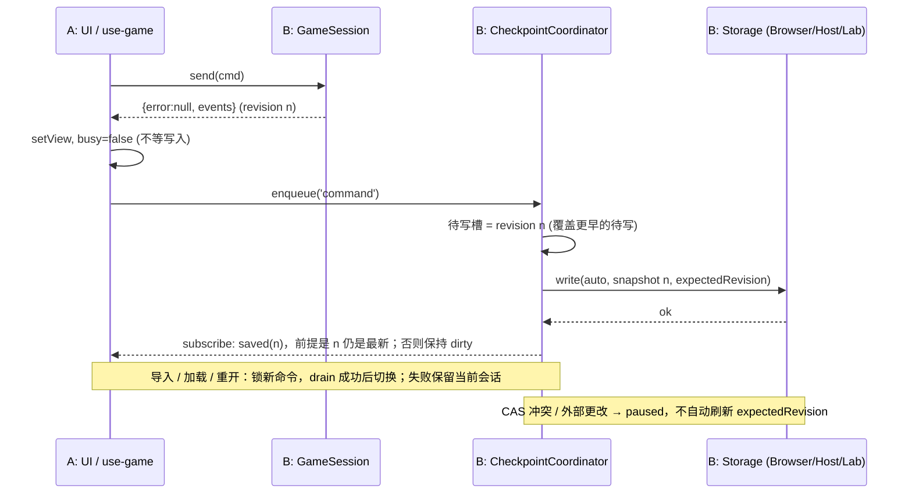
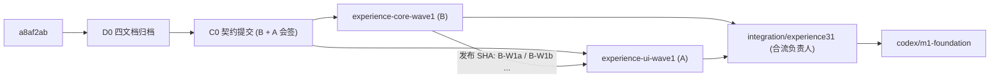
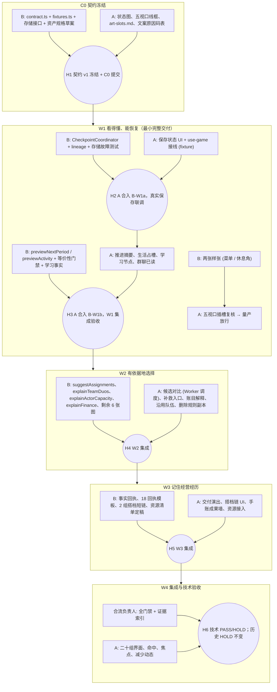

# Living Studio 3.1 双线程方案：审核意见与执行补充

- 日期：2026-11-17（Asia/Shanghai）
- 审核对象：[LIVING_STUDIO_3_1_PARALLEL_PLAN_20261116.md](LIVING_STUDIO_3_1_PARALLEL_PLAN_20261116.md)（以下称“原方案”）
- 核对基线：`codex/m1-foundation @ a8af2ab`（实现基线；四份文档在本次 D0 本地提交归档）
- 分工前提（用户指定）：**Gemini = 前端、UI、交互、视觉、演出；Codex = 后端规则、玩法派生、内容、美术资源制作，并兼任唯一合流负责人。**
- 修订状态：2026-11-17 已按用户五项裁决同步修订本文与主方案。本文保留审查依据并补齐执行细节；两份原始可玩性报告不改。不代表 C0 接口或任何产品任务已实现。
- 执行优先级：用户最新裁决 → 已修订主方案与本文 → 历史审查建议。D0 文档归档先于 C0 技术契约冻结；不再存在待用户拍板事项。

---

## 0. 总体结论

原方案的产品方向、领域规则与兼容性红线继续采用。用户已批准受条件约束的内容哈希复用和槽位 lineage 元数据；具体边界见 §3.4–3.5，不能扩大为改存档协议或删校验的许可。

从“两条线程同时开工”的角度看，还缺 6 类可执行信息，否则两条线程会在 W1 互相等待或返工：

1. **规则唯一来源的迁移没有列成任务。** 前端目前确实还有规则副本（见 R1），原方案只在 §6.1 第 7 条带过一句。
2. **`previewNextPeriod` 的实现路线有一个陷阱。** 直接在分离状态上执行 `advance` 会偷看 RNG（见 R2），需要明确禁止，并设计等价性测试。
3. **保存协调器与 `use-game.ts` 的接线时序没有约定。** 涉及 `busy` 门禁是否等待写入、导入/加载如何排空队列等，这正是最容易“各写一半”的地方（见 R3）。
4. **run lineage 没有落地方案。** 新局默认 seed 都是 1，只靠 seed 无法区分周目（见 R4）。
5. **共享热点文件、文案归属、分支同步方向和契约变更流程没有写清楚**（见 R5–R7）。
6. **原审查提出的真人试玩与埋点要求已经取消**（R9 / EXP-13）。用户如有反馈将另行提供，实施与技术验收不等待它。

第 3 节给出补全后的所有权矩阵、契约草案、同步协议、交接时序和每条线程的任务卡。

---

## 1. 依据核对（原方案中的事实陈述）

| 原方案陈述 | 核对结果 | 依据 |
|---|---|---|
| 普通 Web 只在 `DayEnd/Restarted` 自动保存，hosted/desktop 不同 | ✅ 属实 | `use-game.ts` 中 `send`：`hosted\|\|desktop\|\|DayEnd/Restarted` 才 `write('auto')` |
| 导入成功 ≠ 已写自动档 | ✅ 属实 | `importFile` 只 `importSave` 并设置 `paused`，不写 auto |
| `saveBrowser` 含完整 replay 校验 | ✅ 属实，**而且每次还会对整个 Content 做稳定序列化和 SHA-256** | `oot-persistence/src/browser.ts` |
| 群聊回复免费、一次性奖励；未读与未回复由同一字段驱动 | ✅ 属实 | 核心动作 `chat-reply`；`campaign.ts` 第 211 行 `unreadThreads = chosenReply===null`；`messenger-drawer.tsx` 用同一条件画红点 |
| 面对面聊天确定性占槽 | ✅ 属实，`chat` 不调用 RNG | `campaign.ts` `action==='chat'` 分支 |
| 手册隐藏偏好是全局 key | ✅ 属实 | `onboarding.tsx` `guideKey` + `localStorage` |
| 推进器状态可能误导 | ✅ 属实 | `ui2-logic.ts` `advancePeriodInfo` 是前端自行推断 |
| `GameSession` 已有分离状态预览 | ✅ `previewAssignment` / `previewOffice` 已在用 `dispatchCommand` 返回的新状态做试算；该模式不适用于带随机结果的 `advance` 预览 | `oot-platform/src/session.ts` |
| 离线包覆盖新图 | ✅ 构建时自动收集 `dist/art/**`，新图会**自动进入 SW 预缓存**（这会增加安装体积，但不影响首屏关键链） | `apps/web/vite.config.ts` |

原方案的事实部分没有发现错误。

---

## 2. 审核问题

| 编号 | 严重度 | 问题 | 建议 |
|---|---|---|---|
| R1 | **高** | **前端仍有规则副本，归属与原方案“B 管规则”冲突。** `living-adapter.ts` 的 `evaluateTeamDuos` 自行判断搭档协同是否生效，与核心的 `activeJobDuos` 重复实现（上一轮 W2-02 正是在这里出的 bug）。`scene-layout.ts` 的 `actorEffectiveContext / isActorOverloaded / activeStationBonus`、`living-adapter.ts` 的 `resolveStopReason`、`ui2-logic.ts` 的 `advancePeriodInfo / ledgerWindowSummary` 也属于规则推断，而这些文件都归 A。 | 新增 **EXP-14 规则唯一来源迁移**，按 §3.2 的迁移表执行：**B 先导出核心派生并写对照测试 → A 改为调用 → A 删除副本**。原方案 §6.1 第 7 条升级为正式任务，放在 W1 后半到 W2。 |
| R2 | **高** | 克隆状态执行 `advance` 仍然偷看随机结果；全字段无条件相等也可能迫使实现者偷看 | 独立纯派生；529/419 步逐状态预览、只在原命令为 advance 时对照真实推进，确定字段严格一致，条件字段按明确前提和受控 fixture 核验（§3.10） |
| R3 | **高** | 保存与命令共用 busy 会锁界面；同步重放即使包装为 async 仍阻塞；切换会话有旧写入竞态 | 命令完成解除 busy，协调器最多一份在写、一份待写。切换前锁新命令并 drain；失败留在当前会话，不能用 cancelPending 代替。auto 只有一个写入口，CPU 阻塞另测（§3.4） |
| R4 | 中 | seed 或固定 slot 名称都不能区分周目 | 已批准平台槽位 `meta.lineageId`；新局/成功重开/导入新建，读同一槽沿用；Host 缺少身份映射时安全重置（§3.5） |
| R5 | 中 | **共享热点文件没有归属**：`apps/web/vite.config.ts`、`apps/web/package-verification.test.ts`（离线清单 / 体积断言，新图会影响它）、根 `package.json`、`vitest.config.ts`、tsconfig 引用、`pnpm-lock.yaml`、`office-lab.ts`（`LabSaves` 要适配协调器接口）、`presentation-events.ts`、`harness/build-log.md`。 | 见 §3.1 的补充矩阵。原则：构建与离线类归 B；Web 运行时类归 A；依赖变更一律要合流负责人批准，本轮默认不新增依赖。 |
| R6 | 中 | **文案归属有歧义。** 原方案同时写了“A 在 adapter 中映射双语文案”和“B 新表现文案 `experience-copy.ts`”。原因码说明、按钮文字、交付回执、搭档对话分别归谁，没有说清楚。 | 拆成两类：**界面文案**（原因码标签、按钮、提示、空态）归 A，放在 `experience-ui-copy.ts`；**叙事内容**（回执模板、搭档短链、客户回信）归 B，放在 `content/presentation/experience-v1.json` + 校验 + `experience-copy.ts`。两边都只用原因码和事实标签对接。 |
| R7 | 中 | **分支同步方向与契约变更流程不明确。** 原方案只写了 C0 冻结和“先合 B 再合 A”。但 A 在 W1 中途就需要接真实服务验证，不能等到最后才集成。 | 采用**单向同步**：只允许 A 合入 B 已发布的 SHA，B 从不合入 A。契约带版本号，冻结后只允许增量添加，破坏性修改要双方确认并升版本。见 §3.6。 |
| R8 | 中 | **候选队伍搜索的计算成本没有预算。** 每个候选都要对状态执行 accept + assign + forecast（需要复制完整状态），256 个候选在移动端可能达到数百毫秒。 | 规定**B 提供纯函数和截断信息，A 负责调度**（Worker 或空闲分片）。门禁：桌面基线主线程单次阻塞 ≤50ms，否则必须放进 Worker。请求要绑定 revision，旧结果丢弃（原方案 §6.1 第 6 条已有）。 |
| R9 | 已取消 | 原审查建议增设真人试玩、埋点和执行人 | 用户明确排除全部相关要求；EXP-13 仅保留取消记录，不实现 playtest-log、漏斗映射或导出，不设等待用户的门禁 |
| R10 | 低 | 未跟踪文档不会进入新工作树 | 用户已批准，四份文档先以 D0 提交；后续 C0 以 D0 为祖先，新工作树均可读取 |
| R11 | 低 | **美术插槽规格不足以保证五视口裁切。** 原方案给出了 768×512（3:2）和 960×320（3:1）。但在 390px 宽度下，3:1 横幅只有约 130px 高，叠加文字的安全区、焦点位置和暗色主题处理都没有说明。 | C0 由 A 交 `docs/experience31/art-slots.md`：每个插槽的比例、文字安全区、`object-position` 焦点、暗色主题处理（叠加层或降低亮度，不另做暗色图）。B 按这个规格出样张。 |
| R12 | 条件预授权 | 每次保存重新算 Content 哈希，保护代码存在性能瓶颈可能 | 超冻结预算且证实哈希是瓶颈时，允许最小内容哈希复用；保持输出字节和全部校验，不再重复申请，同步提供测量与兼容性证据（§3.4） |

---

## 3. 执行补充

### 3.1 所有权矩阵补全

在原方案 §3 的基础上，补上未分配的文件：

| 文件 / 范围 | 所有者 | 说明 |
|---|---|---|
| `packages/oot-core/**`（新增派生，不改结算）、`packages/oot-platform/**`（会话预览、`CheckpointCoordinator`、存储 `meta`） | B | 公开入口只经 `index.ts` 导出 |
| `packages/oot-platform/src/fixtures.ts`（拟新增，仅测试与开发使用） | B | 用独立开发/测试包入口导出 `experienceFixture(name)`；A 的开发加载受 visualReviewEnabled 与构建条件共同保护；生产入口不得引用，发布包按依赖图及产物校验隔离 |
| `content/presentation/experience-v1.json` + 校验器 + `apps/web/src/experience-copy.ts` | B | 不进入参与哈希的 Content |
| `art/art-batch-7/**`、`apps/web/public/art/experience/**`、`apps/web/src/experience-art.ts` | B | 只提供纯路径映射，不写布局 |
| `apps/web/package-verification.test.ts`、`apps/web/vite.config.ts`（离线 / 构建） | B | 新图会改变资源清单和体积，由出图方同步更新断言 |
| `apps/web/src/**` 其余全部，含 `use-game.ts`、`office-lab.ts`（`LabSaves` 适配）、`presentation-events.ts`、`ui2-logic.ts`、`living-adapter.ts`、`scene-layout.ts`、新增 `experience-adapter.ts`、`experience-ui-state.ts`、`experience-ui-copy.ts`、必要的 Worker 宿主 | A | 规则副本删除等 B 提供接口后执行（§3.2）；UI 文案归 A，回执等叙事文案归 B |
| 根 `package.json`、`vitest.config.ts`、`tsconfig*.json`、`pnpm-lock.yaml` | 合流负责人 | 本轮默认不改；新增 package export 时由 B 提出、合流负责人合入 |
| `docs/STATUS.md`、任务台账、`harness/build-log.md`、证据索引 | 合流负责人 | 两条线程只写各自的 `docs/experience31/track-*.md` |
| `docs/experience31/contract.md`、`art-slots.md` | 契约：B 起草、A 会签；插槽：A 起草、B 会签 | 冻结后放进 C0 提交 |

> [!IMPORTANT]
> **已生效的合流约束：** Codex 若需编辑 A 所有文件，必须退回 Gemini 提交，或在 `track-a.md` 记录 Gemini 对具体补丁、文件与验证结果的确认。正常合入 Gemini 已提交代码不属于跨界编辑；不能由 Codex 代写“Gemini 已确认”。

### 3.2 规则唯一来源迁移表（EXP-14）

| 当前前端函数 | 文件 | 核心替代接口（B 新增） | 迁移批次 | 对照测试 |
|---|---|---|---|---|
| `evaluateTeamDuos` | `living-adapter.ts` | `explainTeamDuos(state, content, jobId, draftTeam)` → `{duoId, state:'locked'\|'inactive'\|'active', reason}[]`，内部复用 `activeJobDuos` / `sharedDeliveries` | W2 | 在所有搭档 × 模式 × 类别 × 同场景矩阵上，新旧结果一致；不一致处逐条裁决是否本就是 bug |
| `actorEffectiveContext`、`isActorOverloaded`、`activeStationBonus` | `scene-layout.ts` | `explainActorCapacity(state, content, actorId)` | W2 | 与核心实际结算使用的上下文和工位加成对比 |
| `resolveStopReason` | `living-adapter.ts` | 纳入 `previewNextPeriod().stops` | W1 | 与真实推进后的停工名单一致 |
| `advancePeriodInfo` | `ui2-logic.ts` | 改为消费 `previewNextPeriod()` | W1 | A 侧快照测试 + B 侧等价性门禁 |
| `ledgerWindowSummary` | `ui2-logic.ts` | `explainFinance(state)`（EXP-09） | W2 | 现金 / 贷款 / 未完成预付款 / 净偿付资金 / 未来账单逐项对账 |

流程分 3 步，每一步单独提交：

1. **B 导出接口并写核心规则矩阵。** 需要同时调用旧前端函数的迁移对照放应用测试层，通过包公开入口访问核心，禁止 core/platform 反向依赖 Web。以真实结算为准，不把旧 UI bug 当正确答案。
2. **A 切换到新接口。**
3. **A 删除规则副本，测试所有者删除临时旧函数调用。** 核心矩阵和真实集成回归继续保留；文案/布局的纯映射不算规则副本。新增对照文件在 C0 明确一个所有者，不跨线抢改既有 A 测试。

### 3.3 C0 契约草案（供冻结时修改）

```ts
// packages/oot-platform/src/experience-contract.ts（B 起草，A 会签）
export const EXPERIENCE_CONTRACT = 1;
export type Certainty =
  | { certainty: 'certain' }
  | { certainty: 'conditional'; conditions: readonly [string, ...string[]] }; // C0 冻结原因码，不能空泛标“可能”
export type Fact<R extends string = string> = Certainty & {
  reason: R; actorId?: string; jobId?: string; amount?: number;
};

export interface NextPeriodPreview {
  revision: number;                 // 对应 session revision，旧结果必须丢弃
  slot: number; nextSlot: number;   // 结算当前 absoluteSlot 后再加一
  working: Fact<'contract-work' | 'overtime'>[];
  resting: Fact<'idle-recover' | 'night-sleep'>[];
  recoverySkipped: Fact<'sleep-skipped-by-activity'>[]; // 不计入实际休息者集合
  waiting: Fact<'next-work-slot' | 'clarify-pending' | 'review-pending'>[];
  stops: Fact<'cloud-quota' | 'local-capacity'>[];
  deadlines: Fact<'due-this-slot' | 'due-next-day'>[];
  bills: Fact<'weekly-bill' | 'debt-due' | 'electricity'>[];
  blocked: null | 'pending-choice' | 'bankrupt' | 'ending' | 'arranging';
}

export interface ActivityPreview {
  revision: number; legal: boolean; error?: string;   // 复用核心错误码
  cash: number; research: number;                     // 确定值
  occupiesSlot: boolean; skipsNightRecovery: boolean;
  gains: Fact[]; losses: Fact[];                      // 心情 / 好感等确定增量；不确定的标 conditional
}

export interface AssignmentSuggestion {
  id: string; kind: 'save-resources' | 'stable-quality' | 'fast-delivery';
  team: Member[]; forecast: ReturnType<typeof forecastAssignment>;
  advantages: Fact[]; costs: Fact[];
}
export interface SuggestResult { revision: number; draftKey: string; suggestions: AssignmentSuggestion[]; evaluated: number; truncated: boolean; none?: Fact; }

export type SaveStatus =
  | { kind: 'idle' | 'dirty'; revision: number }
  | { kind: 'saving'; revision: number }
  | { kind: 'saved'; revision: number; savedAt: number }
  | { kind: 'paused'; revision: number; cause: 'external-change' | 'conflict' | 'auto-paused' }
  | { kind: 'error'; revision: number; code: string; exportable: true };

export interface CheckpointCoordinator {
  enqueue(reason: 'command' | 'import' | 'load' | 'restart' | 'host-checkpoint'): void; // 捕获一致快照后排队，不同步重放
  drain(): Promise<SaveStatus>;          // 切换前先锁新命令；error/paused 时禁止继续切换
  retry(): Promise<SaveStatus>;          // 只重试写入，绝不重发命令
  subscribe(fn: (s: SaveStatus & { lineageId: string }) => void): () => void;
  readonly lineageId: string;
}
```

冻结规则：

- 字段名、枚举、单位、conditional 的前提及 fixture 进入同一个 C0 提交。冻结后只允许兼容地新增可选字段；新增枚举需证明旧消费者有兜底，否则按破坏性变更处理。以上是类型草案，Member/forecastAssignment 等要在 C0 由真实公开入口导入；reason 覆盖范围必须对照核心补齐，不代表当前已编译或实现。
- 任何删除或改义都要升级 `EXPERIENCE_CONTRACT`，并由双方在各自的 track 文档里确认。

### 3.4 保存时序与 `use-game.ts` 接线规范



- **快照与执行分离**：当前 `exportSave()` 第一个 await 前还会执行 replay 等同步工作，不能在 enqueue 中直接调用然后宣称“后台”。先捕获同一 `{lineageId, revision}` 的不可变状态/日志，再由调度器执行导出和写入；最多一份在写、一份待写，新快照替换尚未开始的旧快照。不能事后从已变化的 session 导出旧 revision。
- **busy 门禁**：保存失败不会回滚业务。普通命令可以在保存中继续执行；导入、加载、重开先锁新命令，再 drain 当前队列，成功才切换。error/paused 时中止切换，提供重试与内存导出；导出当前内存快照是失败恢复通道，不能要求保存先成功。取消待写不能代替 drain，旧周目回调需按 lineage 过滤。
- **hosted checkpoint**：`oot:checkpoint` 消息改为调用 `enqueue('host-checkpoint')` + `drain()`，回执沿用原来的 `{id, ok}`，DSH 协议不变。
- **LabSaves**：A 在 `office-lab.ts` 中实现协调器要求的存储接口（接口定义由 B 提供），实验室模式仍然只用内存。
- **UI 表达**：常驻状态显示低干扰的“已保存 / 保存中”；出现 `error`、`paused` 时显示可聚焦的横幅（含导出按钮），不会被普通成功提示或 BarkOverlay 覆盖。
- **状态语义**：公开状态对应当前 dirty revision；较旧快照写完可更新内部 lastSavedRevision，但不能将较新进度标为 saved。发生写失败时保留最新可导出快照，不重发命令；CAS 冲突不自动修改 expectedRevision。
- **性能门槛**：C0 固定设备/浏览器/样本数、预热、529/419 步及更长日志。记录复制、replay、哈希、I/O、队列等待，报告 p50/p95 和主线程最长任务。主线程单段 ≤50ms；本地保存总耗时 p95 初始预算 ≤1000ms，Host I/O 单列。冻结后不得为放行追改预算。单纯解除 busy 不等于可交互；CPU 超标需 Worker 或可验证的分片调度，包含复制/传输成本。
- **已授权的最小例外**：只有超预算且内容哈希是瓶颈时，B 才为 saveBrowser 增加来自同一不可变 Content 的预计算哈希路径；保留旧签名行为与回放、stateHash、导入校验。缓存不能盲信导入文件或外部字符串，按内容身份/版本失效。提交优化前后逐字节输出等价、内容变更与篡改拒绝、长局与旧档证据。无需重复请求用户许可，但不允许扩大为关闭校验、换协议或跳过 replay。

### 3.5 lineage 方案

- B 在 `StoredSave` 上增加可选字段 `meta?: { lineageId: string }`，不进入导出文本/Content/State/hash。保持现有 keyPath；C0 验证旧记录、备份和适配器兼容后再决定具体实现，不预设所有存储后端都无须调整。
- 新局、`restart` 成功、文件导入时生成新的 UUID；加载某个槽位时沿用该槽的 `lineageId`；自动档写入时带上当前值。
- UUID 仅由宿主随机源生成，不消费核心 RNG。相同 seed 仍有不同 lineage；失败/取消导入或重开不得切换 ID。旧槽位缺少 meta 时生成，并在下一次合法 CAS 写入一同保存，不为了偏好静默覆盖档案。
- HostSaves 不支持 meta 时，B 用与存储 CAS 身份绑定的本地映射；不能用 `hosted:<slot>` 这种固定值识别周目。无法可靠关联时生成新 UUID，并一次性提示“阅读与引导偏好已重置”；领域奖励按原档恢复，DSH 协议不变。
- A 的本地展示元数据（已读、折叠、学习节点的“已看过”）一律放在 `oot-ui:<lineageId>:*` 下，并设上限：最多保留最近 8 个 lineage，更早的清理掉。

### 3.6 分支与同步协议



1. **单向流动**：开发期间 A 只能合入 B 在 `track-b.md` 登记过的发布 SHA，B 不合入 A；最终由集成分支汇合。单向同步减少交叉合流，不保证没有冲突，A 同步时冲突也按所有权处理。
2. **发布 SHA 的条件**：`pnpm check` 全绿，`git diff --check` 通过，公开导出有类型，fixture 已更新，`track-b.md` 写明新增内容和已知限制。
3. **A 接入真实服务的节点**：至少在 W1 中期（H2）和 W1 结束前（H3）各合入一次 B 的发布 SHA，并在真实服务下跑一遍浏览器流程。
4. **冲突处理**：优先由文件所有者修复并重新提交；Codex 编辑 A 文件只能按 §3.1 的退回/具体确认约束执行。发布记录附契约版本、测试、已知限制及可复核 diff，不允许合入未登记的 B 中间提交。

### 3.7 批次时序与交接点



**防止空等的规则**：

- C0 期间 A 不写生产代码，只做设计产物。
- W1 前半 A 用 fixture 开发。
- B 的 W2 规则派生可以在 H3 之前开始，只要不改动已冻结的契约字段。

### 3.8 每条线程的任务卡

#### Gemini（Track A）

| 卡片 | 批次 | 对应 EXP | 依赖 | 完成定义 |
|---|---|---|---|---|
| A-C0-1 状态图与五视口线框 | C0 | 全部 | — | `docs/experience31/ux-c0.md`：保存状态、推进摘要、生活占槽、学习节点、候选对比的线框（5 视口），以及主行动优先级 |
| A-C0-2 插槽规格 | C0 | 美术 | — | `art-slots.md`：8 个插槽的比例、安全区、焦点、暗色处理、加载失败时的空态 |
| A-C0-3 原因码表 | C0 | 全部 | B 的契约草案 | 每个 reason 有中英标签和兜底文案，先在设计文档会签；H1 后落入 experience-ui-copy.ts |
| A-W1-1 保存状态与接线 | W1 | EXP-01 | H1 fixture → H2 真实服务 | 按 §3.4 接线；错误/暂停横幅可聚焦、可导出；普通 Web 在“接单 / 派遣 / 赠礼 / 群聊回复 / 交付”后等到“已保存”再刷新，状态一致 |
| A-W1-2 推进摘要 | W1 | EXP-03 | `previewNextPeriod` | HUD 与 StageHub 共用同一份预览；夜间无加班时不暗示合同会工作；展开说明不会触发 `advance` |
| A-W1-3 生活占槽 | W1 | EXP-02 | `previewActivity` | 深夜 chat/gift/meal/study/story 在按钮旁写明“占用个人时段 · 将跳过今晚恢复”；群聊不标占槽 |
| A-W1-4 学习节点 | W1 | EXP-04 | 学习事实 + lineage | 七个节点可跳过、重看；CTA 指向具体动作；新 lineage 不继承隐藏状态 |
| A-W1-5 群聊已读 | W1 | EXP-05 | lineage | 进入正文才标为已读；红点只看已读状态；仍可稍后回复一次 |
| A-W1-6 首单说明 | W1 | EXP-06（前半）、EXP-07 | 现有 forecast | 首单显示验收线和“为什么适合”，数字全部来自实时 forecast |
| A-W2-1 候选对比 | W2 | EXP-06 | `suggestAssignments` | 桌面并排、窄屏纵向，显示草稿差值；主线程单段 ≤50ms，超标必须 Worker；旧结果丢弃 |
| A-W2-2 补救与财务 | W2 | EXP-06、EXP-09 | `explainFinance` | 失败后的真实补救路径；净偿付资金不叫“利润” |
| A-W2-3 沿用队伍 | W2 | EXP-11 | `previewAssignment` | 只预填草稿，重新校验后由玩家确认，不自动花钱或派遣 |
| A-W1/2-4 删除规则副本 | W1 → W2 | EXP-14 | B 对应接口和对照已发布 | W1 先迁移停工/推进，W2 收口协同/容量/财务；覆盖五类规则及所有 helper，living-ui 回归通过 |
| A-W3-1 交付演出与成果墙 | W3 | EXP-08 | 事实回执、`experience-art.ts` | 顺序为结果→原因→钱款→人物回应；可以跳过；减少动态时显示完整静态结果 |
| A-W4-1 二十组界面验收 | W4 | 门禁 | — | 5 视口 × 中英 × 亮暗；`elementFromPoint` 命中、焦点、Esc 都有证据 |

#### Codex（Track B + 合流）

| 卡片 | 批次 | 对应 EXP | 依赖 | 完成定义 |
|---|---|---|---|---|
| B-C0-1 契约与 fixture | C0 | 全部 | — | `experience-contract.ts`、`fixtures.ts`（至少包括：首单、深夜 E40/负载 5、加班、有待验收、云额度停工、保存冲突），可编译、有测试 |
| B-C0-2 存储接口与资产规格 | C0 | EXP-01、美术 | A-C0-2 | 存储接口供 Browser/Host/Lab 三方实现；按插槽规格写出提示词草案 |
| B-W1-1 保存协调器与 lineage | W1 | EXP-01 | — | 覆盖：连续命令、延迟写、写失败、CAS、多标签、导入/加载/重开交错；529/419 步日志的保存耗时基线（见 R12） |
| B-W1-2 推进与活动预览 | W1 | EXP-02、EXP-03 | — | 确定性派生、不调用 `advance`；等价性门禁通过；调用前后状态、哈希、RNG、日志都不变 |
| B-W1-3 学习事实 | W1 | EXP-04 | — | 七个节点只从成功命令或状态投影得出，增量更新，不在 render 中全日志重算 |
| B-W1-4 样张 | W1 | 美术 | A-C0-2 | 菜单与休息角两张，manifest 和体积达标，交 A 复核 |
| B-W2-1 候选搜索 | W2 | EXP-06 | — | 有界搜索（≤256）、固定排序、去重、返回截断信息；不写日志、不自动买资源 |
| B-W1/2-2 规则派生迁移 | W1 → W2 | EXP-14、EXP-09 | C0 | §3.2 五类规则；W1 先交停工/推进接口，W2 交协同/容量/财务；应用层新旧对照不反向污染核心依赖 |
| B-W2-3 剩余 6 张图 | W2 | 美术 | 样张已放行 | 总计 8 张 ≤900KB；更新 `package-verification` 断言；保护资产哈希不变 |
| B-W3-1 事实回执与叙事内容 | W3 | EXP-08、EXP-07 | — | `experience-v1.json` 有校验；18 组回执 + 2 组搭档 × 3 阶段；只引用真实证据，证据缺失用中性文本 |
| B-W4-1 发布门禁 | W4 | EXP-10 | — | 固定验收版本指纹；基线旧档能导入并继续玩；离线与图片失败降级；保留 VF5 / Visual Freeze HOLD |
| M-W4 合流 | W4 | 全部 | 全部 | 先合 B 再合 A；fixture 不进入产物；STATUS/台账/build-log 与证据索引齐全 |

### 3.9 台账新增项

| ID | 优先级与负责人 | 内容 | 验收 |
|---|---|---|---|
| EXP-13 | 已取消；不设执行人 | 原真人试玩埋点、漏斗和导出要求移出范围 | 无实现、无依赖、无门禁；用户反馈若有另行提供 |
| EXP-14 | W1 接口为 P0 前置、W2 收口；B 接口、A 迁移 | 规则唯一来源迁移（§3.2） | 五类规则不再在前端重算；对照矩阵以核心结算为准，差异逐条裁决 |

### 3.10 门禁补充

| 门禁 | 内容 | 阻断级别 |
|---|---|---|
| 推进预览等价性 | 529/419 步每个状态预览；原命令为 advance 时对照真实结果。确定的工作/休息/停工/到期/账单严格相等；条件项按冻结前提和受控 fixture 对照，不能全标 conditional | 阻断合流 |
| 预览纯净性 | 所有 `preview*` / `suggest*` / `explain*` 调用前后，`stateHash`、RNG 游标、命令日志长度都不变 | 阻断合流 |
| 保存交互 | 连续命令不被写入锁住；按 §3.4 预算测量 CPU/I/O，失败能导出；切换屏障、lineage、CAS、旧回调均通过 | 超标/竞态阻断；哈希瓶颈可用已授权 R12 |
| 候选计算 | 桌面主线程单次阻塞 ≤50ms，超标迁至 Worker；Worker 复制/传输仍计入主线程预算，不以“用了 Worker”自动通过 | 阻断 W2 |
| 规则副本 | rg 检索 §3.2 函数及相关 helper，再代码审查/行为对照；纯展示包装可留，改名复制公式不算迁移完成 | 阻断 W2 |
| fixture 隔离 | 开发入口按构建条件隔离；检查生产依赖图、产物与运行时入口不可达，不能仅搜索压缩后函数名 | 阻断合流 |

逐轨迹校验不改变历史命令序列：非 advance 步只检查预览纯净性；advance 步保存预览后再执行原命令。随机影响项必须在 C0 指定影响来源与前提，实际结果据事件/状态差分独立提取，不能只用同一个 helper 自证。另有受控无随机影响 fixture 的严格相等测试；blocked 预览要与真实拒绝原因一致。输出确定/条件/blocked 样本计数、失败位置与原轨迹哈希。旧 529/419 fixtures 保持原文件不动，测试驱动另建。

固定回归继续包括 Wave 2 的模态 Bark 原生命中、mistral-llama 云端 inactive/本地 active、qwen-kimi 澄清提示、有效容量与负载/停工区分，以及五视口和真实减少动态开关。新增功能通过不解除既有 VF5 / Visual Freeze HOLD。

---

## 4. 用户裁决已落实

| 裁决 | 执行结果 / 边界 |
|---|---|
| 四份文档均提交 | 主方案、本文、oot_playability_review_gpt6.md、oot_playability_review_965ccc2.md 一次本地 D0 提交；两份原始审查原样保留，无 push |
| 允许保存性能最小例外 | 按 §3.4 实测触发，输出与校验不变；当前只批准范围，尚未修改实现 |
| 允许槽位周目 ID | 平台 meta，不进导出文本与领域哈希；Host 缺映射安全重置，不伪造跨周目稳定身份 |
| 忽略全部真人试玩要求 | EXP-13 取消，相关任务卡、埋点、漏斗、招募、观察和 W4 门禁全部移除；另行反馈不阻塞 |
| 接受 A 文件合流约束 | Gemini 修复或确认具体补丁；不由 Codex 单方面跨界修复并自认验收 |

## 5. 下一步直接执行顺序

1. 从 D0 开始 C0：B 编写契约、纯函数/存储入口、fixture 与性能协议；A 同时产出状态图、五视口线框和 8 个插槽规格。C0 阶段代码草案尚未冻结时，A 只做设计与契约会签。
2. H1 锁定共同 SHA 后建立 A/B 独立 worktree。A 用 fixture 完成布局，B 优先保存协调器/lineage；只读玩法派生可与保存测试并行推进，不等待整套美术。
3. H2 接真实保存，H3 接真实预览并删除停工/推进副本。两张样张获得 A 的布局确认后，B 制作其余六张。
4. H4 收口候选、财务、协同/容量与全部规则副本；H5 收口叙事和成果表现；H6 只裁决本轮技术门禁，并单列历史 HOLD。
5. 每次发布提供固定 SHA、契约版本、改动清单、实际检查与证据；具体交接字段按主方案 §12。代码实现与记录实现 SHA 的状态文档分开提交。当前文档提交不宣称接口、资产或门禁完成。
