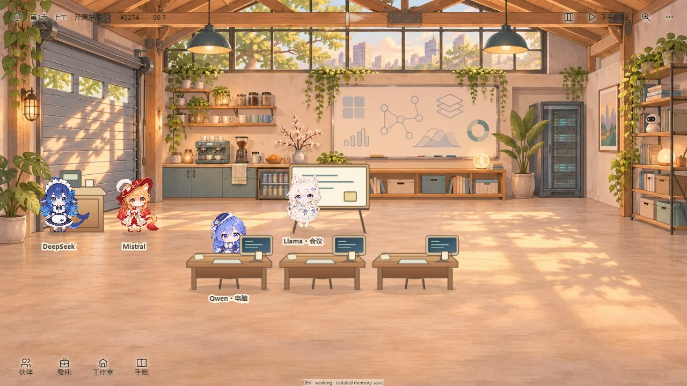
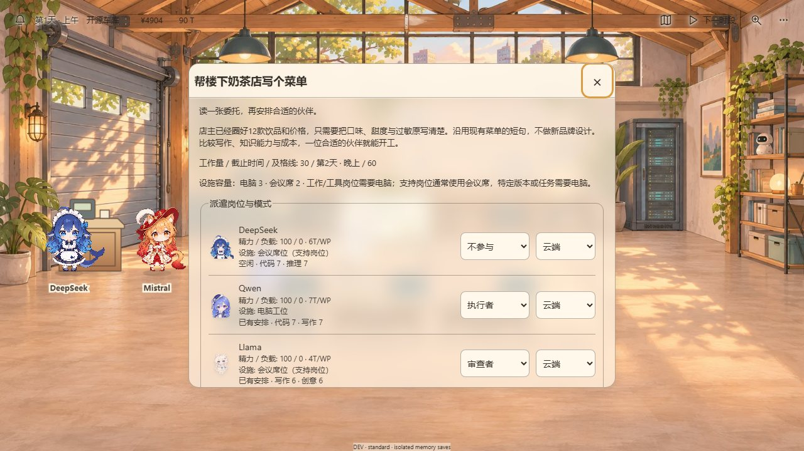
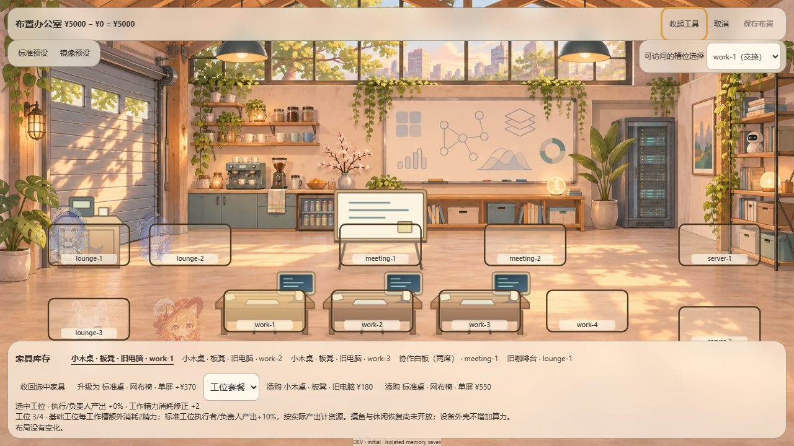

# 《Out of Tokens》最新 UI / 美术审查（2026-11-09）

> 历史基线报告：以下“当前 HEAD / 未修改代码 / 未运行检查”均指原审查时的 0c41339，不能作为后续工作树结论。本轮集成结果、设计定调与执行计划见 [UI_ART_DIRECTION_1109.md](UI_ART_DIRECTION_1109.md)。本目录原截图保留为修复前证据。

> **审查对象**：`out-of-tokens` @ `0c41339`（工作树干净）
> **最新 UI/美术相关提交**：`d285c3b`（全屏透明 HUD）、`ee9dd84`（角色比例与全屏办公室修正）、`bdaa11c`（O4a 工位效率/疲劳闭环）
> **对标**：《原神》《崩坏：星穹铁道》的视觉语言——不要求同水准，要求"第一眼看起来是同一款游戏、同一套美术与 UI 体系"
> **方法**：实机截图（1280×720 / 1920×1080 / 560×800 / 390×844，含弹窗、抽屉、布置模式、12 人、低精力状态）+ 代码/CSS 审计 + 资产测量 + 两份独立只读审计（UI 设计系统、美术资产）
> **证据**：本报告截图位于 `harness/ui-art-review-1109/`；复现命令见 §6
> **边界声明**：本轮只新增本报告与证据截图，**未修改任何游戏代码、内容或美术资产**；截图均为 DEV lab 会话（隔离内存存档），不是生产存档实机验收

---

## 0. 结论先行

**第一眼能看出这是一款"温柔的 Q 版 AI 工作室经营游戏"，但还不能说"整体风格统一"。**

放远看，暖色手绘房间 + Q 版角色 + 统一色温，情绪和题材是成立的；一旦开始操作（打开委托、布置办公室、看角色卡），画面会立刻露出**四层互不相干的生产体系**：

1. **背景**：AI 生成的手绘/厚涂房间，暖金、无描边、软阴影、大面积空地；
2. **家具**：`create-office-art.mjs` 代码生成的扁平矢量，统一硬描边、硬边椭圆投影、无材质；
3. **角色**：逐字节导入的 AI Village 纸娃娃，1.6 头身、高饱和、无环境光、硬边抠图；
4. **UI**：Preact + 浏览器原生控件的网页后台式界面，系统字体、半透明玻璃卡、`<select>`/`<details>`/系统滚动条。

这四层单看都不差（背景甚至接近成品），叠在一起就是"好看的房间 + 贴纸人物 + 简笔家具 + 网页面板"。这正是第一眼"统一感"断掉的地方：不是角色不可爱，也不是 UI 不干净，而是**没有共享同一套光、线、材质与排版语言**。

### 评分（10 分制）

| 维度 | 分数 | 说明 |
|---|---:|---|
| 场景/背景 | **7.5** | 7 张场景同一画风、暖光统一、铺满全屏方向正确；空地过多、母版分辨率不足 |
| 角色立绘 | **7.0** | 12 人辨识度高、表情/姿势完整；但未与场景光照融合，明度/饱和离散大 |
| 家具与道具 | **3.5** | 与背景不是同一画风；最新"标准工位"是最刺眼的断点 |
| HUD / 场景浮层 | **4.0** | 方向对（透明、场景优先），但无视觉焦点、对比度不足、主行动隐形 |
| 弹窗 / 抽屉 / 表单 | **3.5** | 半透明纸面 + 13px 正文 + 原生控件，像网页后台而不是游戏菜单 |
| 组件与动效一致性 | **4.0** | 组件语言不统一，动效只有一处 180ms，状态反馈弱 |
| **第一眼整体统一性** | **5.0** | 远看是一款游戏，近看是四层拼贴 |
| **细看完成度** | **4.0** | 与《原神》《星铁》的差距集中在材质、排版、光照整合、动效与构图 |

**一句话诊断：美术层已经是"同一款游戏"的水准，交互层还不是同一套视觉体系。**

**现状快照（当前 HEAD，1280×720）：**







---

## 1. 现在做对了什么（不要在改造中丢掉）

- **全屏、场景优先的方向是对的**。`d285c3b` 把 HUD 从"品牌卡 + 资源条 + 地点大标题 + 日控件"约 200px 的占位压到 40px 单条，场景真正铺满视口，透明浮层贴合 AI Village 的原生体验。这是本轮最有价值的视觉决策。
- **暖色"温柔午后"基调成立**。背景、角色、标签、面板都落在米黄/木色/鼠尾草绿的范围里，没有出现冷蓝科技风或黑金重甲风的跑偏。题材与情绪的第一眼是统一的。
- **12 人同框可读**。`ee9dd84` 把 280/200/130 三档割裂尺码改成 172 基线 + 景深曲线，并修掉入座露腿、显示器过小、布置模式遮挡、平板资源丢失等实机问题。这些问题在旧截图里是明显事故，现在已经不成立。
- **办公室布置模式的"场景即编辑器"方向正确**：不切页面、不换背景，在原场景上叠槽位与工具条，符合"一间屋子"的世界观。
- **角色身份保留得好**：没有为了统一而把 12 人画成同一张脸，发色、瞳色、头饰仍然区分度很高；这比"统一到毫无个性"更接近《原神》的角色阵容思路。

---

## 2. 问题清单（按严重度）

### P0 —— 一眼破功 / 影响主行动，建议本轮立即修

#### P0-1 主行动按钮被重置为"裸文字"，玩家找不到"下一步"

- `village-ui.css:8`：`button.primary, button.primary:hover, :root[data-theme=dark] button.primary { background: transparent; border: 0; ... }`，覆盖了 `style.css:6` 的实心主按钮。
- 受影响的是全游戏最重要的三个动作：
  - HUD「下一时段」（`alpha-app.tsx:75`）——透明文字浮在窗景/木梁上；
  - 派遣弹窗底部「确认派遣」——截图里就是一行普通文字；
  - 验收结算「验收结算」——同样没有形状。
- 这是**可玩性 P0**，不只是美术问题：主行动没有形状、对比度与位置层级，玩家在弹窗长文里找不到"确认"。

**修法**：恢复实心主按钮，并给它本作自己的材质（黄铜/木牌/象牙纸凸起皆可），全站只允许一种主按钮形状；主按钮在同一屏内最多 1 个。

#### P0-2 面板材质体系塌成"同一种半透明玻璃"，且透明到内容穿透

- `village-ui.css:3` 把 `--paper`、`--glass`、`--card` 三套材质合并：
  - `--paper: rgba(255,248,235,.68)`、`--glass` 同值、`--card: transparent`；
  - 所有弹窗、抽屉、气泡、编辑头/脚都用同一张 68% 透明玻璃（`:29`、`:55`、`:58`、`:68`、`:76`）。
- 后果：
  - 工作看板/抽屉打开时，角色与家具从面板后透出（截图 `desktop-1280-work-board.jpg` 能看到蓝发角色透在"空闲伙伴"文字后面）；
  - 弹窗标题栏是半透明粘性头，滚动内容从标题下透出；
  - 弹窗**没有遮罩**（`village-ui.css:56` `dialog::backdrop{background:transparent}`），场景亮部与弹窗亮部糊成一片，焦点弱。
- 68% 玻璃 + 14px 模糊 + 13px 正文，是"好看但不可读"的典型组合。

**修法**：建立三层材质，不要再一张玻璃走天下：
1. **HUD（场景层）**：保留透明，但文字用 4 向 1px 象牙描边替代 10px 辉光，必要时加顶部 64px 渐变 scrim；
2. **菜单/弹窗（阅读层）**：象牙纸面 ≥96% 不透明 + 外 1px 胡桃木线 + 内 1px 高光 + 角部小木刻/黄铜铆钉；遮罩压暗场景 35–45%；
3. **工具/布置（操作层）**：深胡桃木 85–90% + 象牙字，和纸面菜单明确区分。

#### P0-3 角色与场景的光照、阴影、材质没有整合 → 贴纸感

- 角色层只有 alpha 抠图 + 一个居中的硬边椭圆影（`office-scene.ts:31`：`ellipse(0,4,34,8)`，`#4b3829` 18%）；没有环境光染色、没有接触阴影、没有 rim light。
- 背景的光是明确的：后窗斜射、地板光斑向右下、左侧墙有树影、整体暖金；角色却像是从另一个光照棚里裁出来贴上去的（正面平光、高饱和）。
- 实测离散度（原始不透明部分）：12 人头发的明度 V 93.5（GLM）→ 239.7（Llama），饱和度 S 10.1%（GPT）→ 63.0%（Mistral），色温 R−B −94.5（Seedance）→ +133.3（Mistral）；而全部背景的 R−B 只在 +35…+84。**角色之间的色差大于整个场景的色差**，并且没有一张被环境暖光"收"进去。
- 叠加问题：角色在 1280 下仅约 115px 高，12px 名字标签占角色高度 10.5%，标签压在桌板/桌腿上（`desktop-1280-working.jpg` 的"Qwen · 电脑"正压桌面）。

**修法（按性价比）**：
1. Pixi 层给角色加统一 ambient 染色（暖色 8–12% overlay/multiply）+ 轻微降饱和 + 对比度对齐背景；
2. 脚下一枚柔边接触阴影（blur 6–10px，rx 26/ry 6）+ 2px 接触暗点，方向跟随场景光向量；
3. 预烘焙 1px 场景色 rim light（或 Pixi 描边层），把角色从背景里"拔"出来；
4. 标签降到 11px、改成象牙小木牌/纸签，入座时贴桌沿而不是盖在桌面中央。

#### P0-4 最新"标准工位"是一块扁平冷灰板，且与基础工位只差换色

- `standard-front.svg` 的面板 `#4c545b`、桌腿 `#59636a`（色相约 213°），而同文件木色是 `#e5ba85→#ab724b`；截图实测面板主色 R−B≈+45.7，同帧地板 R−B≈+79.1——**比它站立的地板冷 33 个单位**，是全画面最大的人造色温断点。
- 更关键的是：`standard-front.svg` 与 `basic-front.svg` 除 3 个 fill 和显示器 `rx=10→5` 外，**几何完全一致**；`ee9dd84` 曾加的第二块副屏在 `bdaa11c` 中被删除。玩家花 ¥370 升级，画面上只是"桌子变灰了"。
- 这与 O4a 的玩法意图（基础工位更耗精力、标准工位 +10% 产出）完全脱节：**机制升级在场景里读不出来**。

**修法**：标准工位换剪影而不是换色——升降桌腿、双屏/竖屏、网布椅背露出、桌下暖色灯带、线缆/绿植；同时把冷灰面板改暖灰或加暖色 overlay，保证与地板同色温。基础工位保留"小木桌 + 板凳 + 旧电脑"的窘迫感。

---

### P1 —— 集成/对外展示前必修

#### P1-1 排版没有一个"游戏级"的字号与字体体系

- 全站字体：`Segoe UI, Microsoft YaHei, sans-serif`（`style.css:6`），无 `@font-face`；标题 18–20px，正文 12–14px，标签 11–12px；107 条字号声明中 **82 条 ≤13px（77%）**，12px 占 39 条。
- 数字只 3 处用 Georgia（`style.css:7`、`:14`），其余是比例数字，无 `tabular-nums`；HUD 现金/额度增长时会抖动。
- 结果：在 1920 屏上，13px 文字相对缩小，正文占比观感只有 1280 的约 2/3（无流式字号/rem 缩放）；整屏没有一个 24px 以上的视觉锚点（`d285c3b` 同时删掉了 32px 的地点大标题）。

**修法**：一套双字体 + 6 级字号阶梯：
- 标题/数字：衬线或手写感显示字（思源宋 600/700 / 霞鹜文楷，做 WOFF2 子集），仅用于面板标题、章节名、结算评级；
- 正文：思源黑/Noto Sans SC（或系统黑体）14–15px；
- 阶梯：11 / 12 / 14 / 16 / 20 / 28 / clamp(28,2vw,40)；
- 全局 `font-variant-numeric: tabular-nums`；数字配黄铜/象牙白，不用 Georgia。

#### P1-2 原生控件"裸奔"，是"网页表单感"的第一来源

- 派遣弹窗每人两个原生 `<select>`（角色/模式）——系统下拉框、系统箭头、系统聚焦框；
- 技能用原生 `<meter>`；折叠面板 22 处 `<details>`；1 处 `<fieldset>` 保留 1px 圆角边框，而同屏 `.campaign-panel` 已被拍平成无边框列表，**同屏两套容器语言**；
- 弹窗 `overflow:auto` 无滚动条样式，Windows 经典滚动条直接露出来（`desktop-1280-job-forecast.jpg` 右侧可见）；
- 英文下角色/模式直接显示枚举值 `none / worker / cloud`（`alpha-app.tsx:102` 的 `tr(zh, r)` 把 `r` 当英文），是本地化缺陷。
- 焦点环：`style.css:6` 的 `outline:3px solid #db9c43` 在浅纸面上对比度仅 **1.86:1**，且弹窗打开时程序化聚焦关闭按钮，截图里每次弹窗右上角都有一个巨大的橙色圆角框，像调试高亮。

**修法**：把 4 处 `select`、1 处 `meter`、22 处 `details` 换成统一自定义组件（纸面触发按钮 + 自绘列表；胶囊进度条；木刻三角折叠头）。滚动条统一细样式；焦点态改为"2px 黄铜描边 + 纸面下压"，只在键盘操作时出现。英文枚举改为 `Not assigned / Worker / Planner / Reviewer / Tool` 与 `Cloud / Local`。

#### P1-3 面板宽度"反向响应"，1920 比 680 更窄

- `village-ui.css:30`：抽屉固定 320px；`:79`：≤899px 时反而 360px。
- 于是 1920 屏上面板 320px（正文 12–13px），680px 平板上 360px——**越大的屏幕，面板越小、字相对越小**。
- 配合 68% 透明，1920 上的抽屉像一张贴在巨大场景上的小纸片。

**修法**：`width: clamp(320px, 26vw, 460px)`；弹窗 `width: min(720px, 92vw)`，>1500px 时升到 820–900px；字号用 rem/clamp 跟随根字号。

#### P1-4 HUD 对比度不达标，靠 10px 辉光硬撑

- `village-ui.css:11`：`--hud-ink:#2b241e`；`:15`：`text-shadow: 0 0 10px var(--hud-halo), 0 0 4px ...`。
- 实测：亮木梁约 2.9:1、深色梁约 3.1:1、绿植/阴影处约 **1.45:1**（正文目标 4.5:1）。4× 放大可见字边糊成灰雾（`detail-hud-4x.jpg`）。
- 顶部一排 HUD 元素（通知、时间、地点、现金、额度、地图、下一时段、视角、更多）同字号、同色、同重量，**没有一个视觉焦点**。

**修法**：4 向 1px 象牙描边 + 1 层 2px 暖阴影（替代 10px 辉光）；顶部加 64px 渐变 scrim；时间/资源/主行动做成 3 个层级；主行动用实心/描边按钮承担焦点。

#### P1-5 家具是另一条生产线：三套描边、五套阴影、光向脱钩

- 16 个办公室 SVG **100%** 元素继承 `#6b5240` 2.2 单位描边（1280 下约 1.47px，1920 下 2.2px）；背景 0 描边；角色线稿约 0.6px；布置槽位 3.5 单位。**同屏 3 种线宽**。
- 阴影共 5 套（家具 4 种颜色/不透明度 + 角色 1 套），`<filter>` 数量为 **0**（全硬边）；背景阴影是软边、有方向、带暖色的。家具的阴影是"桌下灰色水洼"，与地板上的斑驳阳光不是同一套光照。
- 木器只复用 4 个全局渐变（wood/panel/screen/cloth），全部垂直方向（`y2=1`），无木纹、无高光、无 AO；桌子的透视是正立面，而房间地板是一点透视——家具像"立在地上的图标"。

**修法**：家具去外描边，改"三色块 + 暗部 + 顶部高光"；统一一个 shadow token（如 `#4a3a2c` 22% + blur 6–10）；定义光向量（后窗→右前），所有渐变改 135°、高光左上、暗部右下；有条件的桌椅/白板用 2.5D 透视重画或改为手绘 PNG。

#### P1-6 12 个角色不是同一套规范（同一作者，非同一规范）

- 头身比：11 人为 0.622，**BlueWhale 0.344**、**GLM 0.672**；`village-characters.ts:5` 用 1.08/0.96 等手工系数硬补，本质是"后期视觉调参"，不是结构统一。
- 原始部件分辨率/细节密度差异大：BlueWhale 面部 524×549（20 个部件），Claude/Qwen 等约 290×287（11 个部件）；GLM/Mistral 的 `back-hair` 画布 1059×939，其他角色 ~300×330。缩放到同屏高度后，**线宽和细节密度不一致**。
- 头像 128×128，内容占比从 34%（Seedance）到 60%（Claude/Kimi）不等；`village-ui.css:62` 又把立绘压到 40×48，部分头像被裁。

**修法**：按角色实际包围盒归一化"可见高度"，统一头肩裁切比；把 BlueWhale 的 20 部件与其他人对齐到同一套画布/线宽；淘汰手工 calibration 表，改为数据驱动的统一归一化；头像按统一构图重裁。

#### P1-7 新玩法（O4a）在场景里"读不出来"

- 工位等级、效率加成、精力消耗只以文字形式出现在派遣预估/布置页脚：`decision-panels.tsx:8`、`office-editor.tsx:27`；
- 主场景没有任何"这个人在标准工位/精力偏低/产出 +10%"的可视信号，角色头顶无状态气泡、工位无等级徽章；
- 预估面板仍是 `<small>/<b>` 两列 + `<li>` 长句，是全局最像"仪表盘"的界面。

**修法**：给 O4a 一套视觉语法——工位右上角木牌徽章（Ⅰ/Ⅱ/Ⅲ + 加成）、角色头顶小状态胶囊（⚡精力/✦效率/🐟摸鱼）、预估改成 3 张数据卡（时间/预算/质量区间）+ 风险徽章；场景内点击工位即可看到等级与效果。

#### P1-8 移动端/平板是"桌面裁切"，不是"移动构图"

- 相机 `scale=max(w/1920,h/1080)`（`office-scene-spec.ts:14`），390×844 时背景铺 1499px，只露出约 **26%**；560×800 只露一张半桌子，主视觉（白板/画架）被裁掉。
- HUD 在 ≤560px 隐藏现金/额度；文字仍 12–13px；dock 按钮 40px（<44px 触控标准），且 `index.html` 无 `viewport-fit=cover`、CSS 无 `env(safe-area-inset-*)`；
- 移动端弹窗直接缩放桌面弹窗：390 下 356×608、13px 正文、原生 select 堆叠，长文阅读压力大；
- `office-lab-badge` 9px 在 12 人场景与角色名重叠（`desktop-1280-twelve.jpg` 底部 "MiniMax" 被 DEV 徽标压住）。

**修法**：≤899px 用独立 focal crop / 独立构图（人物+桌位为中心，背景只做衬底），而不是等比裁切；移动端弹窗改底部 sheet（大字号、分组、横向选项）；HUD 用安全区变量；触控目标 ≥44px；DEV 徽标仅在 lab 且不压内容。

---

### P2 —— 入台账，随版本迭代修

| 编号 | 问题 | 证据 | 建议 |
|---|---|---|---|
| P2-1 | 背景母版 1672×941，按 1920×1080 铺；1080p 上采样 1.148×，2283px 视口 1.365× → 大屏"背景糊 / 家具矢量锐" | `office-scene.ts:26` + 资产尺寸测量 | 以 1920/2560 宽重导；≥1500px 视口用高分辨率源 |
| P2-2 | 全站面板只靠 1px 线和 16px 圆角区分；15 种圆角、约 70 个硬编码 hex；`tokens.css` 与 `village-ui.css` 双层 `:root` 互相覆盖，`--card:transparent` 让旧 token 失效 | `tokens.css:1`、`village-ui.css:3` | 合并为单一 token 文件；圆角收敛到 3 档；删除死 token/死样式 |
| P2-3 | 空状态/错误状态是裸段落，无图标、无 CTA、无插画（委托为空、竞标未开放、账本为空） | `alpha-app.tsx:90`、`:95` | 统一 `EmptyState`（母题图标 + 一句文案 + 主按钮） |
| P2-4 | 面板开合只有抽屉 180ms 位移；弹窗/popover/编辑器/toast 硬切；按钮只有 160ms 颜色/位移；无场景转场、无角色选中反馈、无声音 | `style.css` `panel-in`、`style.css:6` | 统一 120–180ms ease-out：遮罩淡入、面板 scale .985→1、内容 30ms 错峰；补 hover/select/success 反馈 |
| P2-5 | 暗色模式只换 UI 面板，场景仍是白天；深色弹窗浮在明亮场景上 | `desktop-1280-job-forecast` 与 `theme=dark` 截图 | 暗色模式绑定"夜晚场景"（场景 tint + 灯光），或明确标注为"仅 UI 深色" |
| P2-6 | 图标 16/18/19/20/22px 五档、统一 1.6 线宽；dock 激活态用 "下划线" 这种网页链接语义 | `icons.tsx:16`、`village-ui.css:28` | 统一 24 网格/1.8 线宽，加游戏化母题与激活态（黄铜下划/木牌选中） |

### P3 —— 可延后

- 角色标签字体 `Microsoft YaHei` + 5px 白描边（`office-scene.ts:31`）与 UI 字体不是同一套；建议 11px + 纸签底。
- 立绘 40×48 裁切与 `object-fit` 组合导致部分角色构图偏；建议统一头像母版。
- `world-map` 是唯一"双线框 + 地图装饰"的面板，与扁平玻璃语言冲突，后续统一。
- `paperclip.webp` 等故事图标色温与场景背景不同源，可单列一套图标规范。
- 资产字节开销：12 角色部件合计 >24MB（BlueWhale 5.7MB/人），首屏加载与低端机风险；建议按 2× 最大显示尺寸重导 + 图集。

---

## 3. 与《原神》《星穹铁道》的对标差距

说明：本作不是要变成原神，而是借它的**"一体化完成度"**：角色、场景、UI 共享同一套光/线/材质/排版/动效语法。下表只列"第一眼统一感"相关的维度。

| 维度 | 《原神》《星铁》的做法 | 当前本作 | 目标（本作语境） |
|---|---|---|---|
| 角色与场景 | 卡通渲染 + 场景光统一，rim light、接触阴影、环境色反射 | 硬边抠图 + 居中椭圆影，无环境光 | 统一 ambient + 接触阴影 + 场景色 rim，明度收敛 |
| 场景/家具 | 背景、建筑、家具同一画笔与透视，有明确光向量 | 手绘背景 + 矢量家具 + 正立面图标 | 家具改 2.5D/三色上色 + 统一软阴影 + 去外描边 |
| 材质分层 | 暗色半透明 + 金/象牙描边 + 纸/金属/玻璃分层 | 三种材质塌成一种 68% 玻璃 | HUD 透明 / 菜单纸面 / 工具深木，三层明确 |
| 字体 | 专用显示字 + 强层级 + 衬线/字距 | 系统字体，77% 声明 ≤13px | 双字体 + 6 级阶梯 + tabular numerals |
| 边框与装饰 | 角饰、双层框线、稀有度金/紫 | 1px 圆角玻璃，无母题 | 木刻角 + 黄铜细线 + 象牙纸，统一母题 |
| 图标 | 统一网格/线宽/母题，激活态明确 | Lucide 风混用，下划线激活 | 24 网格/1.8 线宽 + 木牌/黄铜激活态 |
| 动效与反馈 | 面板开合、数值滚动、选中/结算演出 | 仅 180ms 抽屉；其余硬切 | 统一 120–180ms + 关键结算演出 |
| 构图 | 主视觉居中、前后景框住、留白服务焦点 | 1920 大片空地；390 裁掉主视觉 | 多视口专门构图 + 前景框景 + 暗角 |
| 数字与状态 | 等宽数字、状态图标、颜色语义 | 比例数字、状态只在面板文字里 | 等宽 + 状态徽章 + O4a 状态可视化 |

**建议的原创方向（不要直接套原神黑金）**：本作已经有自己的"午后木工房"气质，应把它体系化为 **"象牙纸 + 胡桃木 + 鼠尾草绿 + 黄铜细饰"** 的视觉系统。Genshin 式"黑底金框"会压掉现有的温柔感；我们要的是同一套**手作感材质 + 木刻角饰 + 纸签/木牌**，让 UI 看起来像工作室里本来就有的东西。

---

## 4. 改造路线（按性价比排序）

### 第 0 步：一天内可完成的"止损包"（不改玩法）

1. 恢复主按钮实心（`village-ui.css:8`），全站唯一形状；
2. 弹窗纸面 ≥96% 不透明 + 遮罩压暗 35–45% + 粘性头不透明；
3. HUD 改 4 向 1px 描边 + 顶部 scrim，去掉 10px 辉光；
4. 焦点环改 2px 黄铜、仅键盘可见；去掉弹窗右上角的默认橙框；
5. 弹窗/抽屉滚动条统一细样式；
6. 英文枚举 `none/worker/cloud` → 正常英文标签；
7. 标准工位面板从冷灰改暖灰（最低成本先消除色温断点）；
8. 触控 44px + `viewport-fit=cover` + safe-area（移动端）。

### 第 1 周：把"网页后台"变成"游戏菜单"

- 设计 token 收敛（颜色/字号/圆角/阴影/间距），删除双层 `:root` 与死 token；
- 自定义 Select / Meter / Accordion / EmptyState / 主按钮 / 弹窗头；
- 抽屉宽度 `clamp()`，>1500px 加宽；弹窗改 3 张数据卡 + 风险徽章；
- 引入标题显示字（WOFF2 子集）与 tabular numerals；
- 面板材质三层落地（HUD/菜单/工具），布置槽位改"地面胶带/木刻贴片"而不是线框；
- O4a 状态可视化：工位等级徽章、角色状态胶囊、预估数据卡。

### 第 2–4 周：统一美术生产线

- 家具统一光照与材质：三色上色 + 软阴影 + 光向量；标准/基础工位换剪影；
- 角色统一 ambient/接触阴影/rim；按 bbox 归一化头身比，淘汰手工 calibration；
- 背景按 1920/2560 重导；≤899px 独立 focal crop；
- 动效与反馈：面板开合、数值滚动、结算演出、环境粒子/光斑；
- 多视口构图验收：1280 / 1920 / 560 / 390 的首屏截图必须通过下节清单。

### 验收清单（"第一眼统一"通过标准）

1. **三米测试**：把 1280/1920 截图缩到 30% 并排，能否一眼看出是同一款游戏、同一套 UI？
2. **去 UI 测试**：只留场景 + 角色 + 家具，是否像一张画？角色有没有被环境光"收进去"？家具阴影与光向是否一致？
3. **打开任一面板**：字体/材质/按钮/图标是否与 HUD 同一套？有没有原生 select/meter/滚动条？
4. **主行动测试**：不读文字，3 秒内能否找到"下一步"并确认它是可点的？
5. **移动端首屏**：390×844 不裁主角、不溢出、不压安全区、可点区域 ≥44px、弹窗可读。
6. **机制可见性**：不看面板，能否从场景看出"谁在标准工位、谁快没精力、这槽产出多少"？
7. **回归**：1280/1920/560/390 四档 + 中英文 + 明暗主题截图无控制台 error/warn；`pnpm check` 通过（改造代码时）。

---

## 5. 最新提交专项评价

| 提交 | 判断 | 说明 |
|---|---|---|
| `d285c3b` 全屏透明 HUD | **方向正确，代价明显** | 解决了场景被 UI 占位、竖向空间浪费、面板焦点恢复等真问题；但删掉了原来的实心"下一时段"和 32px 地点大标题，导致全屏没有视觉焦点。建议保留全屏透明，但用"实心主行动 + 顶部 scrim + 地点小标题"补回焦点。 |
| `ee9dd84` 角色比例与办公室修正 | **真实改善** | 统一 172 基线 + 景深曲线、入座隐腿、显示器放大/右移、椅背抬高、槽位避让、布置减噪、HUD 光晕都针对实机问题；但 172 是视觉调参，不是结构统一，12 人原始资产的头身/细节差异仍在。 |
| `bdaa11c` O4a 工位效率/疲劳 | **机制到位，表达缺位** | 预估与布置页脚新增了工位/精力文字，但主场景没有任何对应视觉信号；同时删除了标准工位副屏，使"升级"只剩换色。下一步应优先做"机制可视化"，而不是继续加文字。 |

**证据与截图口径**：`harness/o4a/` 旧截图（12:36–12:39）拍摄于 `bdaa11c` 提交前 3–6 分钟，其 `standard-front.svg` 文件时间 12:38:58 早于截图 12:39:42，画面与当前 HEAD 的单屏标准工位一致；为避免不同时间点混用，本报告现状判断统一采用 2026-11-09 从当前 HEAD 重新抓取的 `harness/ui-art-review-1109/` 截图，旧截图仅作对照。

---

## 6. 附录：证据与复现

### 6.1 证据截图（`harness/ui-art-review-1109/`）

| 文件 | 内容 |
|---|---|
| `desktop-1280-working.jpg` | 1280 工作状态（当前 HEAD；HUD/标签/家具/角色同框） |
| `desktop-1280-job-forecast.jpg` | 派遣弹窗（主按钮/原生 select/13px 正文/滚动条） |
| `desktop-1280-arrange.jpg` | 布置办公室（槽位线框/玻璃工具条/选中态） |
| `desktop-1280-drawer-actors.jpg` | 伙伴抽屉（68% 玻璃、角色透出） |
| `desktop-1280-drawer-studio.jpg` | 经营工作室抽屉 |
| `desktop-1280-work-board.jpg` | 工作看板（文字穿透、层级弱） |
| `desktop-1280-twelve.jpg` | 12 人同框（底部 DEV 徽标与标签重叠） |
| `desktop-1920-initial.jpg` | 1920 首屏（大片空地、角色偏小、构图缺焦点） |
| `tablet-560-en-dark.jpg` | 560 英文深色（HUD 取舍、裁切） |
| `mobile-390-scene.jpg` | 390 首屏（只露约 26% 背景） |
| `mobile-390-dialog.jpg` | 390 派遣弹窗（长文、原生 select、无遮罩） |
| `detail-basic-desk-4x.jpg` | 基础工位 4×（硬边椭圆影、硬描边） |
| `detail-standard-desk-4x.jpg` | 标准工位 4×（冷灰面板、与地板色温断点） |
| `detail-hud-4x.jpg` | HUD 4×（辉光糊字、对比度不足） |

### 6.2 复现命令

```powershell
cd out-of-tokens
pnpm dev:web                       # http://127.0.0.1:5173/
```

场景状态（DEV lab，隔离内存存档）：
- 工作/标准：`/?office-lab=working&animation-time=1`、`/?office-lab=standard&animation-time=1`
- 布置：打开后点「工作室」→「布置办公室」（或 `office-lab=initial` 后同路径）
- 移动/平板：用浏览器设备模拟 390×844、560×800
- 英文/深色/减动：`&locale=en&theme=dark&motion=still`
- 12 人：`/?office-lab=twelve&animation-time=1`

### 6.3 关键测量数据（本轮）

- 背景母版：1672×941（全部大场景）；按 1920×1080 铺 → 1080p 上采样 1.148×，2560 视口 1.365×
- 家具 SVG：16 个文件全部继承 `#6b5240` / `2.2` 描边；`<filter>` 数量 0；阴影 4 色 × 4 不透明度
- 角色：单件部件 1.2–5.7MB，12 人合计 >24MB；头身比 0.344 / 0.622 / 0.672；明度 V 93.5–239.7、饱和 S 10.1–63.0%、R−B −94.5…+133.3（背景 R−B +35…+84）
- 排版：107 条字号声明，≤13px 占 82 条（77%）；15 种圆角；约 70 个硬编码 hex；仅 3 处 Georgia 数字；无 `tabular-nums`
- 交互：78 个 `<p>`、22 处 `<details>`、4 个 `<select>`、5 个 `<input>`、7 个 `<dialog>`、1 个 `<fieldset>`、1 个 `<meter>`
- 对比度：HUD 1.45–3.1:1；焦点环 1.86:1；主按钮无背景
- 响应式：抽屉 1920 下 320px、680 下 360px；390 下背景可见约 26%；HUD 图标 40px；无 safe-area

### 6.4 方法限制

- 截图来自 DEV lab 会话（`office-lab` / isolated memory saves），不等于生产存档与真实玩家路径；未做 iOS/Android 实机与低端 GPU 帧率测试。
- 部分资产测量基于原始 PNG/JPEG 压缩图，边缘锐度指标不可靠，故本报告不据此下结论；色温/明度/饱和度以不透明区域采样为准。
- 未运行 `pnpm check`：本轮无代码改动；文档与截图新增不影响构建。

---

## 7. 建议的下一步（落地顺序）

1. **今天**：P0-1（主按钮）+ P0-2（纸面弹窗/遮罩）+ HUD 描边 + 焦点环 + 英文枚举 + 标准工位暖灰，作为"视觉止损"提交。
2. **本周**：P0-3/P1-5（角色 ambient + 家具材质/阴影）与 P1-1/P1-2（字体 + 自定义控件）并行；先做角色 ambient 与标准工位剪影，收益最大。
3. **下个迭代**：P1-7（O4a 可视化）+ P1-8（移动构图）+ P2-1（背景重导）；完成后再做一轮"第一眼统一"验收截图表。

> 如果只做一件事：**先让"确认派遣"和"下一时段"重新变成看得见摸得着的按钮**。这是当前"像网页而不是像游戏"最廉价、最直接的反证。
