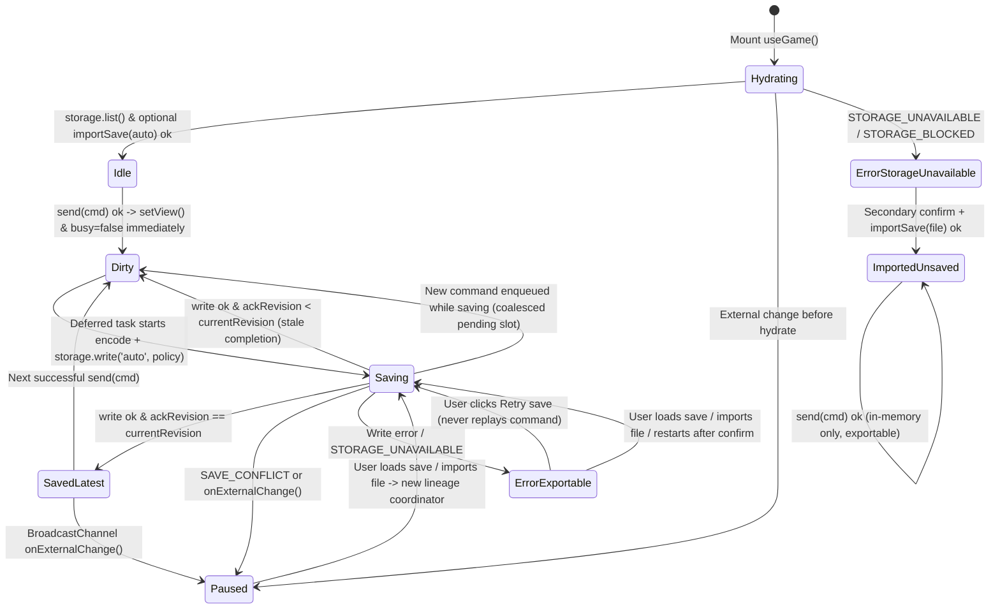
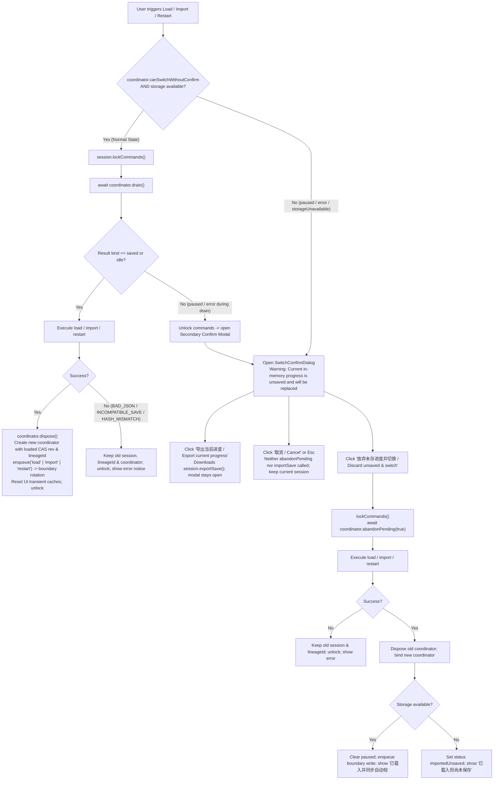
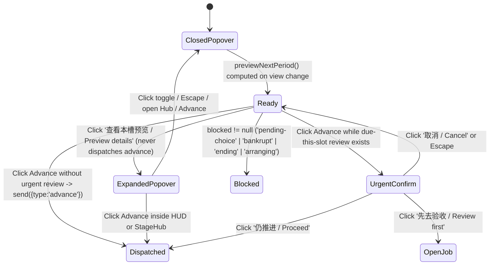
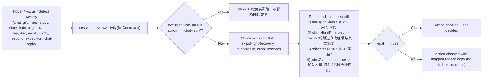
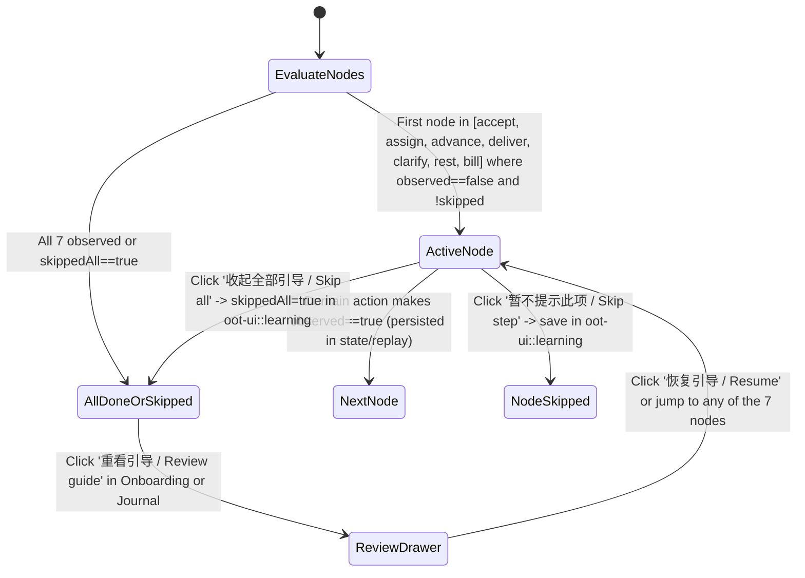
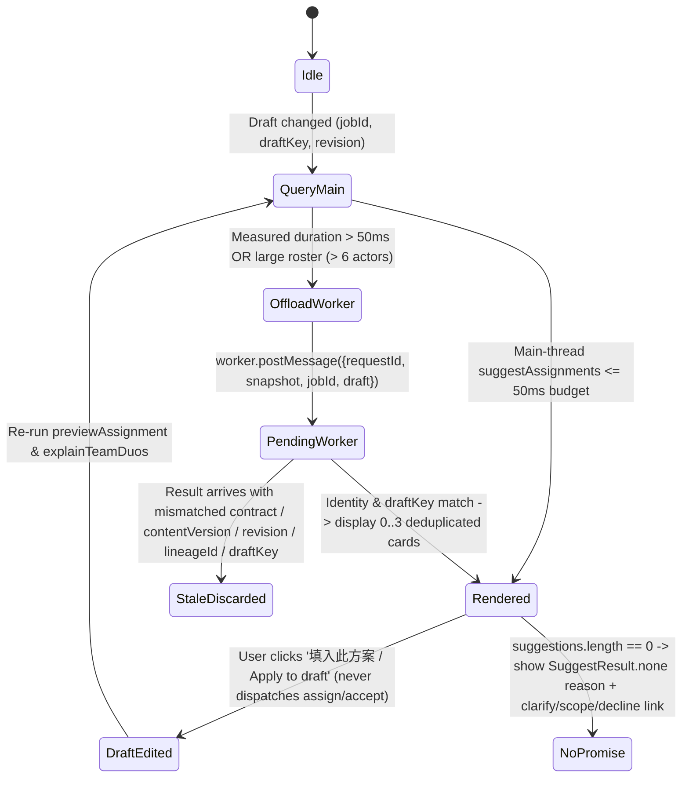

# Living Studio 3.1 Track A — C0 UX Design & Unified Contract Review

- **Date**: 2026-11-17 (Asia/Shanghai)
- **Owner**: Track A (Frontend / UI / Interaction / Visuals / Presentation / Copy / Web Worker Host)
- **Baseline**: `d18241a7aa9c5876367867fe78d9bfdd99d0f0ae`
- **Track B Proposal Reviewed**: `663071a756532a47cecaa47f71d59b8b90bd4a1f` (`checkpoint-contract.ts`, `checkpoint.ts`, `experience-contract.ts`, `fixtures.ts`, `worker.ts`, `docs/experience31/contract.md`, `docs/experience31/performance-protocol.md`)
- **Status**: C0 Design Complete & Co-Sign Review Submitted (NOT an H1 frozen claim; zero production Web code written before H1 freeze)

---

## 1. State Diagrams

### 1.1 Save & Recovery Lifecycle (`SaveStatus` + `imported-unsaved`)



**Monotonic Revision Invariant**:
- Every `SaveStatus` carries `{ contract, contentVersion, revision, lineageId }`.
- When write for revision `k` resolves while the session is already at `currentRevision > k`, `lastSavedRevision = Math.max(lastSavedRevision, k)`, and the UI indicator stays `dirty` (`"等待保存修改…"` / `"Unsaved changes queued…"`), never displaying `"已保存"` / `"Saved"` for stale revision `k`.
- `visibilitychange -> hidden` calls `void coordinator.drain()` as best-effort flush; it never mutates `SaveStatus` to `'saved'` unless the underlying write actually commits for `currentRevision`.
- Boundary policy (`WritePolicy = 'boundary'`) only triggers on `day-end`, `restart`, `import`, `load`. Regular domain commands and `host-checkpoint` use `policy = 'checkpoint'` (overwriting `auto` without rotating `backup-1..5`).

---

### 1.2 Two-State Session Switch Barrier (`load` / `importFile` / `restart`)



**Critical Recovery Rules**:
- Recovery action buttons (`Load`, `Import file`, `Restart`) are **never** disabled solely because `saveStatus.kind` is `'paused'` or `'error'`.
- `SwitchConfirmDialog` always offers an inline, working **导出当前进度 / Export current progress** button before switching.
- `abandonPending(true)` is **forbidden** in normal state; normal switching must run `lockCommands()` → `drain()`.

---

### 1.3 Next-Period Advance Preview (`NextPeriodPreview`)



**HUD & StageHub Parity**:
- Both `HudBar` (corner advance widget) and `StageHubShell` (modal header advance button) read the exact same `NextPeriodPreview` projection via `experience-adapter.ts`.
- At Evening/Night (`slot % 4 >= 2`) when `working` is empty (no `overtime`), the summary explicitly reports `"夜间休整 · 合同等待明早（无加班）"` / `"Night recovery · Contracts wait until morning (no overtime)"`, never `"单推进中"`.
- Expanding the preview popover opens an accessible disclosure region listing `working`, `resting`, `recoverySkipped`, `waiting`, `stops` (`cloud-quota` / `local-capacity`), `deadlines`, and `bills`, without dispatching `advance`.

---

### 1.4 Personal-Slot & Activity Preview (`ActivityPreview`)



**Required Coverage**: `chat`, `gift`, `meal`, `study`, `story`, `train` (8 slots + relocate to `library`), `align` (4 slots + relocate to `library`), `overtime` (night slot work + skip night recovery), `tea`, `duo`, `recall`, `clarify`, `respond`, `expedition`, plus `chat-reply` (0 slots, never marked slot-occupying).

---

### 1.5 Seven Learning Nodes (`ExperienceView.learning` + `oot-ui:<lineageId>:learning`)



**Lineage Isolation**:
- Never writes to global `'oot-ui-opening-guide-v1'`.
- Stored under `oot-ui:<lineageId>:learning` alongside `oot-ui:<lineageId>:threads` and `oot-ui:<lineageId>:last-team`.
- `oot-ui:__lineages__` keeps at most **8** recent `lineageId` entries using LRU; evicting the 9th only removes its `oot-ui:<oldestId>:*` keys and never touches IndexedDB domain saves.

---

### 1.6 Candidate Squad Comparison & Worker Host (`SuggestResult`)



---

## 2. Five-Viewport Wireframes (`1280×720`, `768×1024`, `844×390`, `560×800`, `390×844`)

All 5 viewports enforce: `scrollWidth <= clientWidth` (`0px` horizontal overflow), minimum clickable hit area `>= 44×44 CSS px`, minimum font size `>= 12px`, and keyboard-reachable scrollable containers (`overscroll-behavior: contain`).

### 2.1 `1280×720` (Desktop Landscape)

```text
+---------------------------------------------------------------------------------------------------+
| [Clock: Day 1 · Morning · Bill 7d] [Place]  [¥5000 | 300T | 120 | 0·0RP]  [SavePill] [Chat][Bd][Cam][Term]|
+---------------------------------------------------------------------------------------------------+
| [SaveAlertBanner (when paused/error/unsaved): icon + text + [Export] + [Recover/Retry]] (hidden if ok) |
|                                                                                                   |
| [Left Stack <=340px]                                                                              |
|  - Locations · N out of view                                                                      |
|  - CommissionHudTracker                                                                           |
|  - LearningCard (1 of 7 nodes, Skip, Review, Specific CTA)                                        |
|                                                                                                   |
|             <StageHubShell max-width 1160px, height min(660px, 100dvh-40px)>                      |
|             +------+-----------------------------------------------------------------------+      |
|             | Rail | Title | Tabs | Currencies | [Advance + Preview ? Toggle] | [X]        |      |
|             | 76px +-----------------------------------------------------------------------+      |
|             | Team | <Optional AdvancePreviewPopover max-width 420px anchored top-right>   |      |
|             | Jobs | Workbench: 3-column or 2-row deploy + 3-col Candidate Cards side-by-side|      |
|             | Stud |  [Save Resources]  |  [Stable Quality]  |  [Fast Delivery]            |      |
|             | Jour |  (Diff vs current draft, advantages, costs, [Apply to draft])         |      |
|             |      | Overlay: BarkOverlay inModal=true bottom-center                       |      |
|             +------+-----------------------------------------------------------------------+      |
|                                                                                                   |
| [Dock: Team | Jobs | Studio | Journal]            [AdvanceBtn >=196x54 + Preview ? Button >=44x44]|
+---------------------------------------------------------------------------------------------------+
```

### 2.2 `768×1024` (Tablet Portrait)

```text
+-----------------------------------------------------------------------+
| [Day 1 · Morning] [Place]  [¥5000|300T|120|0·0RP] [SavePill] [C][B][V][T]|
+-----------------------------------------------------------------------+
| [SaveAlertBanner full width - 24px, wrap actions cleanly >=44px]      |
| [StageHubShell: calc(100vw-16px) x calc(100dvh-20px)]                 |
|  +-----------------------------------------------------------------+  |
|  | Top Header: [Back] Title | [Advance] [Preview ?] [Close]        |  |
|  | Row 2 Tabs: [ Overview | Finance | Tech ]                       |  |
|  +-----------------------------------------------------------------+  |
|  | Scrollable Body:                                                |  |
|  |  - Workbench: Brief -> Candidate Cards STACKED VERTICALLY (1fr) |  |
|  |    * [Save Resources] (full width, diff bullets, Apply)         |  |
|  |    * [Stable Quality] (full width, diff bullets, Apply)         |  |
|  |    * [Fast Delivery]  (full width, diff bullets, Apply)         |  |
|  |  - Team & Live Forecast below (no side scroll)                  |  |
|  +-----------------------------------------------------------------+  |
|  | Bottom System Nav: [Team] [Jobs] [Studio] [Journal] (>=48px)    |  |
|  +-----------------------------------------------------------------+  |
+-----------------------------------------------------------------------+
```

### 2.3 `844×390` (Compact Phone Landscape — `max-height: 479px`)

```text
+-----------------------------------------------------------------------------------+
| [D1 · Morn] [¥5000|300T] [SavePill] [Chat][Board][Cam][Terminal] (single row <=48px)|
+-----------------------------------------------------------------------------------+
| [SaveAlertBanner compact single-row: short warning + [Export] + [Recover]]         |
| [StageHubShell: calc(100vw-16px) x calc(100dvh-12px)]                             |
|  +----+-------------------------------------------------------------------------+ |
|  |62px| Header (<=48px): [Tabs inline] | [¥5000] [Advance] [? Preview] [Close]  | |
|  |Nav +-------------------------------------------------------------------------+ |
|  |    | Scrollable Body (max-height safe, overscroll-behavior: contain):        | |
|  |    |  - Workbench steps [Brief | Team & Compare]                             | |
|  |    |  - Candidate Cards stacked or 2-col compact (zero horizontal overflow)  | |
|  |    |  - SwitchConfirmDialog / MessengerDrawer capped at 100dvh - 12px        | |
|  +----+-------------------------------------------------------------------------+ |
+-----------------------------------------------------------------------------------+
```

### 2.4 `560×800` (Narrow Portrait / Half-Screen Split)

```text
+-----------------------------------------------+
| Row 1: [Day 1·Morning] [SavePill] [C][B][V][T]|
| Row 2: [¥5000 | 300T | 120 | 0·0RP] (4 cols)  |
+-----------------------------------------------+
| [SaveAlertBanner stacked]                     |
| [StageHubShell: calc(100vw-16px) x 100dvh-20] |
|  +-----------------------------------------+  |
|  | Title | [Advance icon+lbl] [?] [Close]  |  |
|  | Tabs scrollable / full-width            |  |
|  +-----------------------------------------+  |
|  | Vertical Scroll Body:                   |  |
|  |  - Brief (Do what, When due, Pass line) |  |
|  |  - Candidate Cards STACKED (1fr):       |  |
|  |    Card 1 -> Card 2 -> Card 3           |  |
|  |  - Messenger: horizontal thread tabs +  |  |
|  |    vertical stream (read != replied)    |  |
|  +-----------------------------------------+  |
|  | Bottom Nav: [Team][Jobs][Studio][Jour]  |  |
|  +-----------------------------------------+  |
+-----------------------------------------------+
```

### 2.5 `390×844` (Mobile Portrait)

```text
+-----------------------------------+
| R1: [D1·Morn] [Save] [C][B][V][T] |
| R2: [¥5000|300T|120|0·0RP]        |
+-----------------------------------+
| [SaveAlertBanner (wraps <=108px)] |
|                                   |
| [SwitchConfirmDialog (if open):]  |
|  width: calc(100vw - 16px)        |
|  Header: [Confirm Switch]   [X]   |
|  Body:                            |
|   Warning copy (current unsaved)  |
|   [导出当前进度 / Export (>=44px)]|
|   [放弃未存并切换 / Discard>=44px]|
|   [取消 / Cancel (>=44px)]        |
|                                   |
| [Workbench / Candidate Stack:]    |
|  - 1 column (100% width)          |
|  - No horizontal overflow         |
|  - Outcome Wall / Delivery Card:  |
|    Image 3:2/3:1 -> Result ->     |
|    Reason -> Cash -> Partner note |
|                                   |
| [Dock <=252px]  [Advance 132..148]|
+-----------------------------------+
```

---

## 3. Secondary Switch Confirmation Modal Spec (`SwitchConfirmDialog`)

Triggered **exclusively** when user clicks **Load (`auto` / `manual-1..3` / `backup-1..5`)**, **Import File**, or **Restart** while `coordinator.canSwitchWithoutConfirm === false` (`paused` or `error`) OR storage is unavailable:

- **Dialog Element**: Native `<dialog class="system-dialog ui2-switch-confirm-dialog" aria-modal="true">`, `showModal()`, `Escape` triggers **Cancel**.
- **Copy**:
  - Title: `未保存进度确认` / `Unsaved progress confirmation`
  - Body (paused/error): `当前内存进度尚未保存，继续切换将被所选存档覆盖。你可以先导出当前进度备份。` / `Current in-memory progress is not saved and will be replaced by the selected save. You can export your current progress first.`
  - Body (storage unavailable): `本地存储不可用，当前内存进度无法自动落盘。切换前可先导出当前进度。` / `Local storage is unavailable, so current progress cannot be persisted automatically. Export before switching if needed.`
  - Target descriptor: Shows exact target (`手动档 1` / `自动档` / `导入文件：<filename>` / `继承经验重开`).
- **Actions (all `min-height: 44px`, `min-width: 44px`)**:
  1. **导出当前进度 / Export current progress** (secondary button): exports `session.exportSave()` JSON (`out-of-tokens-alpha.json`), updates `exportedInModal = true`, leaves dialog open and session untouched.
  2. **放弃未存进度并切换 / Discard unsaved & switch** (danger/primary button): executes `lockCommands()` → `await coordinator.abandonPending(true)` (when coordinator active) → performs `load` / `import` / `restart` → if success, disposes old coordinator, creates new coordinator, clears `paused` (or transitions to `ImportedUnsaved` `"已载入但尚未保存"` if storage unavailable).
  3. **取消 / Cancel** (default focus on initial open or Export): closes dialog, calls neither `abandonPending` nor `importSave`, preserves current `session`, `lineageId`, `revision`, and pending snapshot.

---

## 4. Bilingual Reason-Code Table & Deterministic Unknown Fallback

Every `Fact.reason`, `Condition`, `SaveStatus.kind`/`cause`/`code`, `NextPeriodPreview.blocked`, `DuoExplanation.reason`, and `GameSession` error maps through `experience-ui-copy.ts`:

| Domain / Source | Code | Chinese (`zh-CN`) | English (`en`) |
|---|---|---|---|
| `NextPeriodPreview.working` | `contract-work` | 执行合同工作 | Working on commission |
| `NextPeriodPreview.working` | `overtime` | 夜间加班推进 | Night overtime work |
| `NextPeriodPreview.resting` | `idle-recover` | 空闲常规休整（精力 +15） | Idle rest recovery (+15 energy) |
| `NextPeriodPreview.resting` | `night-sleep` | 深夜睡眠恢复（精力回升、负载清零） | Night sleep recovery (energy up, load cleared) |
| `NextPeriodPreview.recoverySkipped` | `sleep-skipped-by-activity` | 占用深夜时段，将跳过今晚睡眠与负载恢复 | Night period occupied; skips sleep & load reset |
| `NextPeriodPreview.waiting` | `next-work-slot` | 合同暂停中，等待下一个白天工作时段 | Commission paused until next daytime work slot |
| `NextPeriodPreview.waiting` | `clarify-pending` | 需求澄清占用中，需等待下个时段 | Clarification pending until next period |
| `NextPeriodPreview.waiting` | `review-pending` | 阶段工作已完成，等待玩家验收结算 | Work complete; awaiting player review |
| `NextPeriodPreview.stops` | `cloud-quota` | 云端算力额度不足，本槽可能停工 | Cloud quota insufficient; may stall this period |
| `NextPeriodPreview.stops` | `local-capacity` | 本地单槽算力上限不足，本槽可能停工 | Local slot capacity exceeded; may stall |
| `NextPeriodPreview.deadlines` | `due-this-slot` | 本时段截止，不处理将逾期或违约 | Due this period; advance risks breach |
| `NextPeriodPreview.deadlines` | `due-next-day` | 次日截止，注意预留审查与交付窗口 | Due next day; reserve review window |
| `NextPeriodPreview.bills` | `weekly-bill` | 即将触发周结（房租、订阅与本地电费） | Upcoming weekly bill (rent, subscription, electricity) |
| `NextPeriodPreview.bills` | `debt-due` | 第 14 天旧债结算到期 | Inherited debt settlement due on Day 14 |
| `NextPeriodPreview.bills` | `electricity` | 累计本地算力待结电费 | Pending local-compute electricity charge |
| `NextPeriodPreview.blocked` | `pending-choice` | 有待决策事件，必须先选择才能推进 | Pending event choice must be resolved first |
| `NextPeriodPreview.blocked` | `bankrupt` | 处于破产状态，请重开或读档 | Studio bankrupt; restart or load a save |
| `NextPeriodPreview.blocked` | `ending` | 本周目已终局，可开启无尽经营或读档 | Run ended; enter endless mode or load a save |
| `NextPeriodPreview.blocked` | `arranging` | 正在布置办公室，请先保存或取消布局 | Arranging office; save or cancel layout first |
| `Certainty.conditions` | `no-event-interference` | 前提：未触发随机事件干扰 | Assumes no random event interruption |
| `Certainty.conditions` | `resources-available` | 前提：推进时云端额度与本地算力充足 | Assumes sufficient cloud & local capacity |
| `Certainty.conditions` | `no-new-defects` | 前提：未产生新增缺陷或隐藏扣分 | Assumes no new defects or hidden penalties |
| `Certainty.conditions` | `personal-condition-unchanged` | 前提：伙伴精力、心情与负载条件不变 | Assumes teammate energy, mood & load stay unchanged |
| `SaveStatus` | `idle` / `saved` | 进度已保存 | Progress saved |
| `SaveStatus` | `dirty` | 有未保存更改，排队保存中… | Unsaved changes queued… |
| `SaveStatus` | `saving` | 正在写入本地存档… | Saving progress… |
| `SaveStatus` | `external-change` | 另一窗口更新了存档，自动保存已暂停。请导出或载入最新档。 | Another tab updated saves. Autosave paused; export or load latest save. |
| `SaveStatus` | `conflict` | 存档版本冲突，自动保存已暂停以防覆盖。请导出或载入最新档。 | Save revision conflict. Autosave paused to prevent overwrite; export or load latest. |
| `SaveStatus` | `auto-paused` | 自动保存已暂停；可通过导出或读档恢复。 | Autosave paused; export progress or load a save to recover. |
| `SaveStatus` | `STORAGE_UNAVAILABLE` | 本地存储不可用，进度仅保存在当前内存，请及时导出。 | Storage unavailable. Progress is in-memory only; export to keep it. |
| `SaveStatus` | `IMPORTED_NO_STORAGE` | 已载入但尚未保存（存储不可用，请用导出保存进度） | Loaded, not saved (storage unavailable; use Export) |
| `SaveStatus` | `WRITE_UNCERTAIN` | 上次宿主写入状态未知，请先载入最新档核对或导出进度。 | Host write uncertain; load latest to reconcile or export progress. |
| `ActivityPreview` | `activity-energy` | 伙伴精力变化 | Partner energy change |
| `ActivityPreview` | `activity-mood` | 伙伴心情变化 | Partner mood change |
| `ActivityPreview` | `activity-affinity` | 伙伴好感度变化 | Partner affinity change |
| `ActivityPreview` | `ACTIVITY_NOT_SUPPORTED` | 该命令属于结算或切换边界，不支持活动预览 | Settlement/switch boundary command does not support activity preview |
| `SessionSwitch` / `Host` | `SESSION_SWITCHING` | 正在切换会话，请稍候完成当前切换 | Session switch in progress; wait for switch to finish |
| `SessionSwitch` / `Host` | `SWITCH_REQUIRES_CONFIRMATION` | 当前处于异常或冲突状态，需先确认后再切换存档 | Unsaved/paused conflict state requires confirmation before switching |
| `SaveEncoder` | `INVALID_CHECKPOINT_PREFIX` | 检查点前缀索引越界，已拒绝编码并保留现场 | Checkpoint command prefix out of range; save encoding rejected |
| `HostLineageMap` | `LINEAGE_RESET` | 宿主存档来源已重置，本局提示与引导状态将按新会话记录 | Host save lineage reset; UI read/guide metadata starts fresh for this run |
| `SuggestResult` / `Duo` | `low-cash-cost` / `low-quota` / `high-quality` / `fast-completion` / `clarify-only` / `mode-mismatch` / `category-mismatch` / `morning-only` / `multi-phase-only` / `not-unlocked` / `no-feasible-team` | 每项均有明确双语标签（实施时全部枚举同步 `experience-ui-copy.ts`） | Explicit bilingual label for each candidate/duo reason |
| **Unknown Fallback** | `unknown` (any unmapped string) | `状态提示（代码：${code}）` | `Status note (code: ${code})` |

---

## 5. Primary Action Priority, Modal Feedback, Keyboard, Focus & Reduced Motion

1. **Primary Action Priority Ladder (Highest → Lowest)**:
   1. `SaveStatus` `'paused'` / `'error'` (`SaveAlertBanner`, focusable, export + recover buttons, **never** dismissed by `BarkOverlay` or `DONE` toast).
   2. `view.pending` Event Choice modal / `view.bankrupt` Restart/Load modal (native `<dialog>`, `dismissible=false`).
   3. Overdue Review Breach Confirmation (HUD & StageHub advance guard).
   4. Stage-specific Primary Action (`posted` → clarify/accept; `accepted` → assign team; `working` → return & advance; `review` → rework/deliver).
   5. Delivery Feedback Card (in order: **结果 → 原因 → 钱款 → 人物回应**; skippable).
   6. Ambient living chatter, learning guide cards, and social barks (`BarkOverlay`).
2. **Modal Top-Layer Rule**:
   - Feedback inside any open `StageHubShell` must mount in its `<dialog class="stage-hub">` `overlay` slot (`data-in-modal="true"`) so it resides in the browser top layer and never gets obscured behind `::backdrop`.
   - `SwitchConfirmDialog` also opens as a native `<dialog>` top-layer modal stacked cleanly above `saves-dialog` / `bankrupt-dialog`.
3. **Keyboard & Focus Return**:
   - `Escape` closes the topmost dismissible layer in strict order: `SwitchConfirmDialog` → `BarkOverlay` (within modal) → `AdvancePreviewPopover` → inner back step (actor detail / mobile job detail) → `StageHubShell` / `MessengerDrawer` / `Map` / `Saves` / `Settings` → HUD popovers / `Locations`.
   - On dismissal or auto-dismissal of any overlay/dialog, focus returns to the invoking trigger ref (`isConnected && !disabled`) or safely falls back to the open parent `<dialog>` close button.
   - Global shortcuts (`1–4`, `M`, `C`, `[`, `]`) remain guarded when inputs/modals are active.
4. **Accessibility & Reduced Motion**:
   - Low energy, context overload, crisis cash, and save errors always combine **Icon + Text Label + Border/Color** (never color-only).
   - Real Settings toggle `减少动态效果` (`document.documentElement.dataset.motion = 'still'`) suppresses all transitions/animations and renders full static delivery/ritual results immediately without blocking actions. All verification checks operate the real toggle (never `?motion=still` in production).

---

## 6. C0 Contract v1 Review & Co-Signature (Reviewing Track B `663071a`)

Track A co-signs **Unified Interface Contract v1 (`EXPERIENCE_CONTRACT = 1`)** with the following explicit signoffs and **required C0 resolutions before H1 freeze**:

1. **Approved & Co-Signed Invariants**:
   - All runtime rule explanations will call only `GameSession` methods (`previewNextPeriod`, `previewActivity`, `explainTeamDuos`, `explainActorCapacity`, `explainFinance`, `suggestAssignments`, `getExperienceView`, `workerSnapshot`); Track A will **never** construct approximate `State` from `GameView` or read private session fields.
   - `previewActivity(command: Command)` accepts full `Command` (including `overtime` and `campaign` actions).
   - `getExperienceView()` holds **only** `{ learning, goal, receipts }` (optional `expectation` welcomed) and no rule formulas.
   - `abandonPending(confirmed: true): Promise<void>` returning `Promise<void>` is **approved** so already-submitted I/O cleanly settles before switching sessions.
   - `ActivityPreview.actors: ActorActivity[]` per-actor breakdown is **approved**; please allow `relocatesTo: Scene | 'expedition' | null` so `expedition` relocation previews cleanly.
   - `SaveEncoder` injection + byte-identical contract with `defaultSaveEncoder` is **approved**; Track A will use `oot-platform/worker` cleanly without touching `packages/**`.
   - `oot-platform/fixtures` dev subpath isolation is **approved**; Track A will gate any dev-only fixture consumer behind `import.meta.env.DEV && visualReviewEnabled` and prove zero reachability in production `dist/`.

2. **Blocking C0 / H2 Design Items Flagged for Track B Before H1/B-W1a Freeze**:
   - **`checkpoint.ts:45` `BOUNDARY_DRAIN_REQUIRED` Race in Non-Blocking UI**: Because `use-game.ts` clears `busy = false` immediately after `session.send(cmd)` without awaiting storage, advancing across DayEnd (`enqueue('day-end')` → `policy: 'boundary'`) followed immediately by the player clicking a card (`accept` / `chat-reply` → `enqueue('command')`) within the deferred `setTimeout(0)` / I/O window would throw `BOUNDARY_DRAIN_REQUIRED`! **Required fix**: keep boundary snapshots non-coalescing in a dedicated boundary queue slot (flushed before any newer coalesced `checkpoint` slot) so boundary snapshots are preserved *and* post-DayEnd commands never throw or pause gameplay.
   - **Missing C0 Export / Contract Alignment Needed for H1**:
     1. Re-export `experience-contract.js` types (`NextPeriodPreview`, `ActivityPreview`, `Draft`, `SuggestResult`, `AssignmentSuggestion`, `DuoExplanation`, `CapacityExplanation`, `FinanceExplanation`, `ExperienceView`, `Fact`, `Condition`, `Certainty`) from `packages/oot-platform/src/index.ts`.
     2. Add `suggestAssignmentsFromSnapshot` stub/type signature to `oot-platform/worker` (or document exact W2 activation in `contract.md`).
     3. Expand `oot-platform/fixtures` to include all 9 R2 B-C0-1 scenarios (`opening-menu`, `night-e40-load5`, `overtime`, `training`, `review-ready`, `cloud-quota-stop`, `save-conflict`, `external-change-paused`, `storage-unavailable`).
     4. Ensure `CapacityExplanation` includes current-slot active workstation efficiency (`activeEfficiency` / `activeStationId`) so EXP-14 replaces `activeStationBonus`; `FinanceExplanation` includes `recentLedgerSummary: { count, inflow, outflow, net }` so EXP-14 replaces `ledgerWindowSummary`; and Host/Session lineage reset emits a boolean signal (`lineageReset?: boolean`) when Host cannot preserve identity so Track A displays the one-time reset notice.
   - **Browser/Device Agreement for `performance-protocol.md` Co-Signature**:
     - Track A co-signs the frozen `<= 50 ms` main-thread segment and `<= 1000 ms` local save p95 budgets on `Windows x64 / Intel(R) Core(TM) Ultra 9 285H / Chromium Foreground Window (document.visibilityState === 'visible')`, measuring `workerSnapshot()` structured clone + `postMessage` transfer + Worker return + queue/replay/hash/I/O per `performance-protocol.md` (5 warmups + 30 recorded samples on the frozen 529, 419, and 60-day logs).

### 6.3 C0 Revision 2 (`424045da`) Review & Final Pre-H1 Co-Signature

Track A reviewed Track B C0 revision 2 (`424045da7bfa0ddcff10f190ec5d869be5ab699e`, recorded in `d4c0a8eb2f293f07fb5776ba818d3d083eab28d5`) and issues final **Contract v1 (`EXPERIENCE_CONTRACT = 1`) Co-Signature** clearing all Track A blockers for common **H1** freeze:

1. **Explicit Approval of `SaveInput.throughCommand?: number` (`checkpoint-contract.ts`)**:
   - Approved. Retaining FIFO boundary markers as `{ revision, commandCount }` integers instead of throwing `BOUNDARY_DRAIN_REQUIRED` cleanly resolves the non-blocking post-`day-end` command race while bounding retained `State` snapshots to one active + one latest pending.
   - Track A confirms that any optional Web Worker `SaveEncoder` (`apps/web/src/save-encoder-worker.ts`) will delegate encoding directly to `defaultSaveEncoder.encode(input)` imported from `oot-platform/worker` (or equivalently replay `input.commands.slice(0, throughCommand)` whenever `input.throughCommand !== undefined`, validating bounds cleanly and **never** encoding `input.state`), guaranteeing exact byte-for-byte parity with `defaultSaveEncoder` on both FIFO boundary prefixes and ordinary checkpoints.
2. **Approved C0 Revision 2 Contract Additions**:
   - `switchImportedSession(session, coordinator, text, options)` (`session-switch.ts`): validated-before-abandon two-state helper returning `{ lineageId, saved: false }` approved; Track A keeps Export / `SwitchConfirmDialog` / fresh coordinator instantiation & initial boundary enqueue in `use-game.ts`.
   - `HostLineageMap`, `HostSaves` optional 3rd constructor arg, and `StoredSave.lineageReset?: boolean`: approved; Track A will surface a one-time non-blocking notice (`LINEAGE_RESET`) whenever unknown/legacy Host records reset lineage identity.
   - `GameSession.previewActivity(Command)`: approved, including `relocatesTo: Scene | 'expedition' | null`, deterministic non-RNG `clarify` reservation, and explicit `ACTIVITY_NOT_SUPPORTED` for settlement/switch boundary commands (`advance`/`choose`/`deliver`/`restart`).
   - Root `oot-platform` type re-exports, `CapacityExplanation.activeEfficiency`, `FinanceExplanation.recentLedgerSummary`, `SuggestAssignmentsFromSnapshot` Worker type in `oot-platform/worker`, and the 9 `oot-platform/fixtures` scenarios + Vite production import block (`fixtureReachable=false`): all approved.
3. **Host Server-Rotation Protocol Note (Protected `apps/dsh/**`)**:
   - Track A acknowledges Track B's finding that `apps/dsh/**` is protected and `POST /api/saves` (`{ id, text, expectedRevision }`) continues rotating server-managed backups on every `auto` write without server protocol extension. Track A will **not** modify `apps/dsh/**` and will keep hosted-save backup descriptions accurate rather than claiming Browser boundary-only rotation equivalence while server protocol is unchanged.
4. **H1 Readiness**:
   - Zero Track A design or contract blockers remain for assembling and freezing the shared **H1** C0 SHA.
